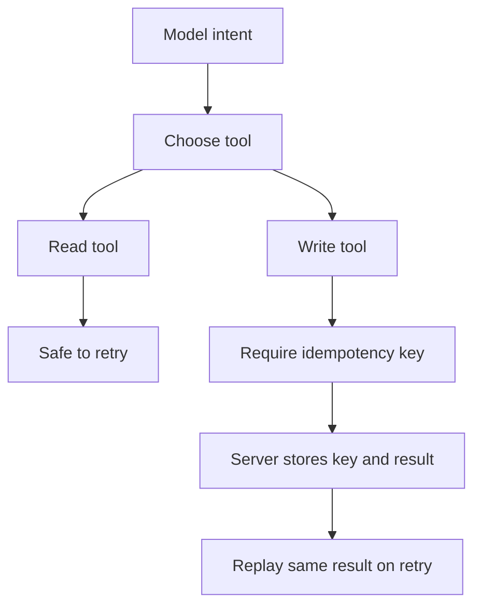

# Idempotency and Side Effects: Designing Tools the Model Can Safely Retry

## English

Language models retry. They misread a result, lose track of state, or get interrupted mid-conversation and try the same action again. Hosts also retry: a transport hiccup, a timeout, a user clicking the same button twice. In a world of read-only lookups this is harmless, but MCP tools can send emails, create tickets, charge cards, or delete rows. The moment a tool has side effects, retries become a correctness problem, and the protocol does not solve it for you — the semantics live entirely in how you design the tool.

The first principle is to separate reads from writes at the tool boundary. A tool named `search_orders` should never mutate anything; a tool named `cancel_order` should never be ambiguous about whether it ran. When a single tool both reads and writes, the model cannot reason about safe retries, and the host cannot cache or parallelise it. Splitting them also improves the schemas: a read tool's input is a query, a write tool's input is an intent plus an identifier, and the two have very different validation needs.

The second principle is idempotency keys. If a tool performs a non-idempotent action — creating a resource, sending a message — accept a client-supplied key that identifies the logical operation, and make the server return the same result for a repeated key instead of performing the action twice. This is the same pattern payment APIs use to make charges safe over unreliable networks. In MCP, the key can be a required argument in the input schema, documented in the tool description so the model knows to generate a stable one per intent rather than per attempt. The server stores the key alongside the result and replays it on duplicate calls within a reasonable window.

The third principle is making side effects visible in the result. A write tool should return what changed, with identifiers the model can reference later: the new ticket ID, the timestamp, the previous state. This lets the model detect that a retry already succeeded — it sees the ticket it created and stops trying. A tool that returns only "OK" gives the model no way to distinguish "I did it" from "someone else did it" from "it was already done".

Finally, consider the two-phase pattern for genuinely dangerous operations. Instead of a single `delete_repository` tool, expose `prepare_delete_repository` which returns a confirmation token and a summary of what would be deleted, and `confirm_delete_repository` which requires the token. The model must show the summary to the user, and the human must approve before the second call. This turns an irreversible action into an explicit, auditable decision, and it costs only one extra tool. The general rule: the more irreversible the effect, the more the tool should look like a proposal followed by a confirmation, not a single button labelled "go".

## 中文

語言模型會重試。它們可能誤讀結果、遺失狀態，或在對話中途被打斷後再試一次同樣的動作。Host 也會重試：傳輸抖動、逾時、使用者連點兩次按鈕。在純唯讀查詢的世界裡這無傷大雅，但 MCP 工具可以寄信、開單、扣款或刪除資料列。一旦工具有副作用，重試就變成正確性問題，而協定本身不會替你解決——語意完全存在於你如何設計這個工具。

第一個原則是：在工具邊界上把讀與寫分開。名為 `search_orders` 的工具永遠不該改動任何東西；名為 `cancel_order` 的工具永遠不該讓人搞不清它到底跑了沒有。當同一個工具既讀又寫，模型無法推理安全重試，host 也無法快取或平行化它。拆分之後 schema 也會更好：讀工具的輸入是查詢，寫工具的輸入是意圖加識別碼，兩者的驗證需求天差地遠。

第二個原則是冪等鍵（idempotency key）。如果工具執行的是非冪等動作——建立資源、發送訊息——就接受一個由客戶端提供的鍵來識別邏輯操作，並讓 server 對重複的鍵回傳相同結果，而不是把動作執行兩次。這正是支付 API 在不可靠網路上確保扣款安全所用的模式。在 MCP 中，這個鍵可以是輸入 schema 的必填參數，並在工具描述中說明，讓模型知道要為每個意圖產生一個穩定的鍵，而不是每次嘗試都換一個。Server 會把鍵與結果一起儲存，在合理時間窗內對重複呼叫重播結果。

第三個原則是讓副作用在結果中可見。寫入工具應該回傳改了什麼，並附上模型之後可以引用的識別碼：新的工單編號、時間戳、先前的狀態。這讓模型能察覺重試其實已經成功——它看到自己建立的工單，就停止再試。只回傳「OK」的工具，讓模型無法分辨「是我做的」、「是別人做的」還是「早就做完了」。

最後，對於真正危險的操作，可以考慮兩階段模式。與其用單一 `delete_repository` 工具，不如提供 `prepare_delete_repository` 回傳確認權杖與將被刪除內容的摘要，以及需要該權杖的 `confirm_delete_repository`。模型必須把摘要給使用者看，由人核准後才能發第二個呼叫。這把不可逆的動作變成明確、可稽核的決定，成本只是多一個工具。通則：效果越不可逆，工具就越應該長成「提案後確認」，而不是一顆寫著「衝」的按鈕。

## Key Takeaway

Because models and hosts retry, every MCP tool with side effects should be split from reads, accept an idempotency key, report what changed, and gate irreversible actions behind a prepare/confirm pair.

## Related Concepts
- MCP Tools — How an AI Actually Does Things
- Building an MCP Server: Design Patterns

## Diagram

