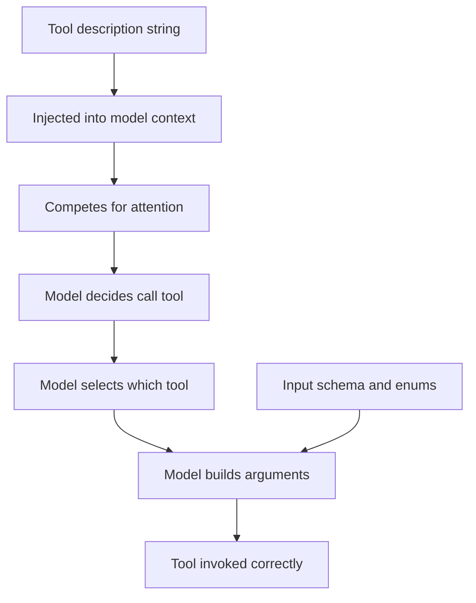

# Tool Descriptions as Prompt Engineering: Writing Text the Model Will Actually Use

## English

Every MCP tool carries a `description` string, and it is not documentation for humans — it is prompt text injected into the model's context, competing for attention with everything else. The model decides whether to call a tool, which tool to call, and what arguments to pass, largely from that description plus the input schema. This means writing tool descriptions is a form of prompt engineering, with the same failure modes: vague descriptions get ignored, ambiguous descriptions get misused, and overlong descriptions crowd out the actual task.

Start with the first sentence. It should say what the tool does and when to use it, in the model's vocabulary rather than the implementer's. "Search the internal knowledge base for documents matching a natural-language query, returning titles and snippets" tells the model both the action and the return shape. "KB query endpoint v2" tells it nothing. If two tools are easy to confuse — `search_docs` and `search_tickets` — the descriptions should explicitly state the boundary: one covers internal documentation, the other covers customer support tickets. Models pick the wrong tool most often when descriptions overlap, not when they are missing.

Include the arguments' meaning and constraints in the schema, and use the description field on each parameter. A parameter named `limit` with no description might receive 10, 100, or 10000. A parameter described as "maximum number of results, default 10, hard cap 50" will be used correctly. Enums are especially valuable: if a status filter only accepts `open`, `closed`, `pending`, declare it as an enum in the schema rather than describing it in prose, because schema constraints are enforced by the host and by the model's structured generation, while prose is merely a suggestion.

Be honest about cost and side effects. If a tool is expensive, slow, or mutates state, say so in the description: "This creates a real ticket and notifies the customer; use only after the user confirms." Models are trained to be cautious and will often respect such warnings, and hosts can surface them in approval UIs. Conversely, if a tool is cheap and safe, say that too, so the model does not over-ask for permission. The description is the only channel through which the server can communicate its risk profile to the model at call time.

Finally, keep descriptions short and stable. Long descriptions consume context on every turn, and changing them frequently makes behaviour hard to debug. A good target is one or two sentences of purpose, one sentence of boundary or caution, and then rely on the schema for structure. Treat the description as an interface contract that you version and test: when a model starts calling a tool with wrong arguments, the fix is often a better description, not a better implementation. The tool is a function, but the description is the API doc the model reads — and unlike a human, the model will read it literally every time.

## 中文

每個 MCP 工具都帶有一個 `description` 字串，而它不是給人看的文件——它是注入模型上下文的提示文字，要與其他一切爭奪注意力。模型是否呼叫工具、呼叫哪一個、傳什麼參數，很大程度上取決於這段描述加上輸入 schema。這意味著寫工具描述就是一種提示工程，失敗模式也一樣：模糊的描述被忽略，含糊的描述被誤用，過長的描述擠掉真正的工作。

從第一句開始。它應該用模型的詞彙、而非實作者的詞彙，說明這個工具做什麼、何時使用。「Search the internal knowledge base for documents matching a natural-language query, returning titles and snippets」同時告訴模型動作與回傳形狀。「KB query endpoint v2」什麼都沒說。如果兩個工具容易混淆——`search_docs` 與 `search_tickets`——描述就該明講邊界：一個管內部文件，一個管客服工單。模型選錯工具，最常發生在描述重疊時，而不是描述缺失時。

把參數的意義與限制放進 schema，並善用每個參數的 description 欄位。一個叫 `limit` 卻沒有描述的參數，可能收到 10、100 或 10000。描述成「最大結果數，預設 10，上限 50」的參數就會被正確使用。列舉（enum）尤其有價值：如果狀態篩選只接受 `open`、`closed`、`pending`，就在 schema 中宣告為 enum，而不是用散文描述，因為 schema 限制會由 host 與模型的結構化生成強制執行，而散文只是建議。

對成本與副作用要誠實。如果工具昂貴、緩慢或會改動狀態，就在描述中說明：「This creates a real ticket and notifies the customer; use only after the user confirms.」模型受過謹慎訓練，通常會尊重這類警告，host 也能在核准介面中顯示它們。反過來說，如果工具便宜又安全，也要講清楚，免得模型過度請求許可。描述是 server 在呼叫當下唯一能把風險輪廓傳達給模型的通道。

最後，描述要短且穩定。長描述每一輪都在消耗上下文，頻繁更動則讓行為難以除錯。好的目標是一到兩句說明用途、一句說明邊界或警告，其餘結構交給 schema。把描述當成要版本化、要測試的介面契約：當模型開始用錯參數呼叫工具，修法往往是改描述，而不是改實作。工具是函式，但描述是模型會讀的 API 文件——而且跟人不一樣，模型每一次都會照字面讀它。

## Key Takeaway

A tool description is prompt text the model reads on every turn, so write it short, boundary-aware, and honest about cost and side effects — then version it like an interface contract.

## Related Concepts
- How MCP Servers Describe Themselves: Schemas as the Contract
- MCP Tool Naming Conventions and Namespacing

## Diagram

