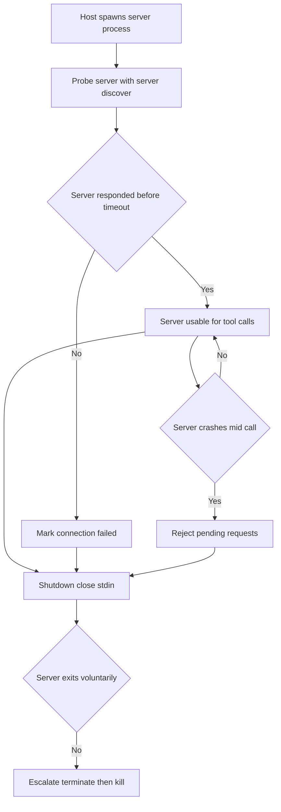

# MCP Server Lifecycle Management: Starting, Stopping, and Supervising Child Processes

## English

Most MCP servers run as child processes of the host application, connected over stdio pipes. That means the host is not just a client — it is also a process supervisor, and it has to answer some unglamorous questions: Who spawns the server? What happens if it crashes mid-call? How do you shut it down without leaking orphan processes or losing in-flight work? These concerns never appear in the JSON-RPC message spec, but they dominate real deployments.

Consider startup. A host typically launches a server with a command and arguments (for example, a Node or Python script), then waits for the server to prove it is usable before it considers the server available. Historically that meant waiting for the `initialize` handshake, but the current protocol revision (2026-07-28) removed `initialize`/`notifications/initialized` entirely to make MCP stateless: every request now carries the protocol version and client capabilities in `_meta`, and servers advertise what they support through the `server/discover` RPC. A host can therefore call `server/discover` as a readiness probe, or simply send the first real request. If the process exits during that window, the host must decide whether to retry, surface an error to the user, or disable that server's tools. A naive host that blocks forever waiting on a server that has already crashed will appear to hang. Good hosts apply a startup timeout and treat a premature exit as a failed connection.

Crash recovery is subtler. If a server dies while a tool call is in flight, the host's pending request will never receive a response. The host should reject those pending promises with a clear error rather than leaving them dangling, because a model that never learns the call failed may loop or hallucinate a result. Whether to auto-restart is a policy question: restarting is friendly for stateless read-only servers, but risky for servers holding session state, since the new process knows nothing about the old one's state.

Shutdown has its own hazards. On stdio transport, the cleanest signal is closing the server's stdin: a well-behaved server reads end-of-file and exits voluntarily. If it does not, the host escalates to a termination signal, and only as a last resort kills the process outright. On POSIX systems, killing a parent process does not automatically kill its children, so a server that spawns its own subprocesses (a language server, a database client) can leave orphans behind unless it is placed in a process group and the whole group is signalled.

Finally, supervision includes backpressure and resource limits. A misbehaving server that floods stdout with log noise can drown the JSON-RPC stream, so logging belongs on stderr, not stdout. Hosts may also cap memory or CPU for untrusted servers. In short, treating an MCP server as a managed child process — with health checks, timeouts, clean teardown, and log separation — is what separates a demo from something you can leave running all day.

## 中文

大部分 MCP 伺服器都以主機應用程式的子行程形式執行，透過 stdio 管道連線。這意味著主機不只是客戶端，它同時是行程監督者，必須回答一些不顯眼卻關鍵的問題：誰負責啟動伺服器？若它在呼叫途中崩潰怎麼辦？如何關閉它而不留下孤兒行程或丟失進行中的工作？這些問題從不出現在 JSON-RPC 訊息規格裡，卻主導著真實部署。

先談啟動。主機通常以指令加引數（例如 Node 或 Python 指令碼）啟動伺服器，然後等伺服器證明自己可用，才視之為可用。過去呢一步係等待 `initialize` 握手，但現行協定修訂（2026-07-28）為咗令 MCP 變成無狀態，已經完全移除 `initialize`／`notifications/initialized`：而家每個請求都會在 `_meta` 帶上協定版本同客戶端能力，伺服器則透過 `server/discover` 這個 RPC 宣告自己支援咩。所以主機可以用 `server/discover` 做就緒探測，或者直接送出第一個真實請求。若行程在這個視窗內退出，主機必須決定是重試、向使用者顯示錯誤，還是停用該伺服器的工具。一個天真地無限等待一個已經崩潰嘅行程嘅主機，看起來就像當機。良好的主機會設定啟動逾時，並把過早退出視為連線失敗。

崩潰復原更微妙。若伺服器在工具呼叫進行中死亡，主機的待處理請求永遠收不到回應。主機應以清晰的錯誤拒絕這些懸而未決的請求，而非任由它們懸掛，因為一個永遠不知道呼叫失敗的模型可能會陷入迴圈或憑空編造結果。是否自動重啟是政策問題：對無狀態的唯讀伺服器而言重啟很友善，但對持有工作階段狀態的伺服器則有風險，因為新行程對舊行程的狀態一無所知。

關閉也有其危險。在 stdio 傳輸上，最乾淨的訊號是關閉伺服器的 stdin：行為良好的伺服器讀到檔案結尾便會自願退出。若它不這樣做，主機升級至終止訊號，最後才不得已強制殺死行程。在 POSIX 系統上，殺死父行程不會自動殺死其子行程，因此若伺服器自行啟動子行程（語言伺服器、資料庫客戶端），除非把它放進行程群組並向整個群組傳送訊號，否則會留下孤兒。

最後，監督還包括背壓與資源限制。一個行為失常、不斷以日誌噪音淹沒 stdout 的伺服器，會淹沒 JSON-RPC 串流，所以日誌應寫到 stderr 而非 stdout。主機亦可為不受信任的伺服器限制記憶體或 CPU。簡言之，把 MCP 伺服器視為受管理的子行程——具備健康檢查、逾時、乾淨拆卸與日誌分離——正是示範品與可整天掛著執行的事物之間的分界。

## Key Takeaway

An MCP server is a supervised child process, so hosts must handle startup timeouts, crash recovery, clean shutdown, and log separation — not just JSON-RPC messages.

## Related Concepts
- Transport Deep Dive: stdio Pipes vs Streamable HTTP
- Logging, Audit Trails, and Observability in MCP

## Diagram

