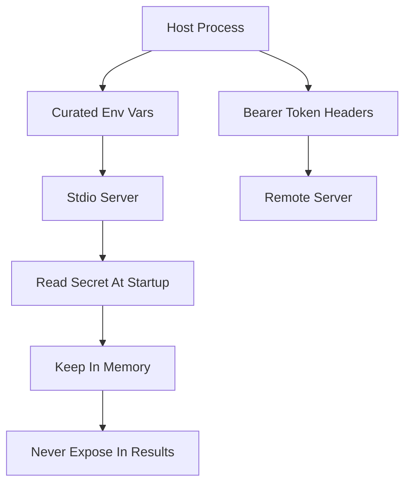

# Environment and Secret Injection: How Servers Get the Credentials They Need

## English

A tool that cannot reach anything is useless, so every MCP server eventually needs configuration: a database URL, an API key, a filesystem path, a feature flag. Where does that configuration live, and how does it reach the server safely? This is an operational question that sits between the transport layer and the security model, and getting it wrong is one of the most common ways secrets leak.

For stdio servers, the conventional channel is the process environment. The host spawns the server with a curated set of environment variables, and the server reads them at startup. The key discipline is curation: a host should pass only the variables that server needs, not blindly inherit its own entire environment. Inheriting everything means every installed server can read every secret the host holds, which quietly turns each server into a potential exfiltration point. A minimal allow-list per server is the safer default.

Secrets in environment variables have trade-offs. They are easy to set and universally supported, but they can leak through crash dumps, child processes that inherit the environment, and diagnostic output. Servers should never echo their environment into tool results or logs. A common hardening step is to read the secret once at startup, keep it in memory, and never include it in any response the model can see — because anything the model sees can end up in a transcript, a summary, or a downstream call.

Remote servers face a different problem. When a server is reached over HTTP rather than spawned locally, the credential question becomes about tokens and headers: the client presents a bearer token or similar, and the server validates it. Here the host must decide whether it is acting with the user's identity or a service identity, and must ensure tokens are scoped narrowly and rotated. Tokens should be passed in headers, never in URLs, because URLs get logged by proxies and browsers.

Finally, configuration should be treated as declarative and reviewable. Whether it is a JSON file listing servers with their commands, arguments, and environment, or a managed configuration service, users should be able to see exactly what each server will receive before it runs. Secret values themselves should be referenced indirectly — for example, by pointing to an environment variable or a secret store entry — rather than pasted into a shared config file that gets committed to version control. The principle is simple: configuration is code, secrets are references, and least privilege applies to environment variables just as much as to filesystem access.

## 中文

一個無法接觸任何東西的工具是無用的，所以每個 MCP 伺服器最終都需要配置：資料庫 URL、API 金鑰、檔案系統路徑、功能旗標。這些配置住在哪裡，又如何安全地送達伺服器？這是介於傳輸層與安全模型之間的營運問題，而做錯正是機密洩漏最常見的方式之一。

對 stdio 伺服器而言，慣常的渠道是行程環境。主機以一組精選的環境變數啟動伺服器，伺服器在啟動時讀取它們。關鍵紀律在於精選：主機應只傳遞該伺服器所需的變數，而非盲目繼承自己的整個環境。繼承一切意味著每個已安裝的伺服器都能讀取主機持有的每一項機密，悄悄把每個伺服器變成潛在的洩漏點。為每個伺服器設定最小允許清單是較安全的預設。

環境變數中的機密有其取捨。它們易於設定且普遍支援，但可能透過崩潰傾印、繼承環境的子行程，以及診斷輸出而洩漏。伺服器絕不應把自己的環境回顯到工具結果或日誌中。常見的加固步驟是在啟動時讀取一次機密、儲存在記憶體中，且永不把它放進模型可見的任何回應——因為模型看到的任何東西都可能落入逐字稿、摘要或下游呼叫。

遠端伺服器面對不同問題。當伺服器透過 HTTP 而非本機啟動來接觸時，憑證問題變成關於權杖與標頭：客戶端出示持有者權杖或類似物，伺服器加以驗證。此時主機必須決定它是以使用者身分還是服務身分行事，並確保權杖範圍收窄且會輪換。權杖應放在標頭而非 URL 中，因為 URL 會被代理與瀏覽器記錄。

最後，配置應被視為宣告式且可審閱的。無論是一份列出伺服器指令、引數與環境的 JSON 檔案，還是受管理的配置服務，使用者都應能在執行前清楚看到每個伺服器將收到什麼。機密值本身應以間接方式引用——例如指向某個環境變數或機密儲存庫的條目——而非貼進會被提交到版本控制的共享配置檔。原則很簡單：配置是程式碼，機密是引用，而最小許可權同樣適用於環境變數，正如適用於檔案系統存取一樣。

## Key Takeaway

Pass servers a minimal, curated environment, reference secrets indirectly rather than embedding them, and never let a credential flow into anything the model can see.

## Related Concepts
- MCP and the Authority Problem: Whose Credentials Does a Tool Use?
- MCP Security Model — Authentication, Authorization, and Trust Boundaries

## Diagram

