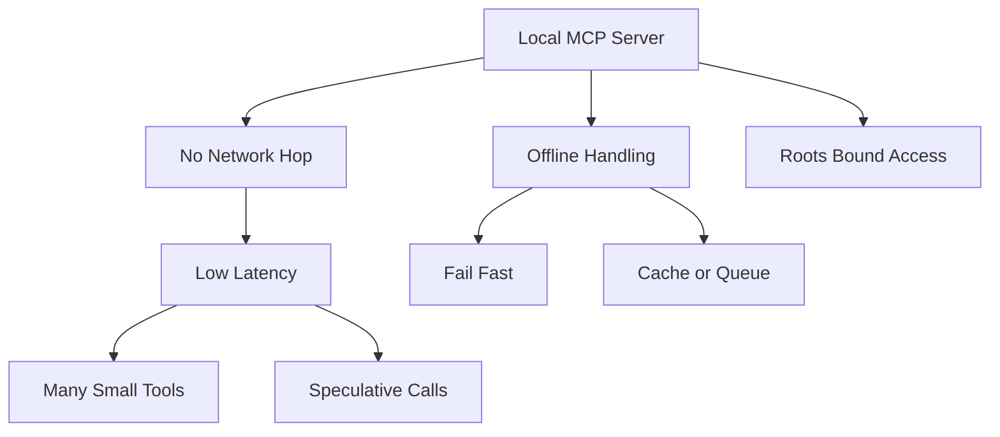

# Offline and Local-First MCP: Tools When the Network Is Not There

## English

Most MCP discussion assumes a chat session talking to a cloud model, but a large class of servers are useful precisely because they touch local resources: a notes folder, a git repository, a local SQLite database, a home automation hub. These servers raise a design question that rarely gets asked: what should a tool ecosystem look like when the model, the host, and the server all live on the same machine and the network may be slow, metered, or absent?

Local-first MCP servers have a distinct profile. Latency is measured in milliseconds because there is no network hop, so the economics change: a tool that takes 30 ms round-trip can be called freely, whereas the same tool over the internet might be expensive enough to discourage use. This shifts design toward many small, composable tools rather than one giant batch operation. It also makes it practical for the model to call a tool speculatively — list files, then read one — the way a human clicks around a folder.

Offline operation changes error handling. A tool that normally reaches a remote API must decide what to do when the network is down: fail fast with a clear message, serve from a local cache, or queue the operation for later. Each choice has consequences the model should understand. If a tool silently serves stale data, the model may reason confidently on outdated facts; if it queues writes, the model must be told the write is pending rather than done. The tool description is the right place to state these behaviours, since it is the contract the model reads.

There is also a trust dimension. A local server that can read your filesystem is powerful, and the roots primitive exists to bound it — the host declares which directories the server may touch. (Roots were deprecated in the 2026-07-28 MCP revision: the feature still works during the deprecation window, but new implementations should pass directories and files through tool parameters, resource URIs, or server configuration instead.) Local-first design leans heavily on this: a notes server scoped to one folder is far safer than one with unrestricted home-directory access, and the narrow scope also makes its tool descriptions simpler and its behaviour more predictable.

Finally, local-first servers enable a kind of graceful degradation that cloud-only designs cannot. When the internet is unavailable, the host can still offer file search, note-taking, code indexing, and calendar reads from local stores, while marking cloud-backed tools as temporarily unavailable. The model's job is to route around the gap — and the host's job is to make that gap visible through capability and health signals rather than letting tools fail mysteriously. Designing for the offline case does not just help travellers on aeroplanes; it forces clearer contracts about state, caching, and availability for everyone.

## 中文

大部分 MCP 討論都假設聊天工作階段與雲端模型對話，但一大類伺服器之所以有用，正因為它們接觸本機資源：筆記資料夾、git 儲存庫、本機 SQLite 資料庫、家居自動化中樞。這些伺服器提出一個鮮少被問的設計問題：當模型、主機與伺服器都住在同一部機器，而網路可能緩慢、計流量或不存在時，工具生態應是什麼模樣？

本機優先的 MCP 伺服器有獨特輪廓。延遲以毫秒計，因為沒有網路跳轉，經濟學因此改變：一個來回 30 毫秒的工具可隨意呼叫，而同樣工具經網際網路可能貴得令人卻步。這使設計傾向許多小型、可組合的工具，而非一個巨型批次操作。它也讓模型實際可行地試探性呼叫工具——先列出檔案，再讀取一個——就像人類在資料夾裡點來點去。

離線操作改變錯誤處理。一個平常要接觸遠端 API 的工具，必須決定網路斷線時怎麼辦：以清晰訊息快速失敗、從本機快取供應，還是把操作排隊稍後執行。每個選擇都有模型應理解的後果。若工具悄悄供應過時資料，模型可能自信地依據過時事實推理；若它排隊寫入，模型必須被告知寫入是待處理而非已完成。工具描述正是陳述這些行為的合適地方，因為那是模型閱讀的契約。

還有信任層面。一個能讀取你檔案系統的本機伺服器很強大，而 roots 原語正是用來約束它——主機宣告伺服器可觸及哪些目錄。（roots 已在 2026-07-28 的 MCP 修訂中被棄用：該功能在棄用期間仍可運作，但新的實作應改以工具參數、資源 URI 或伺服器設定來傳遞目錄與檔案。）本機優先設計極度倚賴這種範圍限制：範圍限定於一個資料夾的筆記伺服器，遠比擁有無限制家目錄存取權的伺服器安全，而狹窄範圍也令其工具描述更簡單、行為更可預測。

最後，本機優先伺服器促成一種僅雲端設計無法做到的優雅降級。當網際網路不可用時，主機仍可從本機儲存提供檔案搜尋、筆記、程式碼索引與日曆讀取，同時把雲端支援的工具標記為暫時不可用。模型的工作是繞過缺口，而主機的工作是透過能力與健康訊號讓缺口可見，而非任由工具神秘地失敗。為離線情況設計不僅幫助飛機上的旅客；它迫使所有人對狀態、快取與可用性建立更清晰的契約。

## Key Takeaway

Designing MCP servers for local and offline use changes latency economics, error handling, and trust scoping — and makes availability contracts clearer for everyone.

## Related Concepts
- Roots: Telling a Server Which Parts of the Filesystem It May Touch (deprecated in 2026-07-28)
- Cost, Latency, and Context Budget: The Hidden Economics of MCP Tools

## Diagram

