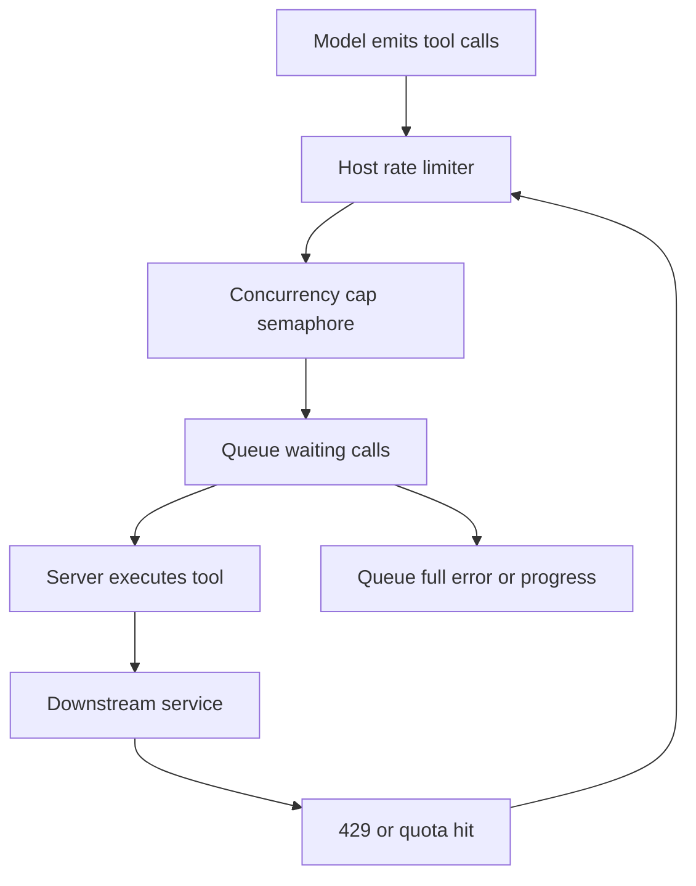

# Rate Limiting and Backpressure: When Tools Are Slower Than the Model

## English

A language model can emit tool calls faster than most external systems can service them. A single turn might trigger five tool calls, and each might hit a database, a third-party API, or a filesystem. Without a mechanism to slow the caller down, you get thundering-herd behaviour: bursts of requests that overwhelm a downstream service, trigger 429 Too Many Requests responses, or blow a shared quota. Rate limiting is the deliberate throttling of how many calls (or how much data) a client or server will accept per unit of time. In MCP terms, this usually lives in the host or an aggregating proxy, since individual servers rarely know the global picture.

Backpressure is the complementary idea: when a consumer cannot keep up, it pushes back on the producer instead of silently dropping work or buffering forever. Think of a water pipe — if you keep pumping in water faster than it drains, pressure builds until something bursts. In software, the burst is usually unbounded queues, memory growth, or timeouts. A well-behaved MCP host applies backpressure by limiting how many tool calls are in flight at once (a concurrency cap), queuing the rest, and returning a clear error or a progress notification when the queue is full rather than hanging indefinitely.

Practical levers you can pull include: a token-bucket or leaky-bucket limiter per server, per tool, or per user; a maximum concurrent-call semaphore; request timeouts with explicit cancellation; and per-tool quotas so one expensive tool cannot starve the rest. Because MCP is request/response over JSON-RPC, cancellation is usually expressed as a notification the client sends to tell the server to abandon an in-flight request — but servers must actually honour it, which is a common source of wasted work.

A subtle trap is that the model does not see the queue. If a tool call is silently delayed by 30 seconds, the model may think the tool is broken and retry, multiplying the load. Good designs surface waiting as a progress notification with a token, so the model (or the human) knows the call is alive. They also return structured, retryable errors with a suggested delay, so the model can back off rather than hammering.

Finally, rate limiting is a safety property, not just a performance one. A runaway agent loop that repeatedly calls a write-capable tool can do real damage in seconds. Caps on total calls per turn, per session, and per tool act as circuit breakers. The rule of thumb: assume the model will call your tool more often than you expect, and design the limiter before you ship, not after the first incident.

## 中文

語言模型發出工具呼叫的速度，往往快過大多數外部系統能夠處理的速度。一個回合可能觸發五次工具呼叫，每次都可能打到資料庫、第三方 API 或檔案系統。如果沒有機制讓呼叫方慢下來，就會出現「驚群效應」：大量突發請求淹沒下游服務、觸發 429 Too Many Requests，或者耗盡共用配額。限流（rate limiting）就是刻意限制用戶端或伺服器每單位時間內接受多少呼叫（或多少資料量）。在 MCP 的語境下，這通常落在 host 或彙整代理（aggregating proxy）身上，因為個別伺服器很少掌握全局情況。

背壓（backpressure）是相輔相成的概念：當消費者跟不上時，它會向生產者施加壓力，而不是默默丟棄工作或無限緩衝。想像一條水管——如果你灌水的速度比排水的速度快，壓力會不斷累積，直到某處爆裂。在軟件中，爆裂通常是無界佇列、記憶體暴增或逾時。行為良好的 MCP host 會用背壓來限制同時在飛的工具呼叫數量（併發上限），其餘排隊，並在佇列滿載時回傳明確錯誤或進度通知，而不是無了期地卡住。

實務上可調的槓桿包括：針對每個伺服器、每個工具或每個使用者套用令牌桶（token bucket）或漏桶（leaky bucket）限流器；設定最大併發呼叫的信號量（semaphore）；加上明確取消的請求逾時；以及為每個工具設配額，避免一個昂貴工具餓死其他工具。由於 MCP 是建基於 JSON-RPC 的請求／回應模式，取消通常以通知形式表達——用戶端送出一則通知，告訴伺服器放棄進行中的請求——但伺服器必須真正兌現，這往往是浪費工作的常見來源。

一個微妙的陷阱是：模型看不到佇列。如果工具呼叫被默默延遲三十秒，模型可能以為工具壞了而重試，令負載倍增。好的設計會把等待狀態以帶 token 的進度通知呈現，讓模型（或人類）知道呼叫仍然存活。它們也會回傳結構化、可重試的錯誤，並附上建議的延遲時間，讓模型可以退避而不是狂打。

最後，限流不只是效能問題，更是安全屬性。一個失控的代理迴圈若反覆呼叫具寫入能力的工具，可以在數秒內造成真實損害。對每個回合、每個工作階段、每個工具的總呼叫次數設上限，就等同斷路器（circuit breaker）。經驗法則：假設模型呼叫你工具的頻率會高過你的預期，並在發佈之前就設計好限流器，而不是等到第一次事故之後。

## Key Takeaway

Rate limiting and backpressure protect both downstream services and the user from runaway agent loops; surface waiting as progress notifications and retryable errors instead of silent queues.

## Related Concepts
- Progress Tokens and Long-Running Tool Calls
- Cost, Latency, and Context Budget: The Hidden Economics of MCP Tools

## Diagram

