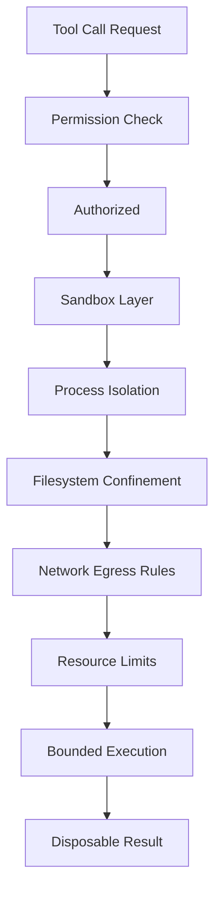

# Sandboxing Tool Execution: Containment Beyond Permissions

## English

Permission checks answer the question "is this caller allowed to invoke this tool?" Sandboxing answers a different question: "if the tool misbehaves, how much damage can it do?" These are orthogonal. A tool can be perfectly authorised and still be dangerous — because the model supplied a malicious argument, because the tool has a bug, or because the underlying dependency was compromised. Sandboxing is the practice of running code inside a restricted environment so that even a successful exploit is bounded in blast radius.

Common containment layers stack like an onion. Process-level isolation (running the server as a low-privilege user, in a separate container, or in a VM) limits what the process can touch. Filesystem confinement (chroot, mount namespaces, or read-only bind mounts) restricts which paths are visible; this pairs naturally with MCP roots, which tell a server which directories it may work in — but roots are advisory metadata, not an enforcement mechanism, so the OS-level sandbox must still back them up. Network egress rules (deny-by-default firewalls, allowlists of domains) stop a compromised tool from exfiltrating data. Resource limits (CPU, memory, wall-clock time, open file descriptors) prevent denial-of-service against the host.

For tools that evaluate untrusted input — code interpreters, template engines, query builders — the strongest option is a dedicated sandbox runtime: a WebAssembly interpreter with no syscalls, a gVisor-style user-space kernel, or a microVM like Firecracker. These give you a fresh, disposable environment per call, so one call cannot poison the next. The trade-off is startup latency, which is why warm pools exist: keep a few pre-booted sandboxes ready and hand one out per invocation.

A frequent mistake is to trust the tool's own input validation. If your MCP server shells out to a command with a model-supplied string, you have a command-injection vulnerability regardless of what your JSON Schema says — schemas describe shape, not safety. The rule is: never build a shell command by string concatenation from model output; pass arguments as an array, use parameterised queries for SQL, and treat every model-supplied path as hostile until canonicalised and checked against an allowlist.

Sandboxing also has a data dimension. Even a read-only tool can leak secrets if it can read environment variables, credential files, or the host's process table. Strip the environment down to the minimum the server needs, mount only the directories it must see, and log every outbound network attempt. The mental model: assume the model will one day be tricked into calling your tool with adversarial arguments, and design so that the worst outcome is an error message, not a breach.

## 中文

權限檢查回答的是「這個呼叫方是否獲准使用這個工具？」沙箱（sandboxing）回答的是另一個問題：「如果工具有不當行為，它可以造成多大破壞？」兩者互相正交。一個工具可以完全獲得授權，但仍然危險——因為模型提供了惡意參數、因為工具有 bug，或者因為底層依賴被入侵。沙箱化就是把程式碼放在受限環境中執行，令即使攻擊成功，影響範圍（blast radius）仍然有界。

常見的隔離層像洋蔥一樣層層疊加。行程層隔離（以低權限使用者身分、在獨立容器或 VM 中執行伺服器）限制了行程能觸及的東西。檔案系統圍堵（chroot、mount namespace 或唯讀 bind mount）限制了哪些路徑可見；這與 MCP roots 天然配對——roots 告訴伺服器它可以在哪些目錄工作——但 roots 只是提示性元資料，不是強制機制，所以作業系統層的沙箱仍須補上。網路出口規則（預設拒絕的防火牆、網域允許清單）阻止被入侵的工具外洩資料。資源限制（CPU、記憶體、實際耗時、開啟的檔案描述符）則防止對 host 的阻斷服務攻擊。

對於會評估不受信任輸入的工具——程式碼解譯器、模板引擎、查詢建構器——最強的選項是專用沙箱執行環境：沒有系統呼叫的 WebAssembly 解譯器、gVisor 風格的使用者空間核心，或像 Firecracker 這類微型 VM。它們為每次呼叫提供全新、可丟棄的環境，令一次呼叫無法汙染下一次。代價是啟動延遲，這正是暖池（warm pool）存在的原因：預先開好幾個沙箱待命，每次呼叫派一個出去。

常見的錯誤是信任工具自身的輸入驗證。如果你的 MCP 伺服器用模型提供的字串去呼叫 shell 指令，那麼無論你的 JSON Schema 寫得多好，你都有命令注入漏洞——schema 描述的是形狀，不是安全。規則是：永遠不要用字串串接把模型輸出組成 shell 指令；以陣列傳遞參數、對 SQL 使用參數化查詢，並把每個模型提供的路徑都視為敵意，直到正規化並對照允許清單為止。

沙箱也有資料層面。即使是唯讀工具，只要它能讀取環境變數、憑證檔案或 host 的行程表，就可能洩漏機密。把環境變數削減到伺服器真正需要的最低限度，只掛載它必須看見的目錄，並記錄每一次對外網路嘗試。心智模型是：假設總有一天模型會被誘騙，用對抗性參數呼叫你的工具，並據此設計，令最壞情況只是一則錯誤訊息，而不是一次入侵。

## Key Takeaway

Authorisation decides who may call a tool; sandboxing bounds what a tool can do if it is tricked, so layer process, filesystem, network, and resource limits rather than trusting schema validation.

## Related Concepts
- MCP Security Model — Authentication, Authorization, and Trust Boundaries
- Roots: Telling a Server Which Parts of the Filesystem It May Touch

## Diagram

