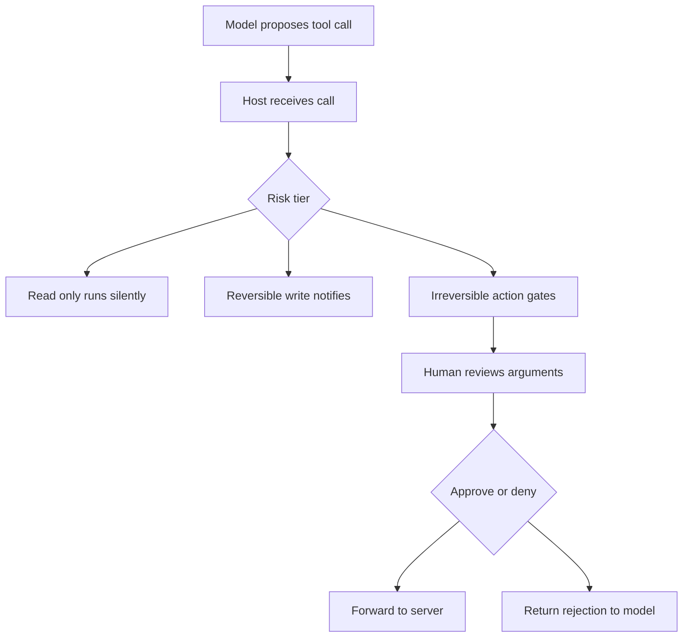

# Human-in-the-Loop: Confirmation Gates and Approval Workflows

## English

Not every tool call should run unattended. Reading a file is cheap to get wrong; sending an email, issuing a refund, or deleting a branch is not. Human-in-the-loop (HITL) design is the practice of inserting a deliberate pause where a human must approve, edit, or reject a proposed action before it executes. In MCP, this is a host-side responsibility: the protocol itself does not mandate a confirmation step, but the host controls the loop and can interpose one at any point between receiving a tool call from the model and forwarding it to the server.

The simplest pattern is a binary confirmation gate: the host shows the tool name and arguments, the human clicks approve or deny, and the result is fed back to the model as either the tool result or a structured rejection. This is easy but fatiguing — a user asked to approve sixty calls will start clicking "yes" reflexively, defeating the purpose. Better designs tier the friction: read-only tools run silently, reversible writes (creating a draft, staging a change) run with a notification, and irreversible or high-value actions (payments, deletions, outbound messages) require explicit approval. Some systems let the human edit the arguments before approving, turning approval into a lightweight correction step.

A richer pattern is the two-phase commit: the tool call proposes a change, the server stages it (writes to a draft, opens a pull request, creates a pending transaction), and a separate commit call finalises it. This gives the human a chance to review the actual diff rather than a description of it. It also composes well with idempotency — a staged change can be inspected, retried, or abandoned without side effects. The model is told "staged, awaiting approval" and can continue reasoning while the human decides.

Design questions worth answering up front: Who is the approver (the end user, an admin, a policy engine)? What happens on timeout — does the pending action expire, or wait forever? Can approvals be batched so a user approves a plan of ten actions at once rather than ten separate dialogs? How is the approval recorded for audit, and does the record capture the exact arguments that were shown to the human versus the ones that were executed? That last point matters: if the arguments can change between display and execution, the approval is meaningless.

Finally, HITL is not only a safety valve — it is a teaching signal. Every rejection is data about where the model's judgement diverges from the human's. Logging rejections with their arguments and reasons gives you a corpus for improving tool descriptions, tightening schemas, or adding guardrails. The goal is not to approve everything, but to make the approval step so well-targeted that humans spend their attention only where it actually matters.

## 中文

不是每一次工具呼叫都應該無人值守地執行。讀取一個檔案，出錯的代價很低；發送電郵、批出退款或刪除分支，代價卻不然。人在迴路（human-in-the-loop，HITL）設計，就是在執行動作之前刻意插入一個暫停點，讓人類批准、修改或拒絕建議中的操作。在 MCP 中，這是 host 的責任：協定本身沒有強制要求確認步驟，但 host 掌控整個迴路，可以在收到模型的工具呼叫之後、轉發給伺服器之前的任何一點插入確認。

最簡單的模式是二元確認閘門：host 顯示工具名稱與參數，人類按下批准或拒絕，結果就以工具結果或結構化拒絕的形式回饋給模型。這做法容易，但會令人疲勞——一個被要求批准六十次呼叫的使用者，會開始反射式地按「是」，令機制失去意義。更好的設計會把摩擦分層：唯讀工具靜默執行；可逆的寫入（建立草稿、暫存變更）執行時附帶通知；不可逆或高價值的動作（付款、刪除、對外訊息）則要求明確批准。有些系統容許人類在批准前修改參數，把批准變成一個輕量的修正步驟。

更豐富的模式是兩階段提交：工具呼叫提出變更，伺服器先暫存它（寫入草稿、開啟 pull request、建立待處理交易），再由另一個提交呼叫正式完成。這讓人類有機會審閱真正的差異，而不是聽一段描述。它亦與冪等性配合得很好——暫存的變更可以被檢視、重試或放棄，而不產生副作用。模型會被告知「已暫存，等待批准」，並可在人類決定期間繼續推理。

值得事先回答的設計問題包括：批准者是誰（終端使用者、管理員、政策引擎）？逾時會怎樣——待處理動作會過期，還是永遠等待？批准可否批次處理，讓使用者一次批准十個動作的計劃，而不是開十個對話框？批准如何記錄以供稽核，而紀錄捕捉的是展示給人類看的參數，還是實際執行的參數？最後一點至關重要：如果參數在展示與執行之間可以改變，批准就毫無意義。

最後，HITL 不只是安全閥，更是教學訊號。每一次拒絕，都是關於模型判斷與人類判斷在哪裡分歧的資料。把拒絕連同參數與理由記錄下來，就得到一個語料庫，可用來改善工具描述、收緊 schema 或加入護欄。目標不是批准一切，而是讓批准步驟精準到位，令人類只把注意力花在真正重要的地方。

## Key Takeaway

Tier confirmation by risk and prefer staged, reviewable changes over blanket prompts, so human attention stays focused where mistakes are irreversible.

## Related Concepts
- Idempotency and Side Effects: Designing Tools the Model Can Safely Retry
- Sampling and Elicitation: How a Server Calls Back Into the Client

## Diagram

