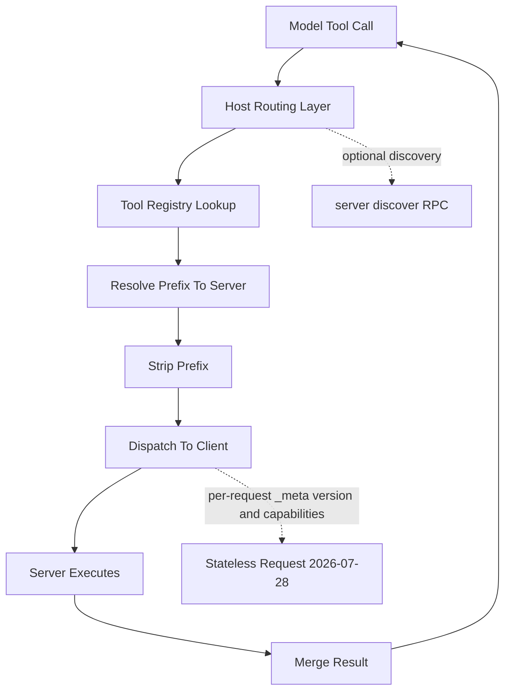

# Multi-Server Orchestration: How a Host Juggles Many Tools at Once

## English

A single MCP host rarely talks to just one server. In practice, an AI coding assistant might connect to a filesystem server, a Git server, a database server, and a web-search server simultaneously. The host is responsible for keeping all of these connections alive, each with its own client object that speaks JSON-RPC over its own transport. The tricky part is not the connections themselves but the routing layer that sits above them: when the model emits a tool call, the host must decide which server owns that tool, dispatch the request, and merge the result back into the conversation. This is where the abstraction starts to leak, because each server advertises its own tool list with its own naming choices, and two servers might both expose something called `search`.

The host therefore maintains a routing table, sometimes called a tool registry, that maps each fully qualified tool name to a specific server-client pair. A common pattern is prefixing tools with a server identifier, so `filesystem.read_file` and `git.read_file` become distinct entries even though both servers named their tool `read_file`. The host strips the prefix before forwarding the call, so the server still sees the original name it advertised. Some hosts let the user configure this prefixing explicitly; others do it automatically and simply hide the prefix from the model's tool list, presenting only the leaf name. Both approaches work, but the automatic one risks collisions if two servers genuinely expose the same leaf name with different semantics.

Orchestration also means handling partial failure. If one server crashes mid-session, the host should not tear down the whole conversation. Instead it marks that server's tools as temporarily unavailable, optionally notifies the model through a system message, and continues serving the other servers. When the crashed server restarts, the host re-discovers it and refreshes the tool list. It is important to be precise about the protocol revision here: in the 2026-07-28 revision of the Model Context Protocol there is no negotiation handshake at all — the protocol is stateless, the protocol version and the server's capabilities ride along in per-request `_meta` metadata, and `server/discover` is the discovery RPC. The `initialize` request and the `notifications/initialized` notification belong to the legacy revisions (2025-11-25 and earlier), so a legacy-era server still expects that handshake, while a dual-era server supports both the modern stateless flow and the legacy handshake. This is conceptually similar to a load balancer removing a failed backend from its pool while keeping the rest of the fleet serving traffic.

There is also the question of ordering and dependency. Some tool calls are naturally sequential: you fetch a file, then edit it, then commit. The host does not enforce this ordering itself; it relies on the model to chain calls in a sensible sequence based on the results it sees. But a well-designed host can add guardrails, such as refusing to dispatch a write operation to a server whose capabilities have not yet been reported (in the modern revision these ride along in each request's `_meta`, or are fetched via `server/discover`; in legacy revisions they come from the initialize handshake), or queuing calls to a single server so that concurrent requests do not race on shared state.

Finally, orchestration has a cost dimension. Every server you connect adds its tool definitions to the model's context window, and a host with ten servers might be advertising fifty or more tools. Good hosts let you scope which servers are active for a given task, or lazily load tool definitions only when the user asks for a capability that needs them. The goal is to give the model enough tools to be useful without drowning it in a menu it will never order from.

## 中文

一個 MCP host 很少只連接單一伺服器。實際上，一個 AI 編程助理可能同時連接到檔案系統伺服器、Git 伺服器、資料庫伺服器和網頁搜尋伺服器。Host 負責維持所有這些連線，每個連線都有自己的 client 物件，各自透過自己的 transport 講 JSON-RPC。真正棘手的地方不是連線本身，而是位於它們之上的路由層：當模型發出工具呼叫時，host 必須判斷哪個伺服器擁有該工具、派送請求，並把結果合併回對話中。這正是抽象開始滲漏的地方，因為每個伺服器都用自己的命名方式宣告工具清單，而兩個伺服器可能都暴露了一個叫 `search` 的東西。

因此 host 會維護一張路由表，有時稱為工具註冊表，把每個完整限定的工具名稱對應到特定的 server-client 配對。常見做法是為工具加上伺服器識別前綴，於是 `filesystem.read_file` 和 `git.read_file` 成為不同條目，即使兩個伺服器都把工具命名為 `read_file`。Host 在轉發呼叫前會剝掉前綴，所以伺服器看到的仍是它當初宣告的原始名稱。有些 host 讓使用者明確設定前綴；有些則自動加上，並在模型的工具清單中只呈現葉名。兩種做法都行得通，但自動做法若遇到兩個伺服器真的暴露相同葉名卻有不同語意，就有碰撞風險。

編排也意味著處理部分失敗。若某個伺服器在會話中途崩潰，host 不應拆掉整個對話。它會把該伺服器的工具標記為暫時不可用，可選擇透過系統訊息通知模型，然後繼續服務其他伺服器。當崩潰的伺服器重新啟動，host 會重新探索它並刷新工具清單。這裡必須對協定修訂版說準：在 2026-07-28 版 Model Context Protocol 中，根本沒有任何協商握手——協定是無狀態的，協定版本與伺服器 capabilities 隨每次請求的 `_meta` metadata 一起傳送，而 `server/discover` 才是探索用的 RPC。`initialize` 請求與 `notifications/initialized` 通知屬於舊版修訂（2025-11-25 及更早），所以舊版年代的伺服器仍然需要那個握手，而同時支援兩個年代的伺服器則兩種都支援。這概念上類似負載平衡器把故障後端從池中移除，同時讓其餘機隊繼續服務流量。

還有順序與依賴的問題。有些工具呼叫天生是循序的：先讀取檔案，再編輯，再提交。Host 本身不強制這個順序；它依賴模型根據看到的結果，以合理的次序串接呼叫。但設計良好的 host 可以加上護欄，例如拒絕把寫入操作派送給尚未回報 capabilities 的伺服器（現代修訂版會在每次請求的 `_meta` 中附上，或透過 `server/discover` 取得；舊版則靠 initialize 握手），或把送往同一伺服器的呼叫排隊，以免並行請求在共享狀態上競爭。

最後，編排有成本面向。你連接的每個伺服器都會把它的工具定義加進模型的 context window，而連接十個伺服器的 host 可能宣告五十個以上的工具。好的 host 讓你針對特定任務限定哪些伺服器處於啟用狀態，或只在使用者要求需要某能力時才延遲載入工具定義。目標是給模型足夠的工具以發揮作用，又不會讓它淹沒在一份永遠不會點餐的菜單裡。

## Key Takeaway

A host with many MCP servers is really a router that maps qualified tool names to server-client pairs, isolates failures, and manages the context cost of advertising every tool.

## Related Concepts
- JSON-RPC request routing
- Partial failure isolation

## Diagram

