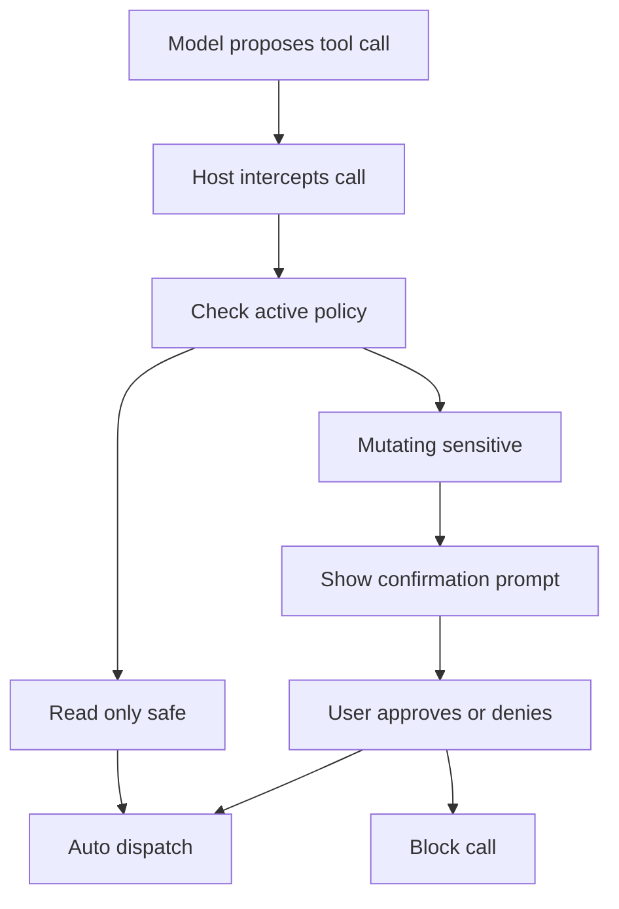

# The Consent Boundary: What the Model Can Do vs. What the User Allowed

## English

MCP draws a sharp line between capability and permission. A server can advertise a tool like `delete_file` or `send_email`, but advertising it does not mean the model is allowed to call it in any given moment. That gap is the consent boundary, and it is one of the most important design considerations in any MCP deployment. The protocol itself provides the mechanism for describing tools and their schemas; it does not, by itself, decide whether a particular call should happen. That decision lives in the host and in the policy the user has configured.

Think of it like a building with keycard access. The building directory lists every room (the server's tool list), but your keycard only opens the doors you have been granted. The host plays the role of the keycard reader: it inspects each tool call, checks it against the active policy, and either dispatches it, blocks it, or pauses to ask the human. A well-designed host distinguishes between read-only tools that are safe to run automatically and mutating tools that require confirmation. Some hosts go further and require confirmation only for tools that touch sensitive resources, letting low-risk reads flow through without interruption.

The confirmation prompt itself is a small piece of user interface with outsized importance. It needs to show the user what tool is being called, what arguments are being passed, and ideally what the likely effect is. A prompt that says only 'the assistant wants to run a tool' is nearly useless, because the user cannot evaluate the risk. A good prompt says something like 'the assistant wants to write to /home/user/notes.md with the following content' and lets the user see the diff. This is why some hosts render tool calls as structured previews rather than raw JSON.

There is also a temporal dimension to consent. A user might approve a tool once, approve it for the session, or approve it permanently. Each choice carries different risk. One-time approval is safest but most annoying; permanent approval is convenient but means a malicious or buggy server could do damage long after the user's initial trust decision. Many hosts default to session-scoped approval for mutating tools and reserve permanent approval for narrow, well-understood operations.

Finally, consent is not just about individual calls but about the aggregate. A model that calls `read_file` a hundred times in a row is technically doing only permitted reads, but it may be exfiltrating data through a tool that the user did not realize could be abused that way. Some hosts add rate limits or anomaly detection on top of per-call consent, treating a burst of unusual activity as a signal to pause and ask. The lesson is that consent is a spectrum, not a binary, and the host's job is to place each tool call at the right point on that spectrum.

## 中文

MCP 在能力與權限之間劃下清楚界線。伺服器可以宣告一個像 `delete_file` 或 `send_email` 的工具，但宣告它並不代表模型在任何時刻都被允許呼叫它。這個落差就是同意邊界，也是任何 MCP 部署中最重要的設計考量之一。協定本身提供描述工具及其 schema 的機制；它本身不決定某次呼叫是否應該發生。那個決定存在於 host 以及使用者所設定的政策中。

把它想成一棟有門禁卡的建築。大樓目錄列出每個房間（伺服器的工具清單），但你的門禁卡只開得了你被授權的門。Host 扮演讀卡機的角色：它檢查每次工具呼叫、對照現行政策，然後決定派送、封鎖，或停下來詢問人類。設計良好的 host 會區分可安全自動執行的唯讀工具，以及需要確認的變更型工具。有些 host 更進一步，只對碰觸敏感資源的工具要求確認，讓低風險的讀取不被打斷地流過。

確認提示本身是一個小小的使用者介面，卻有不成比例的重要性。它需要顯示使用者正在呼叫哪個工具、傳入什麼參數，最好還能顯示可能的影響。只說「助理想要執行一個工具」的提示幾乎沒用，因為使用者無法評估風險。好的提示會說「助理想要寫入 /home/user/notes.md，內容如下」，並讓使用者看到差異。這就是為什麼有些 host 把工具呼叫呈現為結構化預覽，而非原始 JSON。

同意還有時間面向。使用者可能批准一次、批准整個會話，或永久批准。每種選擇風險不同。一次性批准最安全但最煩人；永久批准最方便，但意味著惡意或有 bug 的伺服器可能在使用者最初信任決定很久之後造成損害。許多 host 對變更型工具預設為會話範圍的批准，並把永久批准保留給範圍狹窄、充分理解的操作。

最後，同意不只是關於個別呼叫，也關於總量。一個連續呼叫 `read_file` 一百次的模型，技術上只做了被允許的讀取，但它可能透過一個使用者沒意識到能被這樣濫用的工具外洩資料。有些 host 在逐次同意之上加上速率限制或異常偵測，把一陣不尋常的活動視為暫停並詢問的訊號。教訓是：同意是一道光譜而非二元開關，而 host 的工作就是把每次工具呼叫放在這道光譜上的正確位置。

## Key Takeaway

The protocol tells you what a tool can do; the host and its consent policy decide whether it may, and good hosts place each call on a spectrum from silent auto-run to mandatory human confirmation.

## Related Concepts
- Policy enforcement in hosts
- Human-in-the-loop confirmation UX

## Diagram

