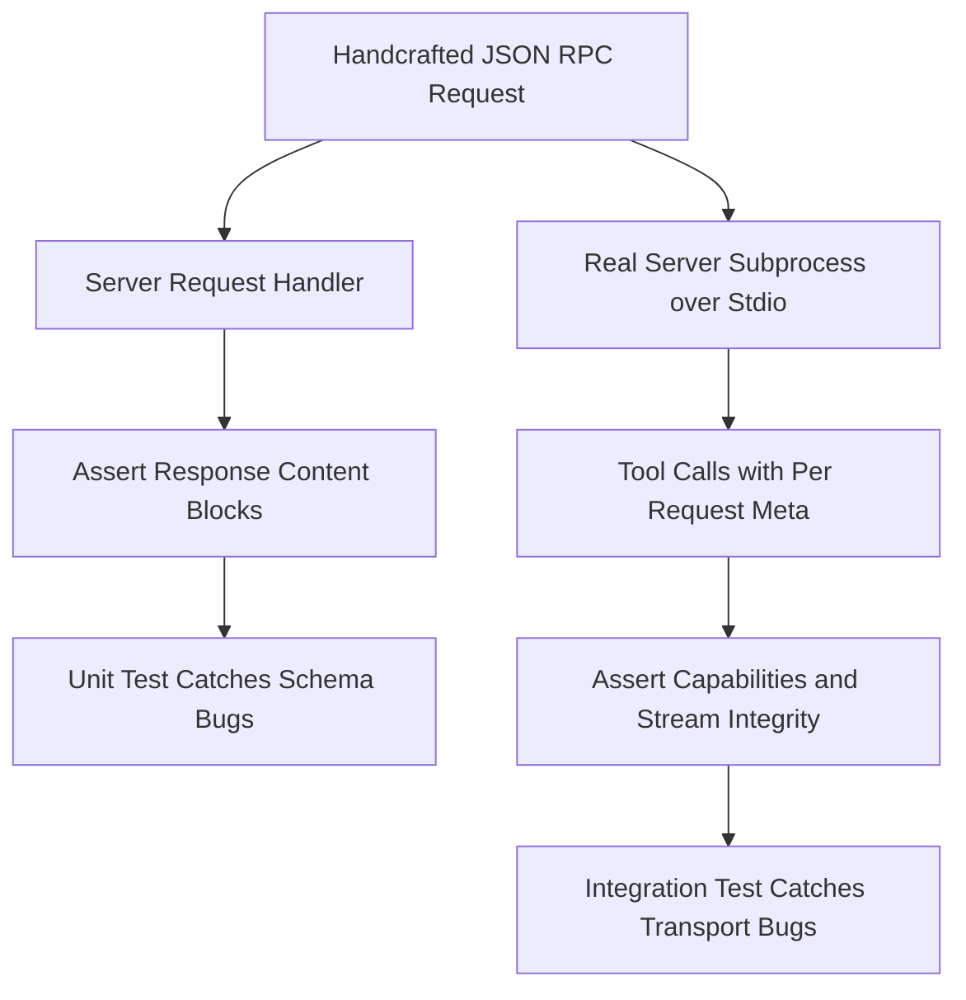

# Testing Without a Model: Mocking and Replaying MCP Conversations

## English

One of the underappreciated benefits of MCP's explicit message format is that it makes testing tractable without an actual language model in the loop. Because every interaction is a JSON-RPC message with a defined shape, you can write tests that feed synthetic requests into your server and assert on the responses, exactly as you would test an HTTP API. This is a huge shift from the world of prompt engineering, where testing often meant eyeballing outputs and hoping for the best.

The simplest testing pattern is a unit test that instantiates the server's request handler directly and calls it with a handcrafted `tools/call` request. You construct the JSON body, pass it to the handler, and assert that the response contains the expected content blocks. This catches schema violations, argument parsing bugs, and error-handling mistakes without needing to spin up a transport or a model. Many MCP SDKs expose the handler as a plain function or object precisely to make this easy.

The next level up is an integration test that runs the server as a real subprocess and communicates with it over stdio. This exercises the transport layer and the lifecycle management that a unit test skips. In the modern protocol revision (2026-07-28) there is no handshake to perform at all — the protocol is stateless and the version and capabilities ride along in each request's `_meta` metadata — so you start the server and send tool calls directly, optionally issuing `server/discover` first if you want to enumerate its tools. Only servers built against the legacy revisions (2025-11-25 and earlier) require the `initialize` request followed by the `notifications/initialized` notification, so a test suite targeting a legacy-era server must still send those two messages, while a dual-era server accepts either style. This catches problems like a server that never reports its capabilities, or one that writes stray output to stdout and corrupts the JSON-RPC stream. A common gotcha: any `console.log` in a stdio server will break the protocol, so integration tests that fail mysteriously are often revealing exactly that bug.

Beyond raw request-response testing, there is the technique of recording and replaying conversations. You capture a real session's JSON-RPC traffic, save it as a fixture, and then in tests replay the client-to-server messages and compare the server's responses against the recorded ones. This is powerful for regression testing: when you change a tool's implementation, you can see exactly which recorded conversations now diverge. It is essentially golden-file testing applied to protocol traffic. The caveat is that responses containing timestamps, random IDs, or external data need to be normalized before comparison, or the test will fail for the wrong reasons.

Finally, there is the question of testing the model's behavior, not just the server's. You cannot easily unit-test a language model, but you can test the tool descriptions and schemas that the model will see. A useful pattern is to write tests that assert on the shape of the tool list: that every tool has a description, that every description mentions when the tool should and should not be used, that argument names are consistent across related tools. These are not tests of the model, but they are tests of the inputs that most strongly shape the model's behavior, and they catch a surprising number of usability problems before a single token is generated.

## 中文

MCP 明確的訊息格式有個被低估的好處：它讓測試變得可處理，而不需要把真正的語言模型放進迴圈。因為每次互動都是形狀已定義的 JSON-RPC 訊息，你可以寫測試，把合成請求餵進伺服器並對回應做斷言，就像測試 HTTP API 一樣。這與提示工程的世界相比是巨大轉變，那裡測試往往意味著用眼睛看輸出然後祈禱一切順利。

最簡單的測試模式是單元測試：直接實例化伺服器的請求處理器，並用親手打造的 `tools/call` 請求呼叫它。你建構 JSON 主體、傳給處理器，然後斷言回應包含預期的 content block。這能抓到 schema 違規、參數解析 bug 和錯誤處理失誤，而不需要啟動 transport 或模型。許多 MCP SDK 正是把處理器暴露為普通函式或物件，好讓這件事變容易。

再上一層是整合測試：把伺服器當成真正的子程序執行，透過 stdio 與它溝通。這會演練 transport 層，以及單元測試跳過的生命週期管理。在現代協定修訂版（2026-07-28）之中，完全沒有握手要做——協定是無狀態的，版本與 capabilities 隨每次請求的 `_meta` metadata 一起傳送——所以你啟動伺服器後可以直接送出工具呼叫；如果想列出它的工具，可以先發出 `server/discover`。只有針對舊版修訂（2025-11-25 及更早）建構的伺服器才需要 `initialize` 請求，之後再加上 `notifications/initialized` 通知，所以針對舊版年代伺服器的測試套件仍然必須送出這兩則訊息，而同時支援兩個年代的伺服器則兩種風格都接受。這能抓到像伺服器從不回報 capabilities，或把雜訊寫到 stdout 而破壞 JSON-RPC 串流的問題。常見陷阱：stdio 伺服器裡任何 `console.log` 都會破壞協定，所以神祕失敗的整合測試往往正是在揭露這個 bug。

除了原始的請求-回應測試，還有錄製與重播對話的技巧。你擷取真實會話的 JSON-RPC 流量、存成 fixture，然後在測試中重播 client 到 server 的訊息，並把伺服器的回應與錄製的比對。這對回歸測試很強大：當你改動某個工具的實作，你可以確切看到哪些錄製的對話現在出現分歧。這基本上是把黃金檔案測試套用到協定流量上。注意事項是：含時間戳、隨機 ID 或外部資料的回應必須先正規化再比較，否則測試會因為錯誤的理由失敗。

最後，還有測試模型行為而不只是伺服器的問題。你無法輕易對語言模型做單元測試，但你可以測試模型會看到的工具描述與 schema。一個有用的模式是寫測試斷言工具清單的形狀：每個工具都有描述、每個描述都提到工具何時該用與何時不該用、相關工具的參數名稱一致。這些不是對模型的測試，而是對最強烈形塑模型行為的輸入的測試，而且它們能在生成任何一個 token 之前抓到數量驚人的可用性問題。

## Key Takeaway

Because MCP traffic is structured JSON-RPC, you can unit-test handlers, integration-test over stdio, and replay recorded sessions as golden files, catching protocol bugs that prompt-based testing would miss.

## Related Concepts
- Golden-file regression testing
- stdio transport pitfalls

## Diagram

