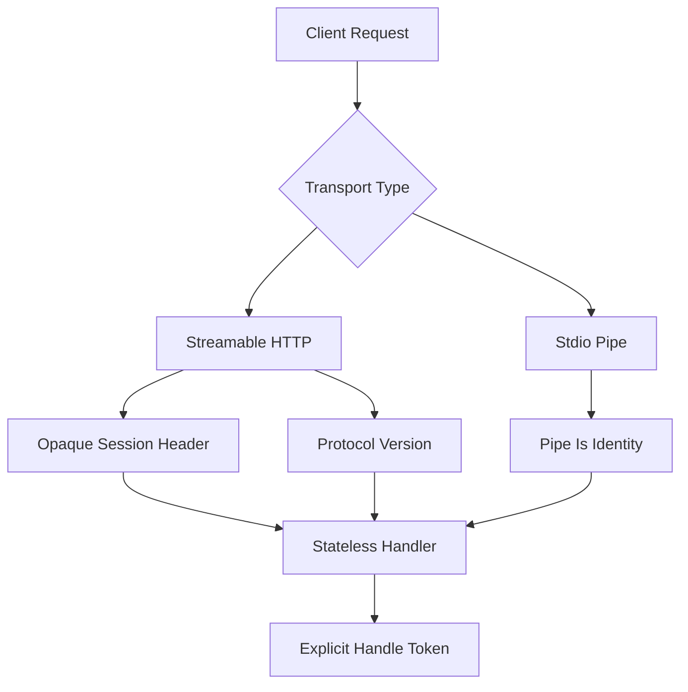

# Statelessness and Session Identity: Who Is the Server Actually Talking To?

## English

One of the quiet design tensions in MCP is that the protocol itself has no built-in notion of a user. JSON-RPC messages carry an id, a method, and params, but nothing that says "this is Alice's request." In the stdio transport this is invisible because a single client process spawns a single server child process — the pipe itself is the identity. The moment you move to a remote transport such as Streamable HTTP, that assumption breaks: many clients may hit one server, connections may be re-established, and requests may be retried after a network blip. The server has to decide whether a given call is a continuation of an existing logical session or a brand-new one, and the protocol gives it only the tools the transport exposes — typically an opaque session identifier passed as an HTTP header and a negotiated protocol version from the initialize handshake.

The practical consequence is that MCP servers are, by default, stateless request handlers. Each tools/call should be answerable without assuming anything carried over from a previous call, because the host is free to reconnect, retry, or fan out to a different server instance behind a load balancer. If a tool genuinely needs state — an open file handle, a paused transaction, a multi-step wizard — the server has to make that state explicit and addressable, for example by returning a handle or token the model can pass back on the next call. That turns implicit session memory into data the model can see and reason about, which is far more robust than hidden server-side maps keyed on connection identity.

A useful analogy is a web API versus a terminal session. A terminal session remembers your working directory, your environment variables, your shell history. A stateless HTTP API remembers nothing; every request must carry everything it needs. MCP servers that want to scale behind a load balancer must behave like the HTTP API, not the terminal. This is why session identifiers in MCP are best treated as routing hints rather than as authentication: knowing a session id tells the server which logical conversation a request belongs to, not who is allowed to make it. Conflating the two is a classic source of confused-deputy bugs, where one user's credentials end up applied to another user's request.

There is also a subtler issue around re-initialization. The initialize handshake negotiates capabilities and protocol version, and a well-behaved client re-runs it on every fresh connection. But a server that caches negotiated capabilities under a session id must be careful: if the client reconnects with a different set of capabilities (say, it lost the ability to handle sampling), the server must not keep routing server-to-client requests down a channel that no longer exists. The clean mental model is that the negotiated state lives on the connection, and the connection is disposable. Anything you want to survive a reconnect must be persisted elsewhere and re-established explicitly.

Finally, statelessness shapes how you design tool semantics. A tool that mutates the world — creating a ticket, sending an email — should be safe to retry, either because it is naturally idempotent or because it accepts a client-supplied idempotency key. A tool that reads should not depend on a previous tool having been called first unless that dependency is expressed as an explicit argument. When you design an MCP server, ask yourself: if every request arrived at a randomly chosen instance of my server with no memory of the last one, would my tools still work? If the answer is no, the state needs to move out of the server and into the conversation.

## 中文

MCP 其中一個不太顯眼的設計張力，是協議本身並無內建「使用者」的概念。JSON-RPC 訊息只帶 id、method 同 params，並無任何欄位講明「呢個係 Alice 嘅請求」。喺 stdio 傳輸之下，呢件事係睇唔到嘅，因為一個客戶端程序只會生出一個伺服器子程序——條管道本身就係身分。但一轉去遠端傳輸（例如 Streamable HTTP），呢個假設即刻崩塌：多個客戶端可能打同一個伺服器，連線可能重新建立，請求可能喺網絡抖動之後被重試。伺服器要判斷某個呼叫係現有邏輯工作階段嘅延續，抑或係全新嘅一個，而協議只係畀佢傳輸層提供嘅工具——通常係一個不透明嘅工作階段識別碼，透過 HTTP 標頭傳遞，再加上 initialize 握手時協商出嚟嘅協議版本。

實際後果係：MCP 伺服器預設係無狀態嘅請求處理器。每個 tools/call 都應該喺唔假設任何前一次呼叫遺留狀態嘅情況下答得出，因為宿主隨時可以重連、重試，或者將請求分散到負載平衡器後面另一個伺服器實例。如果某個工具真係需要狀態——例如開啟咗嘅檔案句柄、暫停咗嘅交易、多步驟精靈——伺服器就要將嗰個狀態明確化同可定址化，例如回傳一個句柄或者權杖，等模型可以喺下一次呼叫時傳返嚟。咁樣就將隱含嘅工作階段記憶變成模型睇得見、推理得到嘅資料，遠比隱藏喺伺服器內部、以連線身分做鍵嘅對照表穩健。

一個好用嘅類比係 Web API 對比終端機工作階段。終端機工作階段會記住你嘅工作目錄、環境變數、shell 歷史；無狀態嘅 HTTP API 乜都唔記，每個請求都要自帶一切所需。想喺負載平衡器後面擴展嘅 MCP 伺服器，就必須表現得像 HTTP API，而唔係終端機。呢個亦解釋咗點解 MCP 嘅工作階段識別碼最好當成路由提示，而唔係認證：知道一個工作階段 id，只係話畀伺服器知呢個請求屬於邊個邏輯對話，並唔係話佢知邊個有權發出呢個請求。將兩者混為一談，就係典型嘅「糊塗代理人」漏洞來源——一個使用者嘅憑證被套用到另一個使用者嘅請求上面。

仲有一個更細微嘅問題，圍繞重新初始化。initialize 握手會協商能力同協議版本，行為良好嘅客戶端每次新連線都會重跑一次。但一個以工作階段 id 快取咗協商能力嘅伺服器就要小心：如果客戶端重連時能力集合唔同咗（例如佢已經無能力處理 sampling），伺服器就唔可以繼續將伺服器對客戶端嘅請求，送落一條已經唔存在嘅通道。最乾淨嘅心智模型係：協商出嚟嘅狀態住喺連線上面，而連線係即用即棄嘅。任何你想捱過重連嘅嘢，都要喺其他地方持久化，再明確噉重新建立。

最後，無狀態性會塑造你點設計工具語意。會改變世界嘅工具——開單、寄電郵——應該可以安全重試，一係因為佢天然冪等，一係因為佢接受客戶端提供嘅冪等鍵。讀取類工具就唔應該依賴之前有冇呼叫過另一個工具，除非呢個依賴以明確參數表達出嚟。設計 MCP 伺服器時，問自己一句：如果每個請求都隨機落喺我伺服器嘅某個實例、對上一個請求毫無記憶，我嘅工具仲運作唔運作？如果答案係否，咁啲狀態就要搬出伺服器，搬入對話裡面。

## Key Takeaway

MCP has no built-in user identity, so servers should treat connections as disposable and make any needed state explicit in arguments rather than hidden in session memory.

## Related Concepts
- Streamable HTTP transport
- Idempotency keys

## Diagram

