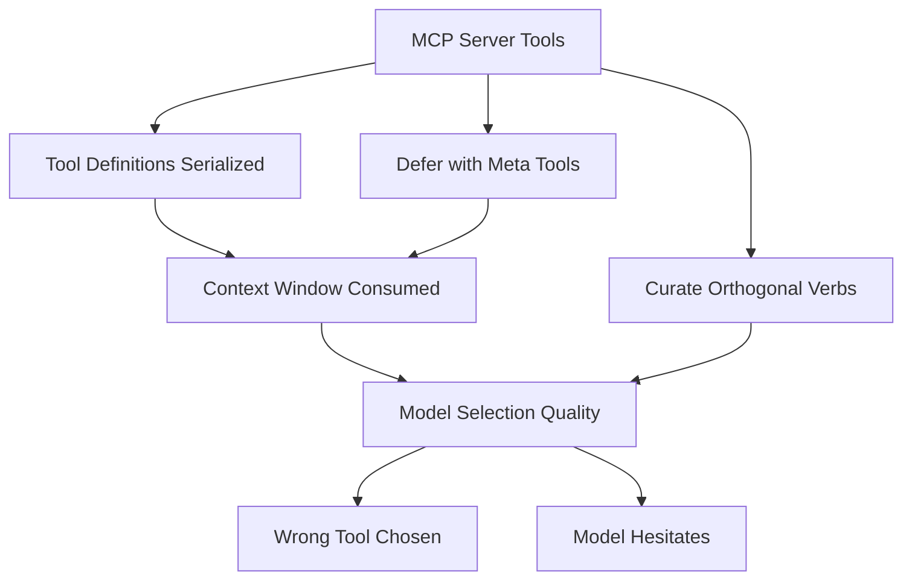

# The Tool Surface as a Budget: Curating What the Model Can See

## English

Every MCP tool you expose costs something before it is ever called. Tool definitions — name, description, and JSON Schema for arguments — are serialised into the model's context on every turn where tool use is enabled. That means a server exposing fifty tools with verbose schemas can quietly consume thousands of tokens of context before the user has typed a single word. This is the flip side of the convenience that MCP offers: the protocol makes it trivial to plug in another server, and therefore trivial to bloat the tool surface until the model is drowning in options and the context window is full of definitions rather than the actual task.

The problem is not only token cost but selection quality. Language models pick tools by reading descriptions, and the more similar tools there are, the more likely the model picks the wrong one or hesitates between two near-duplicates. A server with search_users, find_user, lookup_user, and get_user_by_email is actively harming the model's accuracy, even if each tool is individually well-written. The classic remedy is to expose a small, orthogonal set of verbs — one way to do each thing — and to push variability into arguments rather than into separate tools. If a tool needs a mode switch, an enum argument is almost always better than three sibling tools.

A second lever is deferral. Not every tool needs to be visible at all times. Hosts can implement progressive disclosure: expose a tiny set of meta-tools such as list_tools and describe_tool, let the model discover what exists, and only then load the full schema for the one tool it wants to use. This trades an extra round trip for a much smaller baseline context, and it works well when a server fronts a large, heterogeneous API where most tools are irrelevant to any given conversation. The trade-off is latency and an extra failure mode — the model has to correctly decide to go looking — so it suits broad catalogues more than a handful of hot-path tools.

A third lever is schema discipline. JSON Schema is expressive, and it is tempting to write exhaustive validation with nested objects, oneOf branches, and long descriptions on every field. But every character of that schema is paid for on every turn. Practical rules of thumb: keep descriptions to one or two sentences that state when to use the tool, not how it is implemented; prefer flat argument objects over deeply nested ones; use enums instead of free-text where the set of values is small and known; and put examples in the description rather than in a giant schema. If a tool takes a complex structured payload, consider accepting a string that the server parses, or splitting into a prepare/commit pair, rather than encoding the whole grammar in JSON Schema.

Finally, think about the lifecycle of the tool surface itself. Tools that are only relevant to a narrow phase of a task — a deployment tool, a migration tool — do not need to be resident for the whole conversation. Some hosts allow servers to be attached and detached mid-session, and some servers expose tools conditionally based on what the user has enabled. Treating the tool list as something you curate over the life of a session, rather than something you dump once at startup, is the difference between a server that feels sharp and one that feels like a cluttered toolbar. The measure of a good MCP server is not how many tools it has, but how few the model needs to see to get the job done.

## 中文

你暴露嘅每一個 MCP 工具，喺未被呼叫之前就已經有成本。工具定義——名稱、描述、參數嘅 JSON Schema——會喺每一個啟用工具使用嘅回合，被序列化入模型嘅上下文。即係話，一個暴露五十個工具、個個 schema 都冗長嘅伺服器，可以喺使用者未打一個字之前，就靜靜雞食咗幾千個 token 嘅上下文。呢個就係 MCP 帶嚟嘅便利嘅另一面：協議令你插多一個伺服器易如反掌，因此亦令工具表面膨脹易如反掌，膨脹到模型淹沒喺選項之中，上下文窗口塞滿定義而唔係真正嘅任務。

問題唔止係 token 成本，仲有選擇質素。語言模型係靠讀描述嚟揀工具，相似工具越多，模型揀錯、或者喺兩個幾乎一樣嘅工具之間猶豫嘅機會就越大。一個伺服器同時有 search_users、find_user、lookup_user 同 get_user_by_email，就算每個工具本身寫得幾好，都係喺度主動損害模型嘅準確度。經典嘅補救方法係暴露一組細小、互相正交嘅動詞——每件事只有一種做法——然後將變化推入參數，而唔係開多幾個工具。如果一個工具需要模式切換，用 enum 參數幾乎永遠好過開三個兄弟工具。

第二個槓桿係延後揭露。唔係每個工具都需要無時無刻可見。宿主可以實施漸進式揭露：先暴露一小撮元工具，例如 list_tools 同 describe_tool，等模型自己去探索有咩存在，然後先至載入佢想用嗰個工具嘅完整 schema。呢個做法用多一次來回，換嚟細好多嘅基準上下文，對於一個背後駁住大型異質 API、大部分工具同當前對話無關嘅伺服器尤其有效。代價係延遲同多一個失敗模式——模型要正確噉決定去搵——所以佢適合大目錄，多過適合幾個熱路徑工具。

第三個槓桿係 schema 紀律。JSON Schema 表達力強，好容易就想寫出帶嵌套物件、oneOf 分支、每個欄位都長篇描述嘅完備驗證。但 schema 嘅每一個字元，都係每個回合都要找數。實用嘅經驗法則：描述控制在一兩句，講明幾時用呢個工具，而唔係佢點實作；參數物件寧願扁平，唔好深層嵌套；數值集合細小而且已知嘅地方，用 enum 代替自由文字；例子放喺描述度，而唔係塞入巨型 schema。如果工具要收複雜嘅結構化負載，可以考慮收一個由伺服器自己解析嘅字串，或者拆成 prepare/commit 兩步，而唔係將整套文法編碼入 JSON Schema。

最後，要諗埋工具表面本身嘅生命週期。只喺任務某個狹窄階段先相關嘅工具——部署工具、遷移工具——唔需要成個對話都常駐。有啲宿主容許喺工作階段中途掛載同卸載伺服器，有啲伺服器會根據使用者啟用咗啲乜嘢，條件性噉暴露工具。將工具清單視為一件喺工作階段生命週期內持續策展嘅事，而唔係開機時一次過倒出嚟嘅嘢，就係一個伺服器感覺利落、定係感覺似塞滿雜物嘅工具列嘅分別。衡量一個好 MCP 伺服器嘅標準，唔係佢有幾多工具，而係模型要睇幾少工具就搞得掂。

## Key Takeaway

Tool definitions are paid for in context on every turn, so a good MCP server exposes a small, orthogonal, well-described surface rather than a sprawling catalogue.

## Related Concepts
- JSON Schema design
- Progressive tool disclosure

## Diagram

