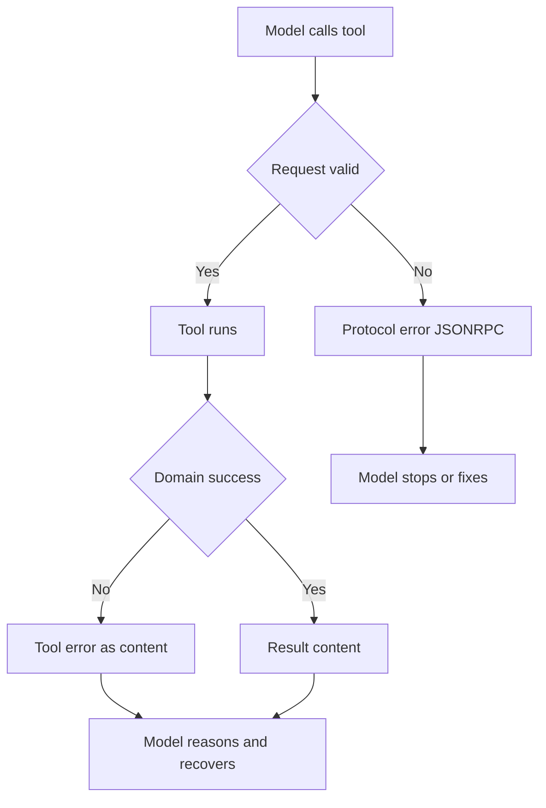

# Failure Is a First-Class Result: Designing Tools That Fail Usefully

## English

Most discussions of MCP tools focus on the happy path: the model calls the tool, the tool returns data, the model continues. But in production, a large fraction of tool calls fail — the file does not exist, the API returns a 429, the query times out, the user's argument was malformed. How a server reports those failures determines whether the model can recover gracefully or whether it flails, retries blindly, or hallucinates a success. The single most important distinction to get right is between a protocol error and a tool error, because they mean completely different things to the model.

A protocol error is a JSON-RPC error: the request itself was malformed, the method does not exist, the server crashed, the arguments did not match the declared schema. These are failures of the machinery, and the host typically surfaces them as such — the model sees that the call did not go through. A tool error, by contrast, is a successful JSON-RPC response whose content describes a failure in the domain: the record was not found, the permission was denied, the input was rejected by the downstream service. The distinction matters because a protocol error usually means "do not retry, something is structurally wrong," whereas a tool error is information the model can reason about and act on. If you return a JSON-RPC error for "user not found," the model may interpret it as a broken tool and give up; if you return it as tool content, the model can try a different search or ask the user for clarification.

A second principle is that error messages should be actionable rather than merely accurate. "400 Bad Request" is accurate and useless. "The date must be in ISO 8601 format, e.g. 2024-03-15; you passed 'March 15'" tells the model exactly what to fix. Where possible, include the offending value, the expected shape, and a hint about the next step. This is prompt engineering in the same sense as tool descriptions: the error text is read by a language model, not just by a human developer, so it should be written for that reader. Avoid stack traces, internal identifiers, and vendor-specific jargon unless they genuinely help the model decide what to do next.

A third principle is to make partial failure representable. Real operations rarely fail cleanly. A batch import may process forty of fifty records; a multi-file edit may succeed on three files and fail on one. If your tool reports only success or failure, the model loses the information it needs to continue sensibly. Structured results — for example a content block containing a JSON object with counts of succeeded and failed items, plus per-item error details — let the model decide whether to retry the failures, report to the user, or roll back. The same logic applies to warnings: an operation can succeed while producing a caveat the user should see, and burying that in a log the model never reads is a missed opportunity.

Finally, consider whether a failure should be retryable and say so. Transient failures — rate limits, timeouts, temporary unavailability — benefit from an explicit signal, such as a retry-after hint or a boolean is_retryable field, so the model does not waste turns retrying a permanent error or give up on a temporary one. Permanent failures — validation errors, permission denials, missing resources — should be marked as such. Combined with idempotency, this turns error handling from guesswork into a contract. The best MCP servers treat failure as a designed output, as carefully shaped as any success payload, because in practice the model spends a surprising amount of its time recovering from things that did not work.

## 中文

大部分關於 MCP 工具嘅討論都集中喺順利路徑：模型呼叫工具、工具回傳資料、模型繼續。但喺生產環境，好大比例嘅工具呼叫都會失敗——檔案唔存在、API 回 429、查詢逾時、使用者嘅參數格式錯。伺服器點樣報告呢啲失敗，決定咗模型能唔能夠優雅噉恢復，抑或亂咁撞、盲目重試、甚至憑空編出一個成功。最關鍵要分清楚嘅，係協議錯誤同工具錯誤嘅分別，因為佢哋對模型嘅意義完全唔同。

協議錯誤係 JSON-RPC 錯誤：請求本身格式錯、方法唔存在、伺服器崩潰、參數唔符合宣告咗嘅 schema。呢啲係機器層面嘅失敗，宿主通常會照樣呈現——模型見到個呼叫根本冇通到。相反，工具錯誤係一個成功嘅 JSON-RPC 回應，只不過內容描述咗領域層面嘅失敗：記錄搵唔到、權限被拒、輸入被下游服務拒絕。呢個區分重要，因為協議錯誤通常代表「唔好重試，有啲結構性嘢錯咗」，而工具錯誤係模型可以推理、可以據此行動嘅資訊。如果你將「使用者唔存在」當成 JSON-RPC 錯誤回傳，模型可能理解成工具壞咗而放棄；如果你當成工具內容回傳，模型就可以試另一個搜尋，或者問使用者澄清。

第二個原則係：錯誤訊息要可操作，而唔止係準確。「400 Bad Request」準確但冇用。「日期必須係 ISO 8601 格式，例如 2024-03-15；你傳咗『3月15日』」就清楚話畀模型知要改乜。可行嘅話，附上出錯嘅值、預期嘅形狀，同下一步嘅提示。呢個同工具描述一樣係提示工程：錯誤文字係畀語言模型讀嘅，唔止畀人類開發者讀，所以要為嗰個讀者而寫。避免堆疊追蹤、內部識別碼、供應商專有術語，除非佢哋真係幫到模型決定下一步點做。

第三個原則係令部分失敗可以被表達。真實操作好少會乾淨利落噉失敗。批量匯入可能處理咗五十筆之中嘅四十筆；多檔案編輯可能三個成功、一個失敗。如果工具只報告成功或失敗，模型就失去咗繼續理性行動所需嘅資訊。結構化結果——例如一個內容區塊，入面係一個 JSON 物件，有成功同失敗項目嘅數目，再加逐項錯誤詳情——就畀模型決定係重試失敗嗰啲、向使用者報告、定係回滾。同樣道理適用於警告：一個操作可以成功，但同時產生一個使用者應該見到嘅注意事項，將佢埋喺模型永遠唔會讀嘅日誌度，就係浪費咗機會。

最後，要諗清楚一個失敗應唔應該重試，並且講明。暫時性失敗——限流、逾時、短暫無法使用——受益於明確訊號，例如 retry-after 提示或者一個 is_retryable 布林欄位，等模型唔會浪費回合去重試一個永久錯誤，或者對一個臨時錯誤提早放棄。永久性失敗——驗證錯誤、權限拒絕、資源唔存在——就應該標明係永久。配合冪等性，呢個就將錯誤處理由靠估變成一份合約。最好嘅 MCP 伺服器會將失敗當成一個有設計嘅輸出，同任何成功負載一樣用心雕琢，因為實際上，模型花咗唔少時間喺度從做唔成嘅事之中恢復。

## Key Takeaway

Distinguish protocol errors from domain-level tool errors, make error messages actionable, and represent partial failure structurally so the model can recover instead of guessing.

## Related Concepts
- JSON-RPC error objects
- Structured tool results

## Diagram

