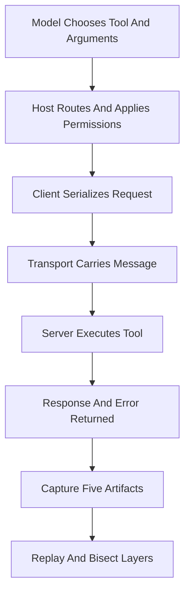

# Debugging Across the Model-Server Gap: Attribution When a Tool Call Goes Wrong

## English

When an MCP tool call produces a bad outcome, the hardest question is often not 'what broke?' but 'which layer broke?'. A failure can originate in the model's choice of tool and arguments, in the host's routing and permission logic, in the client's serialization, in the transport, or in the server's own implementation. Each layer has its own vocabulary of errors, and a symptom visible at one layer frequently has its root cause two layers away. A model that 'refuses to use a tool' might actually be receiving a malformed schema; a server that 'returns empty results' might be getting arguments that were silently truncated by a length limit in the host.

The practical discipline is to capture a complete, replayable record of each interaction: the exact tool list presented to the model, the model's raw tool-call request (tool name plus arguments), the request as serialized on the wire, the server's response including any structured error, and the final content block handed back to the model. Because MCP messages are JSON-RPC 2.0, the request id ties a response back to its request, which makes it possible to correlate logs across the host, client, and server even when they run in separate processes. Keeping those five artifacts lets you replay a conversation deterministically against a mock server and bisect where behavior diverges.

A useful mental model is differential diagnosis. Change one variable at a time: replay the same arguments against the real server (does it still fail?), then against a stub that returns a known-good response (does the model now behave?). If the model behaves with the stub but not the real server, the problem is in the server's output shape; if it misbehaves with both, the problem is in the schema or description the model sees. This is the same logic as bisecting a regression, applied to a pipeline with a non-deterministic component in the middle.

Non-determinism complicates everything. The same prompt and tool list can yield different tool choices across runs, so a single failure is weak evidence. Run the scenario several times and record the distribution of outcomes rather than treating one bad trace as definitive. If a tool is chosen correctly 90% of the time, the bug may be in the description's ambiguity rather than in any code path. Separating 'flaky because the model is stochastic' from 'flaky because the server is intermittent' requires logging timestamps and latencies on both sides.

Finally, build the debugging harness before you need it. A small script that records every request and response to a file, plus a fixture set of representative conversations, turns a mysterious production complaint into a reproducible test case. The goal is not to eliminate the model's unpredictability but to make every other layer boringly deterministic, so that when something goes wrong you can point at exactly one layer with confidence.

## 中文

當一個 MCP 工具呼叫產生壞結果時，最難的問題往往不是「邊度壞咗？」，而是「邊一層壞咗？」。故障可以源自模型對工具同參數嘅選擇、host 嘅路由同權限邏輯、client 嘅序列化、transport，或者 server 自身嘅實作。每一層都有自己嘅錯誤詞彙，而喺某一層見到嘅病徵，根源經常喺隔兩層嘅地方。一個「唔肯用某個工具」嘅模型，可能其實係收到咗格式錯誤嘅 schema；一個「回傳空結果」嘅 server，可能係收到被 host 長度限制靜靜截斷咗嘅參數。

實際嘅紀律，係為每次互動擷取一份完整、可重播嘅紀錄：呈俾模型嘅確切工具清單、模型原始嘅工具呼叫請求（工具名加參數）、喺 wire 上序列化後嘅請求、server 嘅回應（包括任何結構化錯誤），以及最後交返俾模型嘅 content block。因為 MCP 訊息係 JSON-RPC 2.0，request id 會將回應綁返去佢嘅請求，所以即使 host、client、server 跑喺唔同 process，都可以將日誌對應返。保留呢五件 artifact，就可以用 mock server 確定性地重播對話，再用二分法搵出行為喺邊度分岔。

一個好用嘅心智模型係「鑑別診斷」。每次只改一個變數：先用同一組參數打真 server（仲會唔會失敗？），再用一個回傳已知良好回應嘅 stub 打（模型而家行為正常未？）。如果配 stub 正常但配真 server 唔正常，問題就喺 server 嘅輸出形狀；如果兩者都唔正常，問題就喺模型見到嘅 schema 或描述。呢個邏輯同 bisect 一個 regression 一樣，只係套用喺一條中間有個非確定性元件嘅 pipeline 上面。

非確定性令一切更複雜。同一個 prompt 同工具清單，每次跑都可能揀唔同工具，所以單一次失敗係弱證據。將情境跑幾次，記錄結果分佈，而唔係將一條壞 trace 當成鐵證。如果某工具九成時間都揀得啱，bug 可能喺描述嘅含糊，而唔係任何 code path。要分開「因為模型隨機所以 flaky」同「因為 server 間歇所以 flaky」，就要兩邊都記錄時間戳同延遲。

最後，喺你需要之前就建好 debug harness。一個將每個請求同回應寫落檔案嘅細 script，加一組有代表性對話嘅 fixture，就可以將神秘嘅生產投訴變成可重現嘅測試個案。目標唔係消除模型嘅不可預測性，而係令其餘每一層都無聊地確定，咁樣出問題嗰陣，你就可以信心十足咁指住唯一一層。

## Key Takeaway

Debug MCP failures by capturing a replayable record at every layer and bisecting one variable at a time, because the symptom you see is rarely in the layer that caused it.

## Related Concepts
- JSON-RPC 2.0 request-id correlation
- differential diagnosis via mock servers

## Diagram

