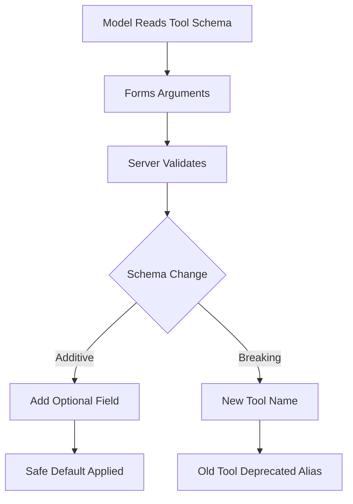

# Schema Evolution Without Breaking the Model: Changing Tool Contracts Safely

## English

An MCP tool's input schema is a published contract: the model reads it, forms arguments from it, and the server validates against it. Unlike a human-facing API where clients can read changelogs, the 'client' here is a language model that has no memory of your previous version and no ability to negotiate. When you change a tool's schema, you are changing the interface that the model reasons about at inference time. This makes schema changes unusually risky: a renamed field does not raise a compile error, it silently degrades into 'the model passes the old name and the server rejects it', or worse, the model omits the field entirely and the tool does something unexpected with a default.

The safest evolution strategy is additive and tolerant. Adding an optional field with a clear description is nearly always safe, because models that do not know about it simply omit it and the server applies a default. Removing a field, renaming one, or changing a type from string to integer is breaking, because the model's prior of 'what this tool looks like' is baked into the description it reads at call time, and any cached examples or fine-tuning data may reflect the old shape. When you must break, the standard technique is to introduce a new tool name (for example, a versioned variant) and keep the old one as a deprecated alias that either forwards to the new implementation or returns a structured error explaining the migration.

Descriptions matter as much as structure. If you add a required field, the description must explain why it exists and give an example value, because a model with no context will otherwise guess. If a field's meaning narrows (say, a date format changes from 'any parseable string' to strictly ISO 8601), that is a semantic break even though the JSON type is unchanged, and it deserves an explicit note in the description plus server-side validation that returns a helpful error rather than a stack trace. Error messages are part of the contract too: a server that says 'invalid date, expected YYYY-MM-DD' teaches the model to retry correctly, while one that says 'validation failed' teaches it nothing.

Versioning the server as a whole is a blunter instrument. MCP's initialize handshake negotiates protocol version, not your tool's version, so bumping your server's semantic version does not automatically tell the model anything. The practical approach is to treat tool names and descriptions as the versioned surface: if you must change behavior incompatibly, do it under a new name, document the old name as deprecated in its description, and monitor whether the old name is still being called before removing it. This mirrors how public APIs deprecate endpoints, adapted to a consumer that cannot read a migration guide.

A useful test is the 'cold model' test: hand the new schema to a model with no other context and ask it to produce arguments for three representative tasks. If it consistently produces valid arguments, the schema is self-describing enough. If it guesses, omits required fields, or picks wrong types, the problem is in the description, not the model. Run this test on every schema change, and keep a small suite of such probes as regression tests, because the cost of a confusing schema is paid on every single call, not just at migration time.

## 中文

一個 MCP 工具嘅 input schema 係一份公開合約：模型會讀佢、根據佢砌參數，而 server 會根據佢驗證。同面向人類嘅 API 唔同——人類 client 可以讀 changelog——呢度嘅「client」係一個語言模型，佢唔記得你上一個版本，亦冇能力協商。當你改一個工具嘅 schema，你改嘅係模型喺推論時推理嘅介面。呢點令 schema 改動異常高風險：改個欄位名唔會拋編譯錯誤，而係靜靜退化為「模型傳舊名、server 拒絕」，或者更差：模型索性漏咗個欄位，工具就用預設值做咗啲意想不到嘅事。

最安全嘅演進策略係加法式同包容式。加一個有清晰描述嘅可選欄位幾乎永遠安全，因為唔知佢存在嘅模型會直接漏咗佢，server 就套用預設值。刪欄位、改名、或者將型別由 string 改做 integer 就係破壞性嘅，因為模型「呢個工具係咩樣」嘅先驗，係喺呼叫時讀到嘅描述度形成，而任何快取咗嘅範例或者微調資料都可能反映舊形狀。真係要破壞時，標準做法係引入新工具名（例如一個有版本嘅變體），保留舊名做已棄用別名，佢要麼轉發去新實作，要麼回傳一個解釋遷移嘅結構化錯誤。

描述同結構一樣重要。如果你加一個必填欄位，描述必須解釋佢為何存在並俾個範例值，否則冇上下文嘅模型只會靠估。如果一個欄位嘅意思收窄（例如日期格式由「任何可解析字串」變成嚴格 ISO 8601），即使 JSON 型別冇變，呢個都係語意上嘅破壞，值得喺描述度明確註明，加埋 server 端驗證回傳有幫助嘅錯誤而唔係 stack trace。錯誤訊息都係合約嘅一部分：一個講「invalid date, expected YYYY-MM-DD」嘅 server 教識模型正確重試，而一個講「validation failed」嘅就乜都教唔到。

將成個 server 版本化係比較鈍嘅工具。MCP 嘅 initialize handshake 協商嘅係協定版本，唔係你工具嘅版本，所以升你 server 嘅 semantic version 唔會自動話俾模型知任何嘢。實際做法係將工具名同描述視為版本化表面：如果要唔兼容咁改行為，就喺新名下做，喺舊名嘅描述度標明已棄用，並且監察舊名仲有冇被呼叫，先至移除。呢個同公開 API 棄用 endpoint 嘅做法一樣，只係適應一個讀唔到遷移指南嘅消費者。

一個好用嘅測試係「冷模型測試」：將新 schema 交俾一個冇其他上下文嘅模型，叫佢為三個代表性任務產生參數。如果佢穩定地產生有效參數，schema 就夠自描述。如果佢靠估、漏必填欄位、或者揀錯型別，問題喺描述而唔喺模型。每次 schema 改動都跑呢個測試，並保留一小套咁樣嘅探針做回歸測試，因為一個令人困惑嘅 schema，代價係喺每一次呼叫度付，而唔係淨係喺遷移時付。

## Key Takeaway

Treat tool schemas as contracts read by a memoryless model: evolve additively, version by name when you must break, and probe every change with a cold-model test.

## Related Concepts
- input schema as a published contract
- deprecation aliases for tool names

## Diagram

