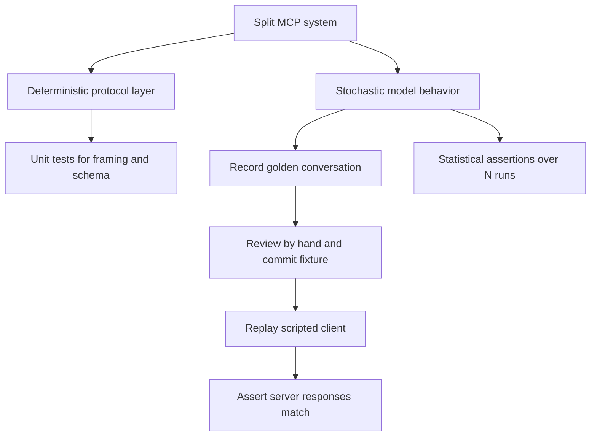

# Deterministic Fixtures and Golden Conversations: Regression Testing a Protocol Built on a Stochastic Model

## English

Testing an MCP integration is awkward because one end of the conversation is a language model. You cannot assert 'the model will call search with query X', because it might not, and a test suite that fails randomly gets ignored. The way out is to split the system into a deterministic part and a stochastic part, and test the deterministic part exhaustively while pinning the stochastic part with recorded fixtures. The protocol layer—JSON-RPC framing, schema validation, error mapping, pagination, notifications—is fully deterministic and deserves ordinary unit tests. The model's tool-selection behavior is not, and deserves a different kind of test.

A golden conversation is a recorded transcript of a complete interaction: the tool list offered, the model's tool-call requests, the server's responses, and the final assistant output. You capture it once from a real run, review it by hand to confirm it is correct, and then commit it as a fixture. From then on, a test replays the model's side from the fixture (a scripted client that emits the recorded requests) and checks that the server produces byte-identical or semantically equivalent responses. This catches regressions in the server without ever invoking a model, so the test is fast, free, and deterministic. The same technique works in reverse: a mock server replays recorded responses so you can test host-side routing and permission logic without a real backend.

For the stochastic part, statistical assertions replace exact ones. Instead of asserting that the model always calls the right tool, run the same prompt N times and assert that it calls the right tool in at least some threshold of runs, and that it never calls a forbidden tool. This turns a flaky boolean into a measured rate that you can track over time: if a description change drops correct selection from 95% to 70%, that is a real regression even though no single run 'failed'. Keep N modest (a handful of runs) so the suite stays affordable, and reserve larger runs for changes that touch descriptions or schemas.

Fixtures also need maintenance discipline. When you intentionally change a tool's schema or output shape, the golden conversation becomes stale, and the right response is to regenerate it deliberately and review the diff, not to auto-accept. A fixture that silently updates itself is worse than no fixture, because it hides exactly the changes you most want a human to see. Treat fixture diffs like code review: a changed response shape should be explainable in one sentence, or it is probably a bug.

Finally, structure tests around the failure modes you actually care about: malformed arguments, missing required fields, server timeouts, partial results, and error responses the model must interpret. Each of these is deterministic and can be tested precisely with a scripted client. The result is a test suite that is mostly fast and hermetic, with a small, clearly-labeled band of statistical tests for the model-facing behavior—so that when something breaks, you know whether it was the protocol or the prompt.

## 中文

測試一個 MCP 整合好尷尬，因為對話其中一端係語言模型。你唔可以斷言「模型一定會用 query X 呼叫 search」，因為佢可能唔會，而一個隨機失敗嘅測試套件最終會被人無視。出路係將系統拆成確定性部分同隨機性部分，確定性部分測到盡，隨機性部分就用錄製咗嘅 fixture 釘死。協定層——JSON-RPC 框架、schema 驗證、錯誤映射、分頁、通知——完全確定，值得用普通單元測試。模型嘅工具選擇行為就唔確定，值得用另一種測試。

一個 golden conversation 係一段完整互動嘅錄製逐字稿：提供咗嘅工具清單、模型嘅工具呼叫請求、server 嘅回應，同最終助理輸出。你喺一次真跑度擷取一次，人手審閱確認正確，然後 commit 做 fixture。之後，測試就由 fixture 重播模型嗰邊（一個照稿發出錄製請求嘅 scripted client），再檢查 server 產生位元相同或者語意等價嘅回應。咁樣就可以完全唔叫模型都捉到 server 嘅 regression，所以測試又快、又免費、又確定。反向都一樣：mock server 重播錄製咗嘅回應，你就可以冇真 backend 都測到 host 端嘅路由同權限邏輯。

至於隨機性部分，就用統計式斷言代替精確斷言。與其斷言模型永遠揀啱工具，不如將同一個 prompt 跑 N 次，斷言佢至少喺某個門檻比例嘅次數揀啱工具，並且永遠唔會揀禁用工具。咁就將一個 flaky 嘅布林值變成一個可以隨時間追蹤嘅比率：如果改描述令正確選擇率由 95% 跌到 70%，即使冇任何單次跑「失敗」，呢個都係真 regression。N 保持細（幾次跑）令套件負擔得起，較大規模嘅跑就留俾郁到描述或者 schema 嘅改動。

Fixture 亦需要維護紀律。當你刻意改工具 schema 或輸出形狀，golden conversation 就過時，正確反應係刻意重新產生並審閱 diff，而唔係自動接受。一個會靜靜自我更新嘅 fixture 比冇 fixture 更差，因為佢啱啱好遮住咗你最想人睇到嘅改動。將 fixture diff 當 code review 咁處理：一個改咗嘅回應形狀應該可以用一句話解釋，否則佢大概係 bug。

最後，圍繞你真正關心嘅失敗模式去組織測試：格式錯誤嘅參數、漏必填欄位、server 逾時、部分結果，同模型必須解讀嘅錯誤回應。每一個都係確定性，可以用 scripted client 精確測試。結果係一個大部分快速又封閉嘅測試套件，加一小段清楚標示、針對面向模型行為嘅統計測試——咁樣出事嗰陣，你就知係協定壞咗定係 prompt 壞咗。

## Key Takeaway

Separate the deterministic protocol layer from the stochastic model layer: test the former with recorded golden conversations and the latter with statistical rate-based assertions.

## Related Concepts
- golden conversation fixtures
- statistical assertions for non-deterministic behavior

## Diagram

