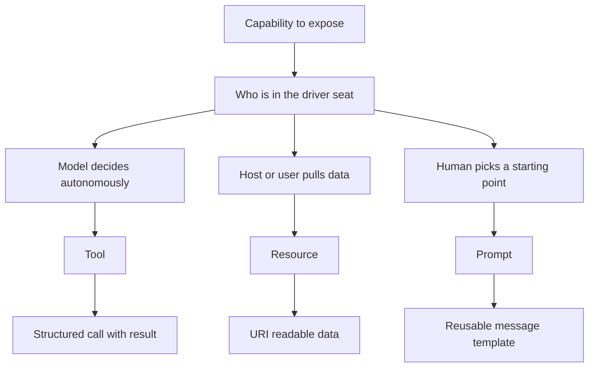

# Choosing the Right Primitive: A Decision Guide for Tool, Resource, and Prompt

## English

One of the most common design mistakes when building an MCP server is reaching for a tool when a resource or prompt would have been a better fit. The three primitives are not interchangeable; each has a different intended consumer and a different invocation model. A tool is model-controlled: the model decides when to call it, it takes structured arguments, and it produces a result the model reads back. A resource is application-controlled: it represents readable data the host can attach to the context (a file, a database row, a log excerpt), identified by a URI, and it is not something the model 'calls' in the tool sense. A prompt is user-controlled: it is a reusable template the user or host can surface, often with arguments the user fills in, and it returns a message list ready to send to a model.

A useful mental test is to ask who is in the driver's seat. If the model should decide autonomously whether to invoke this capability mid-reasoning, it is a tool. If the host or the user should decide when to pull data into the conversation, it is a resource. If a human is choosing a starting point for a task, it is a prompt. For example, 'read the current contents of config.yaml' is naturally a resource, while 'rewrite config.yaml to add a timeout field' is a tool. A prompt might be 'review this pull request' with an argument for the PR number.

There is a subtlety: the same underlying capability can often be modelled more than one way. You could expose a file as both a resource (readable, host-attached) and a tool (read_file(path)) so the model can fetch it on demand. This duplication is legitimate when the two access paths serve different consumers, but it costs context budget and adds surface area. The design question becomes: does the model need to discover this on its own, or is this something the application should curate?

Another consideration is discoverability and safety. Resources are typically listed to the host, which can present them in a UI; tools are listed to the model, which must reason about when to use them. Prompts are surfaced to humans. If you mislabel a destructive action as a prompt, you may hide it from the model that needed it; if you mislabel slow, side-effecting work as a resource, you may break the expectation that resources are cheap to read. Mismatches between primitive and semantics create friction that shows up as confused tool selection or wasted context.

A practical heuristic: design resources for the 'what exists' layer (the data the application knows about), tools for the 'what can change' layer (actions with effects or computation), and prompts for the 'what should I do' layer (curated workflows). When in doubt, prototype with a tool first because it is the most flexible, then demote stable read-only access to a resource once you understand the access pattern. Document the choice in your server's README so future maintainers do not re-litigate it.

## 中文

建立 MCP 伺服器時，最常見的設計錯誤之一，就是在應該用 resource 或 prompt 的時候用了 tool。這三個 primitive 並非可以互換；每個都有不同的預期使用者和不同的呼叫模式。Tool 是由模型控制：模型自行決定何時呼叫，它接受結構化參數，並產生模型會讀回的結果。Resource 是由應用程式控制：它代表主機可以附加到 context 的可讀資料(檔案、資料庫列、日誌片段)，以 URI 識別，而且它不是模型在 tool 意義上「呼叫」的東西。Prompt 是由使用者控制：它是可重用的範本，使用者或主機能叫出來，通常帶有使用者填寫的參數，並回傳一份可直接送給模型的訊息清單。

一個實用的思考測試，是問「誰在主導」。如果應該由模型在推理中途自主決定是否呼叫這個能力，那就是 tool。如果應該由主機或使用者決定何時把資料拉進對話，那就是 resource。如果是由人選擇任務的起點，那就是 prompt。例如「讀取 config.yaml 目前的內容」自然是 resource，而「改寫 config.yaml 以加入 timeout 欄位」則是 tool。Prompt 可能是「審查這個 pull request」，帶有一個 PR 編號參數。

這裡有個微妙之處：同一個底層能力往往可以用多於一種方式建模。你可以把檔案同時暴露為 resource(可讀、由主機附加)和 tool(read_file(path))，讓模型可以按需取得。當這兩條存取路徑服務不同使用者時，這種重複是合理的，但它會消耗 context 預算並增加表面積。設計問題於是變成：模型需要自己發現這件事，還是應用程式應該替它策劃好？

另一個考量是可發現性與安全性。Resource 通常會列給主機，主機可以在 UI 中呈現；tool 會列給模型，模型必須推理何時使用；prompt 則呈現給人。如果你把破壞性動作誤標為 prompt，你可能會把它藏起來，讓需要它的模型看不到；如果你把緩慢、有副作用的操作誤標為 resource，你可能會違反「resource 讀取很便宜」的預期。Primitive 與語意不匹配，會以困惑的工具選擇或浪費的 context 形式浮現出來。

一個實用啟發法：resource 用於「有什麼存在」這一層(應用程式知道的資料),tool 用於「什麼可以改變」這一層(有副作用或需要運算的動作),prompt 用於「我該做什麼」這一層(策劃好的工作流程)。有疑問時，先以 tool 做原型，因為它最有彈性；等你摸清存取模式後，再把穩定的唯讀存取降級為 resource。把這個選擇寫進伺服器的 README，未來維護者就不用再爭論一次。

## Key Takeaway

Pick the primitive by asking who controls invocation: model (tool), host (resource), or user (prompt).

## Related Concepts
- MCP Tools vs Resources vs Prompts
- The Tool Surface as a Budget: Curating What the Model Can See

## Diagram

