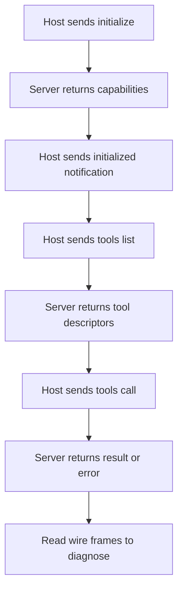

# Reading the Wire: How to Trace a Single MCP Conversation End to End

## English

When an MCP-powered agent misbehaves, the fastest way to understand why is often to read the raw wire traffic rather than reason about the model's behaviour. MCP runs over JSON-RPC 2.0, which means every exchange is a JSON object with a method name, params, and either a result or an error. On stdio transports, this traffic flows as newline-delimited JSON over the child process's stdin and stdout; on Streamable HTTP, it flows as HTTP requests and responses, sometimes with server-sent events for streaming. Learning to read these frames turns an opaque 'the tool did the wrong thing' into a concrete sequence you can inspect.

A single tool call typically looks like this. The host first sends an initialize request, the server replies with its capabilities and protocol version, then the host sends an initialized notification. Later, the host issues tools/list to learn what is available, and the server returns an array of tool descriptors with name, description, and inputSchema. When the model decides to act, the host sends tools/call with a name and arguments object. The server replies with a result containing a content array (text, images, embedded resources) and optionally structuredContent and isError. Each request carries an id, and each response echoes that id, so you can match them up even when several calls are in flight.

Reading this sequence reveals failure modes that are invisible from the model's side. If tools/list returns a schema the model cannot satisfy, you will see the model produce arguments that fail validation, and the server returns an error response with a JSON-RPC error code. If the description is ambiguous, you will see the model pick the wrong tool, and the tools/call frame will name a tool you did not expect. If the server takes too long, you will see progress notifications interleaved, or a timeout error. None of this is visible if you only look at the final assistant message.

Practical tracing requires capturing the frames. For stdio servers, you can wrap the server in a logging proxy that tees stdin and stdout without altering them, or run the server under a supervisor that logs. For HTTP servers, standard request logging plus body capture works, though you should redact secrets and personal data. Some MCP inspector tools display the message stream live, which is invaluable during development. Keep the logs structured (one JSON object per line) so you can grep for a specific tool name or request id.

Once you can read the wire, debugging becomes a matter of forming hypotheses and checking them against frames. 'Did the model see the tool?' becomes 'is it in the tools/list response?' 'Did the call succeed?' becomes 'what is isError and what is in content?' 'Did the server crash?' becomes 'is there a response frame with a matching id?' This discipline of reading the actual bytes, rather than inferring from the final output, is the single highest-leverage debugging skill for protocol-based systems.

## 中文

當一個由 MCP 驅動的 agent 行為異常時，最快的理解方式往往是閱讀原始線路流量，而不是推理模型的行為。MCP 跑在 JSON-RPC 2.0 上，意思是每一次交換都是一個 JSON 物件，帶有 method 名稱、params，以及 result 或 error。在 stdio 傳輸上，這些流量以換行分隔的 JSON 形式流過子行程的 stdin 和 stdout；在 Streamable HTTP 上，則以 HTTP 請求和回應流動，有時用 server-sent events 做串流。學會閱讀這些 frame，就能把模糊的「工具做錯事了」變成具體可檢查的序列。

一次工具呼叫通常長這樣。主機先送出 initialize 請求，伺服器回覆自己的能力與協定版本，接著主機送出 initialized 通知。之後主機發出 tools/list 以得知有哪些可用，伺服器回傳一個工具描述陣列，包含 name、description 和 inputSchema。當模型決定行動，主機送出 tools/call，帶有 name 和 arguments 物件。伺服器回覆一個 result，內含 content 陣列(文字、圖片、內嵌資源)，並可選帶 structuredContent 和 isError。每個請求都帶有 id，每個回應都回顯該 id，所以即使多個呼叫同時在途，你也能配對起來。

閱讀這個序列能揭露從模型那邊看不到的失敗模式。如果 tools/list 回傳的 schema 模型無法滿足，你會看到模型產生無法通過驗證的參數，伺服器回傳帶有 JSON-RPC 錯誤碼的錯誤回應。如果描述含糊，你會看到模型選錯工具，而 tools/call frame 會命名一個你沒預期的工具。如果伺服器太慢，你會看到進度通知交錯出現，或逾時錯誤。這些如果只看最後的 assistant 訊息，全都看不到。

實際追蹤需要擷取 frame。對於 stdio 伺服器，你可以把伺服器包在一個記錄代理裡，原樣 tee stdin 和 stdout，或在監督程序下執行並記錄。對於 HTTP 伺服器，標準請求記錄加上 body 擷取即可，但你應該遮蔽機密和個人資料。有些 MCP inspector 工具會即時顯示訊息流，開發時非常寶貴。把日誌保持結構化(每行一個 JSON 物件)，這樣你就能 grep 特定工具名稱或請求 id。

一旦你能讀線路，除錯就變成形成假設並對照 frame 檢查。「模型有看到這個工具嗎？」變成「它在 tools/list 回應裡嗎？」「呼叫成功了嗎？」變成「isError 是什麼、content 裡有什麼？」「伺服器崩潰了嗎？」變成「有對應 id 的回應 frame 嗎？」這種閱讀實際位元組、而非從最終輸出推論的紀律，是協定式系統中最高槓桿的除錯技能。

## Key Takeaway

Learning to read JSON-RPC frames turns vague agent misbehaviour into a concrete, inspectable sequence.

## Related Concepts
- JSON-RPC 2.0 Under the Hood: Messages, IDs, and Errors
- Debugging Across the Model-Server Gap: Attribution When a Tool Call Goes Wrong

## Diagram

