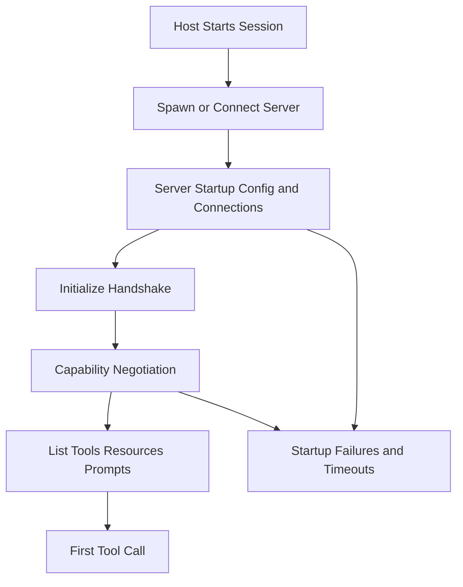

# The Cold Start Problem: What Happens Before the First Tool Call

## English

Most discussions of MCP focus on the steady state: the model picks a tool, the server runs it, the result comes back. But the first few hundred milliseconds of a session are where a surprising number of failures originate, and understanding the cold-start sequence explains a class of bugs that otherwise look random. Before any tool can be called, the host must launch or connect to the server, exchange the initialize handshake, list capabilities, and often list tools, resources, and prompts. Each of these steps can fail, be slow, or return something the host did not expect.

For stdio servers, the host spawns a child process. That process must start, read its configuration (often from environment variables), establish any connections it needs (database, network), and be ready to read JSON-RPC from stdin. If the server's startup involves a slow network call, the host may time out waiting for the initialize response. If the server writes non-JSON diagnostics to stdout, the host's parser will choke, because stdout is reserved for protocol messages; diagnostics belong on stderr. This is a common bug: a well-meaning log statement on stdout silently corrupts the protocol stream.

After initialize, the host learns the server's capabilities. A server that does not advertise the tools capability will not have its tools listed, even if it implements tools/call. A server that advertises resources but returns an empty list will look broken to the host. Capability negotiation is a contract: what you advertise determines what the host will ask for. Mismatches here produce symptoms like 'the tools work in the inspector but not in the host,' which usually means the inspector is lenient about capabilities while the host is strict.

Cold start also matters for latency. Listing tools costs a round trip; if you have many servers, the host may list them all before the first user turn, adding hundreds of milliseconds. Some hosts cache tool lists between sessions, but cache invalidation is tricky because servers can change their tools at runtime via notifications. A server that adds a tool after startup must send the appropriate list-changed notification, or the host will never see it. Understanding this lifecycle explains why a tool sometimes 'appears' only after a restart.

Finally, cold start is where configuration errors surface. A missing API key, a wrong path, a port already in use, a binary not on PATH: all of these manifest as a server that fails to initialize, and the host's error message is often generic. Good MCP servers fail loudly and early, writing a clear diagnostic to stderr and exiting with a non-zero code, rather than hanging silently. When debugging a 'tool not available' problem, always check the cold-start logs first; the issue is often upstream of the model entirely.

## 中文

大部分關於 MCP 的討論都聚焦在穩定狀態：模型選一個工具、伺服器執行它、結果回來。但一個 session 的前幾百毫秒，正是出乎意料多的失敗來源，而理解冷啟動序列，能解釋一整類否則看起來隨機的 bug。在任何工具被呼叫之前，主機必須啟動或連上伺服器、交換 initialize 握手、列出能力，而且往往要列出 tools、resources 和 prompts。這些步驟每一個都可能失敗、變慢，或回傳主機沒預期的東西。

對於 stdio 伺服器，主機會 spawn 一個子行程。該行程必須啟動、讀取設定(通常來自環境變數)、建立它需要的連線(資料庫、網路)，並準備好從 stdin 讀取 JSON-RPC。如果伺服器的啟動涉及緩慢的網路呼叫，主機可能在等待 initialize 回應時逾時。如果伺服器把非 JSON 的診斷訊息寫到 stdout，主機的解析器會噎住，因為 stdout 保留給協定訊息；診斷訊息應該寫到 stderr。這是常見的 bug：一句好意的 log 陳述式寫到 stdout，就悄悄汙染了協定流。

initialize 之後，主機得知伺服器的能力。沒有宣告 tools 能力的伺服器，它的工具不會被列出，即使它實作了 tools/call。宣告 resources 但回傳空清單的伺服器，在主機看來就是壞的。能力協商是一份契約：你宣告什麼，決定主機會要求什麼。這裡的不匹配會產生「工具在 inspector 裡可用，但在主機裡不行」這類症狀，通常意味著 inspector 對能力較寬容，而主機較嚴格。

冷啟動對延遲也很重要。列出工具要一個往返；如果你有很多伺服器，主機可能在第一個使用者回合前把它們全列一遍，增加數百毫秒。有些主機會在 session 之間快取工具清單，但快取失效很棘手，因為伺服器可以在執行時透過通知改變工具。啟動後才加入工具的伺服器，必須送出適當的清單變更通知，否則主機永遠看不到。理解這個生命週期，就能解釋為什麼工具有時要「重啟後」才出現。

最後，冷啟動是設定錯誤浮現的地方。缺少 API key、路徑錯誤、連線埠已被佔用、執行檔不在 PATH 上：這些全都表現為伺服器初始化失敗，而主機的錯誤訊息往往很籠統。好的 MCP 伺服器會大聲且及早失敗，把清楚的診斷寫到 stderr 並以非零碼結束，而不是靜默掛起。除錯「工具不可用」問題時，永遠先檢查冷啟動日誌；問題往往完全在模型的上游。

## Key Takeaway

Most 'tool not available' bugs live in the cold-start sequence, before the model is ever involved.

## Related Concepts
- Lifecycle and Version Negotiation: The initialize Handshake
- MCP Server Lifecycle Management: Starting, Stopping, and Supervising Child Processes

## Diagram

