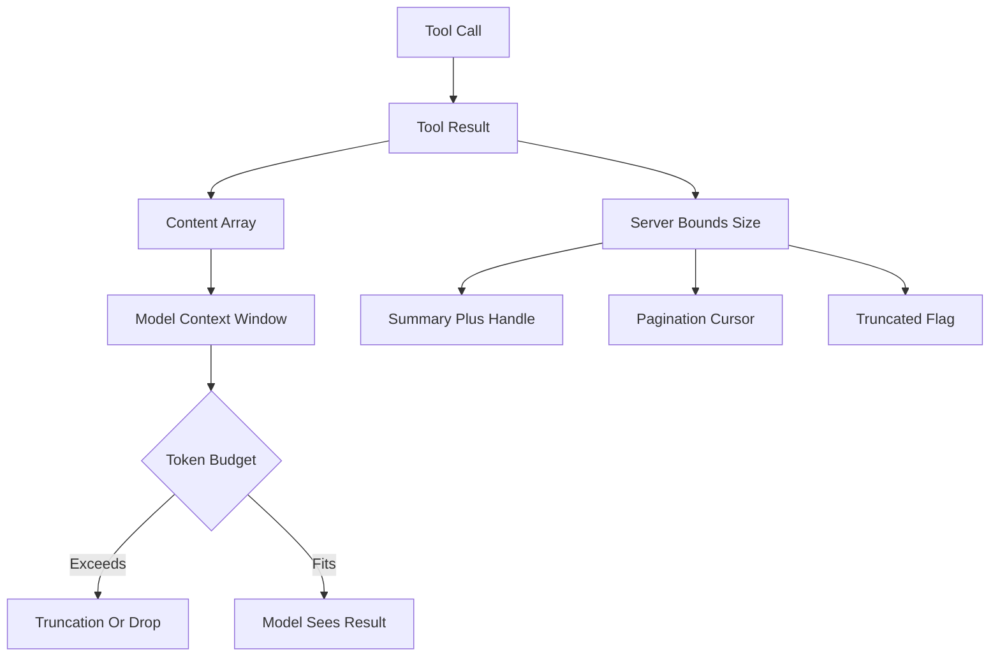

# MCP Tool Result Size and Truncation: What Happens When a Tool Returns Too Much

## English

Every MCP tool call produces a result that eventually gets placed into the model's context window. That window is finite — a fixed budget of tokens shared between the system prompt, the conversation history, and every tool result. A tool that returns a 200-page PDF converted to text, or a database query that yields 10,000 rows, can blow that budget in a single call. This is not a hypothetical: it is one of the most common real-world failure modes when people build MCP servers naively. The model either gets truncated mid-sentence, loses earlier context, or the host silently drops the result and the model sees nothing useful.

The protocol itself does not enforce a size limit on tool results. MCP is a transport, not a policy engine — it will happily carry a megabyte of text in a `content` array. The responsibility for bounding size therefore splits between the server (which knows what it produced) and the host (which knows how much room it has). Good MCP servers treat result size as a design constraint, not an afterthought. Common patterns include: returning a summary plus a reference handle (an ID the model can use to request more), paginating results with an explicit `nextCursor`, or returning structured data with a `truncated: true` flag and a count of what was omitted so the model knows it is looking at a slice, not the whole.

A concrete example makes this vivid. Imagine a `search_documents` tool. A naive implementation returns every matching document's full text. A better implementation returns the top N matches with title, a short snippet, and a document ID — then exposes a separate `get_document` tool that takes that ID and returns the full text of one document. The model can now decide, based on the snippets, which document is actually worth reading. This two-step pattern (search then fetch) mirrors how humans use search engines and keeps each tool call's result small and purposeful.

Truncation is dangerous when it is silent. If a server clips a result at 4,000 characters and says nothing, the model has no way to know it is missing information — it will confidently reason from incomplete data. The fix is to make truncation explicit in the result payload: include a marker like `[truncated: showing 50 of 1,204 results]` or a structured field the model can read. This is the same principle as designing useful errors: the model can only act on what it can see. A result that says 'I am partial' is far more useful than one that pretends to be complete.

Finally, remember that result size interacts with cost and latency. Large results consume tokens on every subsequent turn of the conversation, because the history is re-sent each time. A single 50,000-token tool result can quietly multiply the cost of an entire session. Treating result size as a budget — deciding up front how many tokens a given tool is allowed to contribute — is the practical discipline that separates a toy MCP server from one that works reliably in production.

## 中文

每一次 MCP 工具呼叫都會產生一個結果，而這個結果最終會被放進模型的上下文視窗（context window）裡。這個視窗是有限的——它是一份固定的 token 預算，由系統提示、對話歷史，以及每一個工具結果共同瓜分。一個把 200 頁 PDF 轉成文字回傳的工具，或是一個查出 10,000 列的資料庫查詢，可以在單一次呼叫中就耗盡這份預算。這不是假設性的問題：這是人們天真地建構 MCP 伺服器時，現實中最常見的失敗模式之一。模型不是被從句子中間截斷、就是丟失先前的上下文，或者宿主（host）悄悄丟棄結果，令模型什麼有用的東西都看不到。

協定本身並不對工具結果施加大小限制。MCP 是傳輸層，不是政策引擎——它會樂意地在 `content` 陣列裡攜帶一兆位元組的文字。因此，限制大小的責任就落在伺服器（它知道自己產生了什麼）與宿主（它知道自己還有多少空間）之間。好的 MCP 伺服器會把結果大小視為設計約束，而非事後補救。常見的模式包括：回傳一份摘要加上一個參考代號（一個模型可以用來要求更多內容的 ID）、用明確的 `nextCursor` 分頁，或者回傳帶有 `truncated: true` 旗標與被省略項目數量的結構化資料，讓模型知道自己看的是一部分，而非全部。

一個具體例子可以令這一點更鮮明。想像一個 `search_documents` 工具。天真的實作會回傳每一份符合文件的所有全文。更好的實作會回傳前 N 個符合項目，附上標題、簡短摘要與文件 ID——然後另外提供一個 `get_document` 工具，接受該 ID 並回傳單一文件的全文。模型現在可以根據摘要，自行判斷哪一份文件才真正值得閱讀。這個兩步模式（先搜尋、後擷取）正是人類使用搜尋引擎的方式，並讓每一次工具呼叫的結果保持細小而有目的。

當截斷是無聲地發生時，它是危險的。如果伺服器在 4,000 個字元處裁剪結果卻什麼都不說，模型就無從知道自己遺漏了資訊——它會自信地從不完整的資料中推理。解決方法是在結果酬載中明確標示截斷：加入像 `[truncated: showing 50 of 1,204 results]` 的標記，或是一個模型可以讀取的結構化欄位。這與設計有用的錯誤是同一個原則：模型只能對它看得見的東西採取行動。一個說「我只是部分內容」的結果，遠比一個假裝完整的結果有用。

最後，要記住結果大小與成本、延遲互相影響。大型結果會在對話的每一個後續回合中消耗 token，因為歷史每回合都會被重新送出。單一個 50,000 token 的工具結果，可以悄悄地把整段工作階段的成本倍增。把結果大小當作預算來看待——事先決定某個工具可以貢獻多少 token——就是把玩具級 MCP 伺服器與能在生產環境可靠運作的伺服器區分開來的實務紀律。

## Key Takeaway

Treat tool result size as an explicit budget: return summaries with handles, paginate, and always mark truncation visibly so the model knows what it is missing.

## Related Concepts
- Context window budgeting
- Pagination with cursors

## Diagram

