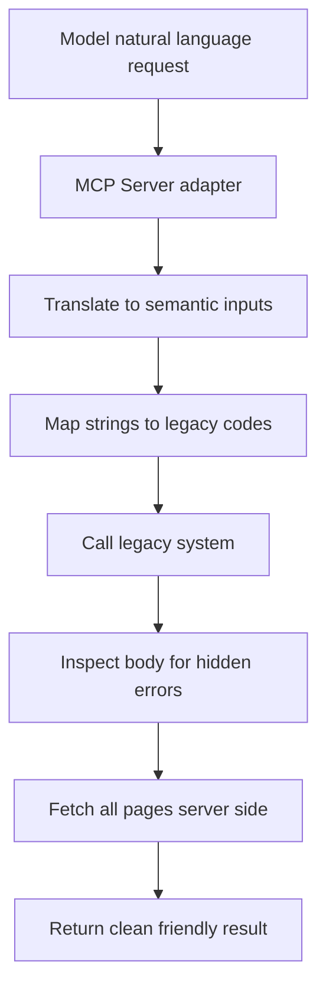

# The MCP Server as a Translator: Wrapping Legacy Systems Without Leaking Their Weirdness

## English

Most MCP servers are not built from scratch — they are adapters wrapped around something that already exists: a REST API, a SQL database, a CLI tool, a gRPC service, a proprietary enterprise system. The job of the server is to translate between two very different worlds. On one side is the model, which thinks in natural language, needs self-describing inputs, and benefits from forgiving, well-labelled results. On the other side is the legacy system, which has its own quirks: numeric enum codes, paginated cursors that expire, mandatory fields that must be sent in a specific order, and error responses that are cryptic or inconsistent. The craft of writing a good MCP server is largely the craft of absorbing that weirdness so the model never has to see it.

A classic mistake is to expose the legacy API one-to-one. Suppose an internal HR system has an endpoint that requires a `dept_code` integer, a `status_flag` that is `0`, `1`, or `2`, and a `page_token` that expires after five minutes. If you expose this directly as a tool, the model must somehow know that `status_flag: 1` means 'active' and that it needs to chain calls quickly before the token expires. It will get this wrong repeatedly. The better design is to translate: accept `department: "Engineering"` and `status: "active"` as strings, map them internally to the numeric codes, and handle pagination server-side by fetching all pages and returning a clean list. The model sees a friendly, semantic interface; the legacy system sees the exact calls it expects.

Translation also applies to errors. Legacy systems often return HTTP 200 with a body that says `{"success": false, "errorCode": 47}` — a pattern that is invisible to a naive client that only checks status codes. Your MCP server must inspect the body, decide whether the call actually succeeded, and if not, produce an MCP error or a result that clearly signals failure. The model should never receive a 'successful' result that is secretly a failure. Similarly, cryptic error codes should be mapped to human-readable messages, because the model reasons from text: 'errorCode 47' means nothing, but 'the employee ID does not exist in the HR system' gives the model something to work with — perhaps by trying a different ID or asking the user to clarify.

There is a temptation to expose every legacy field as a tool parameter. Resist it. Each parameter is a chance for the model to make a mistake, and each one must be described in the schema, consuming tokens and attention. A good adapter exposes only the parameters the model actually needs, with sensible defaults for everything else. If the legacy API has 30 optional fields but 95% of calls only use four of them, expose four. You can always add more later if a real need arises. This is the same principle as a good CLI: `git commit -m` is far more usable than a command that requires you to specify every possible flag.

Finally, remember that a legacy system may have side effects your model does not understand. A call that looks like 'update record' might trigger emails, webhooks, audit logs, or downstream jobs. The MCP server is the right place to document these consequences in the tool description and, where appropriate, to require explicit confirmation before performing them. The server is not just a translator of syntax — it is a translator of semantics and consequences, and it is the layer where the model's simplified view of the world meets the messy reality of the system it is actually touching.

## 中文

大多數 MCP 伺服器並非從零建構——它們是包裹在既有事物外面的轉接器：一個 REST API、一個 SQL 資料庫、一個命令列工具、一個 gRPC 服務，或一套專有的企業系統。伺服器的工作，就是在兩個截然不同的世界之間翻譯。一邊是模型，它以自然語言思考、需要能自我描述的輸入，並受益於寬容且標示清楚的結果。另一邊是舊系統，它有自己的一套怪癖：數字列舉程式碼、會過期的分頁遊標、必須依特定順序送出的必填欄位，以及晦澀或不一致的錯誤回應。寫好一個 MCP 伺服器的功夫，很大程度上就是把這些怪癖吸收掉，讓模型永遠不必看見它們。

一個典型錯誤，是把舊 API 一對一地暴露出來。假設一套內部人力資源系統有一個端點，需要整數的 `dept_code`、值為 `0`、`1` 或 `2` 的 `status_flag`，以及五分鐘後就過期的 `page_token`。如果你直接把這個端點當成工具暴露，模型就必須以某種方式知道 `status_flag: 1` 代表「在職」，而且必須在 token 過期前迅速串接呼叫。它會一次又一次地搞錯。更好的設計是翻譯：接受 `department: "Engineering"` 與 `status: "active"` 這類字串，在內部把它們對映成數字程式碼，並在伺服器端處理分頁——抓取所有頁面後回傳一份乾淨的清單。模型看到的是一個友善、語意化的介面；舊系統看到的則是它預期的那種精確呼叫。

翻譯同樣適用於錯誤。舊系統經常回傳 HTTP 200，但內容是 `{"success": false, "errorCode": 47}`——這種模式對只檢查狀態碼的天真使用者端來說是隱形的。你的 MCP 伺服器必須檢查內容、判斷呼叫是否真的成功，若不成功，就產生一個 MCP 錯誤，或一個清楚表示失敗的結果。模型絕不應該收到一個表面「成功」、實則失敗的結果。同樣地，晦澀的錯誤程式碼應被對映成人類可讀的訊息，因為模型是從文字推理的：「errorCode 47」毫無意義，但「該員工 ID 在人力資源系統中不存在」則給了模型可以處理的東西——也許是換一個 ID 試試，或是請使用者澄清。

人們很容易想把舊系統的每一個欄位都暴露成工具引數。要抗拒這種誘惑。每個引數都是模型犯錯的一次機會，而且每一個引數都必須在結構描述（schema）中描述，消耗 token 與注意力。好的轉接器只暴露模型真正需要的引數，其餘一律給予合理的預設值。如果舊 API 有 30 個選填欄位，但 95% 的呼叫只用到其中四個，那就只暴露四個。日後若真有需要，隨時可以再增加。這與好的命令列工具是同一個原則：`git commit -m` 遠比一個要求你指定每一個可能旗標的命令好用得多。

最後，要記住舊系統可能有一些模型並不理解的副作用。一個看似「更新紀錄」的呼叫，可能會觸發電子郵件、webhook、稽核日誌或下游工作。MCP 伺服器正是記錄這些後果的合適位置——在工具描述中說明，並在適當時候要求明確確認才執行。伺服器不只是語法的翻譯者——它是語意與後果的翻譯者，也是模型簡化的世界觀，與它所實際觸碰的系統那份紛亂現實交會的那一層。

## Key Takeaway

A good MCP server is a semantic translator: hide legacy quirks, expose a small friendly interface, and never let the model see cryptic codes or silent failures.

## Related Concepts
- Adapter and facade patterns
- Error mapping and normalization

## Diagram

