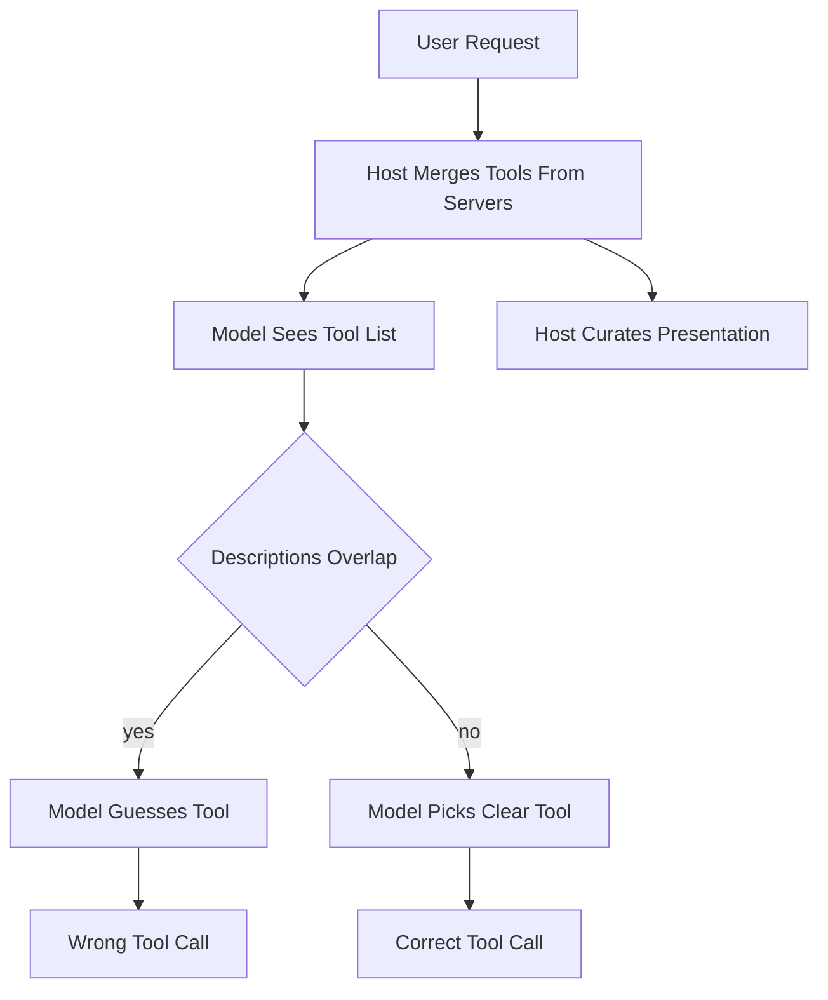

# Composition at the Host Level: How a Model Decides Which Tool to Use When Many Look Similar

## English

In a real deployment, a host rarely talks to one MCP server. It talks to several — a filesystem server, a database server, a web search server, a calendar server — and the model sees a merged list of tools from all of them. The moment two tools look similar, a new problem appears: disambiguation. If the filesystem server exposes `read_file` and the document server exposes `get_document`, and both take an identifier and return text, the model has to decide which one applies. It does this from the tool descriptions alone, because that is all it sees. When descriptions overlap, the model guesses, and guesses produce the wrong tool — often with confusing downstream errors.

The host has a design lever here that is easy to overlook: it controls how tools are presented. It can prefix names with the server name (`fs__read_file`, `docs__get_document`) to make provenance visible, it can group tools by category in the description text, or it can filter the visible tool set based on context — for example, only showing calendar tools when the user has mentioned a meeting. This last technique is powerful: the model's attention is finite, and a list of 80 tools is harder to reason about than a list of 12. Curating the visible surface is not just a cost optimization; it is an accuracy optimization.

A concrete scenario illustrates the tension. Suppose the user asks 'find the Q3 report'. The filesystem server has `search_files` which searches local paths. The document server has `search_documents` which searches an indexed corpus. Both are reasonable. If their descriptions are both vague ('search for things'), the model may pick either. If instead `search_files` says 'search files on the local disk by name or path pattern' and `search_documents` says 'search the company document index by content, returning ranked results', the model can reason: 'the user said find the report, not read a specific file — the document index is more likely'. The fix is not in the protocol; it is in the description text, which is a form of prompt engineering that the host and server authors must cooperate on.

There is also a structural pattern worth knowing: the aggregator or proxy. Instead of connecting the host to ten servers directly, you can run a single MCP server that itself connects to ten others and re-exports their tools under a unified namespace. This centralizes disambiguation logic — the aggregator can rename, re-describe, and filter tools before the model ever sees them. It also solves the collision problem when two servers happen to expose tools with the same name. The trade-off is an extra hop and a single point of failure, so aggregators are best used deliberately, not by default.

Finally, remember that tool selection is a decision the model makes probabilistically, from text. It is not a lookup. Two tools with identical descriptions will be chosen more or less at random. Two tools with clearly distinct descriptions, distinct names, and distinct input schemas will be chosen correctly most of the time. The discipline of designing a multi-server tool surface is therefore the discipline of making each tool's purpose obvious from its text alone — and of removing tools that only add noise. When the surface is well designed, the model's choice feels obvious; when it is not, even a capable model will flounder.

## 中文

在真實部署中，宿主很少只跟一個 MCP 伺服器對話。它會跟好幾個對話——一個檔案系統伺服器、一個資料庫伺服器、一個網路搜尋伺服器、一個行事曆伺服器——而模型看到的，是來自所有伺服器的合併工具清單。一旦有兩個工具看起來相似，一個新問題就出現了：消歧（disambiguation）。如果檔案系統伺服器暴露 `read_file`，而檔案伺服器暴露 `get_document`，兩者都接受一個識別碼並回傳文字，模型就必須決定哪一個適用。它只能憑工具描述來決定，因為那是它唯一看得見的東西。當描述重疊時，模型只能猜，而猜測會產生錯誤的工具選擇——往往伴隨令人困惑的下游錯誤。

宿主在這裡有一個很容易被忽略的設計槓桿：它控制工具如何被呈現。它可以在名稱前加上伺服器名稱（`fs__read_file`、`docs__get_document`）令來源可見，可以在描述文字中按類別分組，或者根據上下文過濾可見的工具集——例如，只有在使用者提到會議時才顯示行事曆工具。最後這個技巧很強大：模型的注意力是有限的，一份 80 個工具的清單，比一份 12 個工具的清單更難推理。精心策劃可見的工具面，不只是成本最佳化，更是準確度最佳化。

一個具體情境可以說明這種張力。假設使用者問「搵下第三季報告」。檔案系統伺服器有 `search_files`，它搜尋本機路徑。檔案伺服器有 `search_documents`，它搜尋一個已建立索引的語料庫。兩者都合理。如果它們的描述都很含糊（「搜尋東西」），模型可能隨便選一個。但如果 `search_files` 說「依名稱或路徑模式搜尋本機磁碟上的檔案」，而 `search_documents` 說「依內容搜尋公司檔案索引，回傳排序後的結果」，模型就能推理：「使用者說的是搵報告，不是讀取某個特定檔案——檔案索引更有可能」。解決方法不在協定裡，而在描述文字裡，那是一種需要宿主與伺服器作者共同合作的提示工程（prompt engineering）。

還有一種值得知道的結構模式：聚合器（aggregator）或代理（proxy）。與其讓宿主直接連線十個伺服器，你可以執行一個 MCP 伺服器，它自己再連線另外十個，並在統一的名稱空間下重新輸出它們的工具。這把消歧邏輯集中起來——聚合器可以在模型看見工具之前，就重新命名、重新描述、過濾工具。它也解決了兩個伺服器恰好暴露同名工具時的衝突問題。代價是多一次跳轉與一個單點故障，所以聚合器最好是有意識地使用，而非預設使用。

最後，要記住工具選擇是模型根據文字所做的機率性決定，不是查表。兩個描述完全相同的工具，會被或多或少隨機地選擇。兩個描述清楚不同、名稱不同、輸入結構描述也不同的工具，大多數時候會被正確選擇。設計多伺服器工具面的紀律，因此就是讓每個工具的用途單憑其文字就顯而易見的紀律——以及移除只會增加噪音的工具。當工具面設計得好，模型的選擇會顯得理所當然；當設計得不好，即使是一個能力很強的模型也會手足無措。

## Key Takeaway

When many servers expose similar tools, correctness depends on distinct names and descriptions plus deliberate host-side curation of the visible tool surface.

## Related Concepts
- Aggregator and proxy servers
- Tool description as disambiguation

## Diagram

