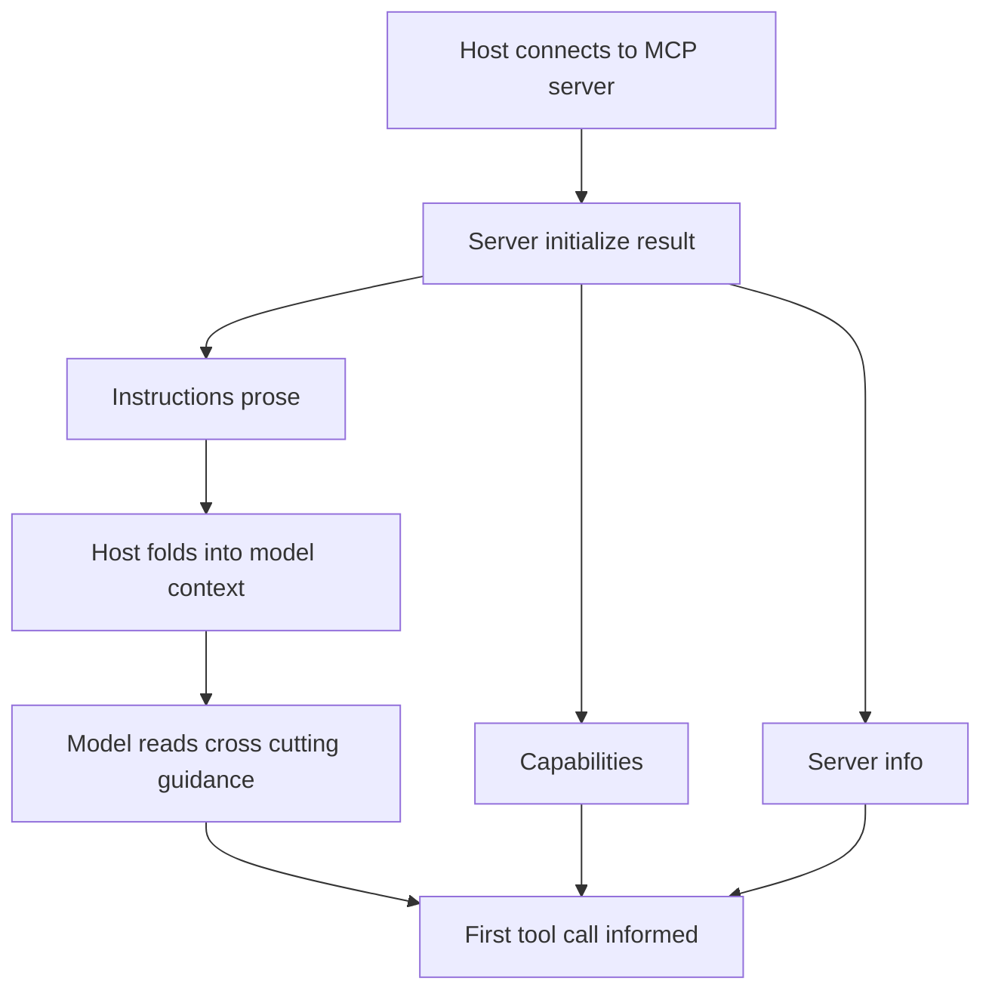

# Server Instructions and the Hidden System Prompt

## English

Most people picture an MCP server as a bag of tools the model can call. But a server can also ship a short block of prose — usually called its instructions — that the host is expected to fold into the model's context before the first tool call. Think of it as the note a new colleague tapes to their desk: not a task, not a function, just context that makes everything else make sense. The instructions field travels in the server's initialize result, alongside its capabilities and server info, so it is available the moment the connection is established, before any tool has been invoked.

The reason this matters is that tool descriptions are inherently local. Each tool schema explains one function in isolation: what arguments it takes, what it returns. What no individual schema can express is the cross-cutting story — the order in which tools are meant to be used, the one global convention that applies everywhere, the fact that identifiers returned by one call must be fed verbatim into another. A server that wraps a ticketing system might want to say: always search before creating, because duplicates are expensive to clean up. That sentence has no natural home in any single tool schema. Instructions give it one.

There is a subtlety about authority. Instructions are advisory text, not executable policy. The host decides whether to include them, where to place them in the context, and how much weight to give them relative to the user's own request. A well-behaved host will present them as server-provided context, clearly attributed, so that a model reading them knows they come from the tool provider and not from the user. This distinction matters for prompt-injection reasoning: text arriving from a server is data about how to use tools, not a command that overrides the user.

In practice, the best instructions read like a short onboarding memo. They are specific (name the actual tools), they are short (a handful of sentences — remember they consume context budget on every turn), and they avoid restating what the schemas already say. A common failure mode is writing instructions that duplicate every tool description, which wastes tokens and gives the model two slightly different versions of the same fact to reconcile. Another is writing vague guidance like 'use these tools wisely', which costs tokens and changes nothing.

When you are debugging a server whose tools are being called in the wrong order or with the wrong assumptions, instructions are one of the first places to look — and one of the cheapest fixes. Before you redesign a schema or split a tool in two, try adding one plain sentence to the instructions block explaining the convention. It is the lowest-friction lever a server author has for shaping behaviour across the whole toolset at once.

## 中文

多數人想像 MCP 伺服器時，腦海裡是一袋模型可以呼叫的工具。但伺服器其實還可以附上一小段文字——通常稱為它的 instructions（指示）——主機（host）會預期在第一次工具呼叫之前，把這段文字放進模型的上下文裡。可以把它想成新同事貼在桌上的便條：不是任務、不是函式，只是讓其他一切說得通的背景資訊。instructions 欄位會隨著伺服器的 initialize 結果一起送出，與 capabilities 和 server info 並列，所以連線一建立它就已經存在，早於任何工具被呼叫。

這件事之所以重要，是因為工具描述本質上是區域性的。每個工具的 schema 只單獨說明一個函式：吃什麼引數、回傳什麼。但沒有任何單一 schema 能表達跨工具的共同故事——工具之間應該按什麼順序使用、哪一條全域慣例適用於所有工具、某次呼叫回傳的識別碼必須原封不動餵進下一次呼叫。一個包裝工單系統的伺服器可能想說：建立之前一定先搜尋，因為重複的工單清理起來很貴。這句話在任何單一工具 schema 裡都找不到自然的歸屬。instructions 給了它一個位置。

這裡有個關於權威性的微妙之處。instructions 是建議性的文字，不是可執行的政策。主機決定要不要納入、放在上下文的哪個位置、相對於使用者自己的請求要給多少份量。行為良好的主機會把它當成伺服器提供的上下文、清楚標明來源，讓讀到它的模型知道這來自工具供應方，而不是使用者。這個區別對提示注入（prompt injection）的推理很重要：來自伺服器的文字是「關於如何使用工具」的資料，而不是覆寫使用者的命令。

實務上，最好的 instructions 讀起來像一份簡短的到職備忘錄。它們具體（直接點名實際的工具）、簡短（幾句話就好——記住它們每一輪都在消耗上下文預算），而且避免重述 schema 已經說過的事。常見的失敗模式，是把每個工具描述都複製一遍，既浪費 token，又給模型兩個略有出入的同一事實要調和。另一種是寫出「請明智地使用這些工具」這類空泛指引，花了 token 卻什麼都沒改變。

當你在除錯一個工具總是被以錯誤順序、錯誤假設呼叫的伺服器時，instructions 是最該先看的地方之一——也是最便宜的修法之一。在重新設計 schema 或把工具拆成兩個之前，先試著在 instructions 區塊加一句白話說明那條慣例。這是伺服器作者一次形塑整套工具行為、摩擦最低的槓桿。

## Key Takeaway

Server instructions are a low-cost, server-wide channel for conventions that no individual tool schema can express, but they are advisory context, not enforced policy.

## Related Concepts
- Tool Descriptions as Prompt Engineering
- The Tool Surface as a Budget

## Diagram

