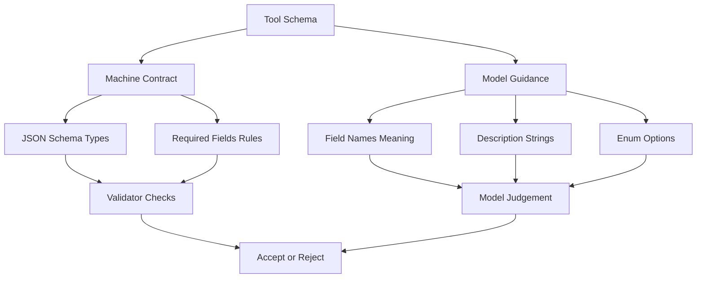

# The Two Audiences of Every Tool Schema

## English

A tool schema has a split personality that is easy to miss. On one side it is a machine contract: a JSON Schema that a validator can check, with types, required fields, enums, and nesting rules. On the other side it is prose written for a language model, which will read the description strings and field names and form a judgement about when and how to use the tool. These two audiences want different things, and a schema that serves only one of them tends to fail the other.

For the validator, precision is everything. If a parameter is an integer between 1 and 100, the schema should say so with minimum and maximum, not with a description that says 'a reasonable number'. If a field is optional, do not mark it required and then explain in prose that it can be omitted — the validator will reject calls the model was told were fine. Ambiguity here produces a specific and frustrating failure: the model sends a perfectly sensible call, the server rejects it on schema grounds, and the model, seeing a validation error, retries with a small variation that may or may not be closer to correct.

For the model, naming and description carry most of the weight. Field names are read as meaning, so id, ticket_id, and external_ref will be interpreted differently even if they are all strings. Descriptions are read as guidance, so 'the customer's email, exactly as they typed it' tells the model not to normalise or lowercase, while 'a date in ISO 8601 format' tells it to format rather than pass through. Enums are especially valuable to the model because they collapse an open-ended choice into a small set of named options, which is far easier to reason about than free text.

The tension shows up when a schema is technically correct but semantically opaque. A field called data of type object with no description passes every validator and tells the model nothing; the model will guess, and guesses on opaque objects are where most malformed calls originate. The fix is rarely to loosen validation. It is usually to either flatten the object into named fields or to write a description that names the shape explicitly, ideally with a tiny example of a valid value.

A useful discipline is to read your own schema twice: once as a validator, asking 'could a wrong call slip through, and could a right call be rejected?', and once as a model, asking 'if I only saw this text, would I know when to reach for this tool and what to put in each slot?' Most schema bugs are found in the second reading, and most of those are fixed by adding or sharpening a description rather than changing a type.

## 中文

每個工具 schema 都有雙重人格，而這點很容易被忽略。一邊是機器契約：一份 JSON Schema，驗證器可以檢查，有型別、必填欄位、enum 與巢狀規則。另一邊是寫給語言模型看的文字，模型會讀描述字串和欄位名稱，據此判斷何時、如何使用這個工具。這兩種讀者要的東西不同，只服務其中一邊的 schema，往往在另一邊失敗。

對驗證器來說，精確就是一切。如果某個參數是 1 到 100 之間的整數，schema 就該用 minimum 和 maximum 講清楚，而不是在描述裡寫「一個合理的數字」。如果某欄位是選填的，就不要標成必填、然後在文字裡解釋它可以省略——驗證器會拒絕模型被告知沒問題的呼叫。這裡的含糊會造成一種具體又惱人的失敗：模型送出完全合理的呼叫，伺服器以 schema 為由拒絕，模型看到驗證錯誤後，用一點小變體重試，而那變體未必更接近正確答案。

對模型來說，命名和描述承擔了大部分的重量。欄位名稱會被當成意義來讀，所以 id、ticket_id、external_ref 即使都是字串，也會被解讀成不同的東西。描述會被當成指引來讀，所以「客戶的電郵，完全照他們打的方式」告訴模型不要正規化或轉小寫，而「ISO 8601 格式的日期」則告訴模型要格式化、而不是原樣傳遞。enum 對模型特別有價值，因為它把開放式的選擇壓縮成一小組具名選項，遠比自由文字容易推理。

張力出現在 schema 技術上正確、但語意上不透明的時候。一個叫 data、型別為 object、沒有任何描述的欄位，通過所有驗證器，卻什麼也沒告訴模型；模型只能猜，而不透明物件上的猜測，正是大多數畸形呼叫的來源。修法很少是放寬驗證，通常是把物件攤平成具名欄位，或寫一段明確點出形狀的描述，最好附上一個合法值的迷你範例。

一個有用的紀律，是把你的 schema 讀兩遍：一遍當驗證器，問「錯誤的呼叫會不會溜過去？正確的呼叫會不會被拒絕？」；一遍當模型，問「如果我只看得到這段文字，我會知道何時該用這個工具、每個欄位該填什麼嗎？」大多數 schema 的 bug 在第二遍被找到，而其中大多數是靠新增或磨利描述來修，而不是改型別。

## Key Takeaway

Every tool schema is read by two audiences — a validator that wants precision and a model that wants meaning — and most schema bugs are fixed by sharpening descriptions, not loosening types.

## Related Concepts
- How MCP Servers Describe Themselves: Schemas as the Contract
- Tool Descriptions as Prompt Engineering

## Diagram

