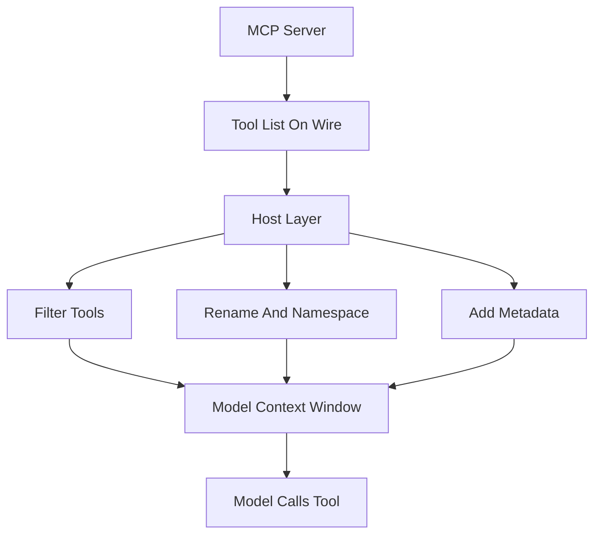

# What the Model Never Sees: The Host's Invisible Filter

## English

There is a layer between the MCP server and the model that is easy to forget because it never appears on the wire: the host. The server sends its tool list, and the model sees a tool list — but they are not necessarily the same list. The host is free to filter, reorder, rename, annotate, or hide tools before presenting them, and understanding this gap explains a whole class of confusing behaviour.

Filtering is the most common transformation. A host connected to ten servers might expose only a subset of tools on any given turn, selected by the user's current mode, by which tools the user has approved, or by a relevance heuristic. If a server author tests with a permissive host and sees all tools available, then ships to a host that curates aggressively, the model may simply never see a tool that the server swears it provides. This is not a bug in either party; it is the host exercising its role as the thing that decides what enters the context window.

Renaming and namespacing are the next layer. Because two servers can both define a tool called search, hosts commonly prefix or otherwise disambiguate tool names before the model sees them. The model then calls the renamed tool, and the host translates the call back to the original name before forwarding it to the server. From the server's perspective nothing changed; from the model's perspective the tool has a different name than the one in the server's own documentation. When debugging, always check what name the model actually used, not what name the server advertises.

Hosts also add their own metadata: approval requirements, risk annotations, grouping into categories, and sometimes a rewritten description that folds in the host's own guidance. A tool marked as requiring confirmation may be presented to the model with a note that the user will be asked to approve it, which changes how the model phrases its request. None of this appears in the server's schema, and none of it is visible to the server at all.

The practical consequence is that a server author cannot fully predict how their tools will be experienced. The best defence is to make each tool self-sufficient — a clear name, a description that stands on its own, arguments that do not depend on context the host might strip — and to test against more than one host when possible. When something behaves oddly, the first question is not 'what did the server send?' but 'what did the model actually see?', and those two answers can differ in more ways than the protocol itself suggests.

## 中文

在 MCP 伺服器和模型之間有一層很容易被遺忘、因為它從不出現線上路上的東西：主機（host）。伺服器送出它的工具清單，模型也看到一份工具清單——但兩者未必是同一份。主機有權在呈現之前過濾、重排、改名、加註或隱藏工具，而理解這道落差，能解釋一整類令人困惑的行為。

過濾是最常見的轉換。一臺連了十個伺服器的主機，可能在某一輪只露出工具的子集，依據的是使用者目前的模式、使用者已核准哪些工具，或某種相關性啟發式。如果伺服器作者在寬鬆的主機上測試、看到所有工具都可用，之後部署到會積極精選的主機，模型可能根本看不到伺服器信誓旦旦說它提供的工具。這不是任何一方的 bug；這是主機在履行它「決定什麼進入上下文視窗」的職責。

改名與名稱空間是下一層。因為兩個伺服器都可能定義一個叫 search 的工具，主機通常會在模型看到之前，替工具名稱加字首或做其他消歧。模型接著呼叫改名後的工具，主機再把呼叫翻譯回原名，才轉發給伺服器。從伺服器的角度看什麼都沒變；從模型的角度看，工具的名字和伺服器自己檔案上的不同。除錯時，永遠要查模型實際用了哪個名字，而不是伺服器宣稱的名字。

主機也會加上自己的中介資料：核准要求、風險標註、分類分組，有時還會改寫描述、把主機自己的指引併進去。一個被標為需要確認的工具，可能會帶著「使用者會被要求核准」的註記呈現給模型，這會改變模型措辭的方式。這些都不在伺服器的 schema 裡，伺服器也完全看不到。

實務上的後果是：伺服器作者無法完全預測自己的工具會被怎麼體驗。最好的防禦是讓每個工具自給自足——名字清楚、描述能獨立成立、引數不依賴主機可能剝掉的上下文——並盡可能在多於一臺主機上測試。當事情行為怪異時，第一個問題不是「伺服器送了什麼？」，而是「模型實際看到了什麼？」，而這兩個答案的差異，可能比協定本身暗示的還要多。

## Key Takeaway

The host sits invisibly between server and model, filtering, renaming, and annotating tools — so debugging always starts with what the model actually saw, not what the server sent.

## Related Concepts
- Composition at the Host Level: How a Model Decides Which Tool to Use When Many Look Similar
- The Consent Boundary: What the Model Can Do vs. What the User Allowed

## Diagram

