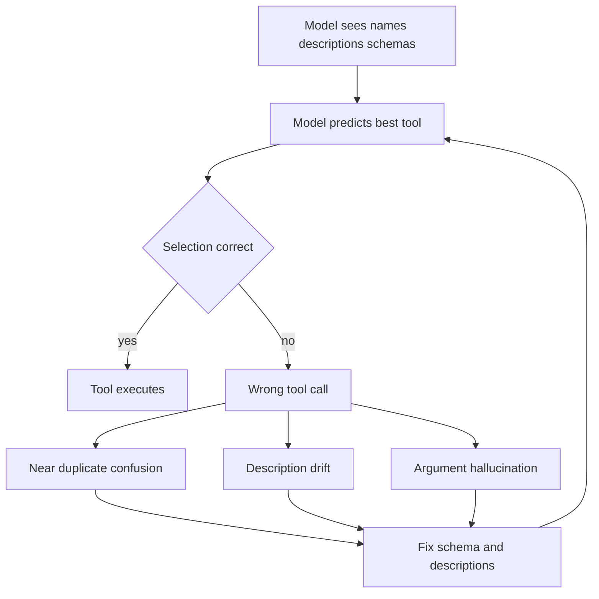

# Tool Selection Failure Modes: When the Model Picks Wrong

## English

Every MCP host faces the same gap: the model only sees tool names, descriptions, and JSON Schemas — never the implementation. Selection is therefore a prediction task, and it fails in predictable ways. The most common is near-duplicate confusion: two tools like `search_documents` and `query_index` sound interchangeable to a language model, so it picks one by surface similarity rather than by what each actually does. A second failure is description drift — a tool's behaviour changes but its description does not, so the model keeps calling it for the old purpose and gets surprising results. A third is argument hallucination: the model invents a parameter that seems natural (e.g. a `format` field on a tool that only returns text) because the schema is sparse and the model fills the gap from world knowledge. None of these are model bugs per se; they are contract bugs surfacing through the model.

The diagnostic discipline is to treat a wrong tool call as evidence about the schema, not about the model. If two tools are confused for each other, the fix is usually to sharpen their descriptions with explicit negative examples — 'use this when X; do NOT use it for Y, use `other_tool` instead' — because language models respond strongly to contrastive phrasing. If the model invents arguments, the fix is to make the schema reject them loudly (additionalProperties: false in JSON Schema) and return a structured error the model can read and correct from.

A subtler pattern is over-eager tool use: the model calls a tool when plain reasoning would have sufficed, because the tool's description implies it is always appropriate. Descriptions that say 'use this to answer questions about the codebase' invite calls even for trivial queries. Better descriptions scope the tool to the specific case where it is the only reasonable choice.

There is also the opposite failure — tool avoidance — where the model answers from memory instead of calling a tool that would have given fresher or more accurate data. This is often caused by descriptions that sound expensive, slow, or risky, or by a schema whose required arguments look hard to supply. Making the happy path obvious (few required fields, clear defaults) reduces avoidance.

Finally, remember that a wrong tool call is observable. Hosts log the tool name, arguments, and result. If you build a habit of reading those logs as a schema critique rather than a model critique, you will find that most selection bugs are fixable in the description text — no retraining, no prompt engineering at the system level, just clearer contracts.

## 中文

每個 MCP host 都面對同一個落差：模型只見到工具的名稱、描述同 JSON Schema，永遠見唔到實作。所以「揀工具」本質上係一個預測任務，而佢會以可預測嘅方式出錯。最常見嘅係「近似重複混淆」：兩個工具好似 `search_documents` 同 `query_index`，對語言模型嚟講聽落可以互換，於是佢憑表面相似度揀，而唔係憑兩者實際做咩嚟揀。第二種失敗係「描述漂移」——工具行為變咗但描述冇變，於是模型繼續為舊用途而呼叫，得到令人意外嘅結果。第三種係「參數幻覺」：模型自己發明一個聽落好自然嘅參數（例如一個只回傳文字嘅工具，佢加個 `format` 欄位），因為 schema 太疏，模型就用世界知識填補空隙。呢啲嚴格嚟講唔係模型 bug，而係合約 bug 透過模型浮現出嚟。

診斷嘅紀律係：將一次錯誤嘅工具呼叫當成關於 schema 嘅證據，而唔係關於模型嘅證據。如果兩個工具互相被混淆，修正方法通常係用明確嘅反面例子去磨利描述——「喺 X 情況用呢個；唔好用嚟做 Y，嗰種情況用 `other_tool`」——因為語言模型對比對式措辭反應好強烈。如果模型發明參數，修正方法係令 schema 大聲咁拒絕佢（JSON Schema 嘅 additionalProperties: false），再回傳一個模型讀得明、可以自我糾正嘅結構化錯誤。

更微妙嘅模式係「過度熱衷用工具」：明明純推理就夠，模型都照呼叫工具，因為工具描述暗示佢永遠適用。好似「用呢個嚟回答關於 codebase 嘅問題」呢類描述，連瑣碎查詢都會誘發呼叫。更好嘅描述會將工具限定喺「只有佢先係合理選擇」嘅具體情況。

仲有相反嘅失敗——「迴避用工具」：模型憑記憶作答，而唔係呼叫一個本來可以俾更新、更準確資料嘅工具。原因通常係描述聽落好貴、好慢、好有風險，或者 schema 嘅必填參數睇落好難提供。令「順路」變得明顯（必填欄位少、預設值清晰）可以減少迴避。

最後要記住：錯誤嘅工具呼叫係可觀察嘅。Host 會記錄工具名、參數同結果。如果你養成將呢啲 log 當成「對 schema 嘅批評」而唔係「對模型嘅批評」嚟讀嘅習慣，你會發現大部分選擇 bug 都可以喺描述文字度修正——唔需要重新訓練，唔需要系統層 prompt engineering，只需要更清晰嘅合約。

## Key Takeaway

A wrong tool call is usually a schema or description problem, not a model problem — read the logs as a contract critique.

## Related Concepts
- Tool Descriptions as Prompt Engineering
- Composition at the Host Level

## Diagram

