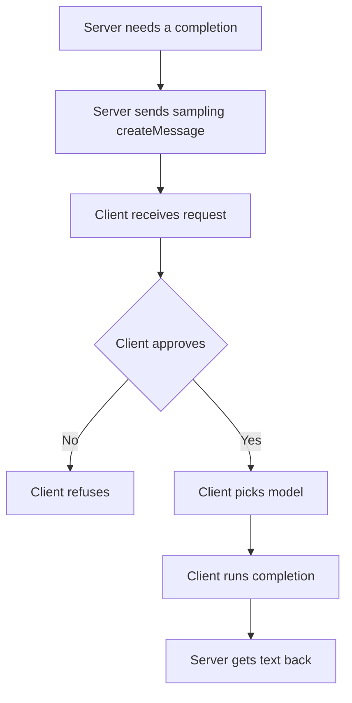

# Sampling in Practice: When the Server Borrows the Model

## English

Most MCP discussion treats the model as the caller and the server as the callee. Sampling flips that relationship: an MCP server can ask the client to run an LLM completion on its behalf. The server sends a `sampling/createMessage` request containing messages (system prompt, user turns, optional model preferences), and the client — which is the side that actually holds the model credentials and the user's trust — decides whether to honour it, which model to use, and what to send back. The server never sees an API key. This is the protocol's answer to a real problem: a tool that needs to summarise, classify, or rewrite text internally would otherwise have to bundle its own model or call out to a hard-coded provider.

The design is deliberately asymmetric. The server proposes; the client disposes. A client can refuse a sampling request, rewrite the messages before forwarding them to the model, or substitute a cheaper model than the server asked for. This matters because the server is often less trusted than the user's own host — a third-party MCP server should not be able to silently spend the user's tokens or inject arbitrary prompts into the user's model context. The `modelPreferences` field (hints about cost, speed, and intelligence) is advisory, not binding; the client is free to ignore it.

A concrete example: an MCP server that wraps a code-linting tool might, after running the linter, use sampling to ask the model to explain each warning in plain English. The server has no model of its own; it just knows how to phrase the question. The client receives the request, shows the user a confirmation (or applies a pre-approved policy), runs the completion on the user's configured model, and returns the text. The server then formats it into its tool result.

Sampling also has an important human-in-the-loop dimension. Because the request flows through the client, the client can display the exact prompt to the user before sending it, or auto-approve based on rules ('allow sampling for this server, up to N tokens per call'). This is how sampling stays safe: the trust boundary is enforced at the client, not at the server.

The practical lesson is that sampling is not a backdoor for servers to run arbitrary inference. It is a negotiated, auditable request. If you are building a server that uses sampling, design it to degrade gracefully when the client refuses — return a partial result, or a clear error the model can act on. If you are building a client, treat sampling as a capability you grant selectively, the same way you grant filesystem access.

## 中文

大部分 MCP 討論都假設模型係呼叫方、server 係被呼叫方。Sampling 就反轉呢個關係：一個 MCP server 可以要求 client 代佢執行一次 LLM 完成。Server 送出一個 `sampling/createMessage` 請求，入面有 messages（system prompt、user 對話、可選嘅模型偏好），而 client——即係真正持有模型憑證同使用者信任嗰一方——決定要唔要履行、用邊個模型、回傳咩。Server 永遠見唔到 API key。呢個係協議對一個真實問題嘅答案：一個內部需要摘要、分類或者改寫文字嘅工具，否則就要自帶模型或者寫死某個供應商。

呢個設計係刻意不對稱嘅。Server 提出，client 處置。Client 可以拒絕 sampling 請求、喺轉發俾模型之前改寫 messages，或者換一個比 server 要求更便宜嘅模型。呢點好重要，因為 server 通常比使用者自己嘅 host 更唔可信——一個第三方 MCP server 唔應該可以靜靜雞花使用者嘅 token，或者將任意 prompt 注入使用者嘅模型上下文。`modelPreferences` 欄位（關於成本、速度、智慧嘅提示）只係建議性質，唔係約束；client 可以自由忽略。

一個具體例子：一個包裝 code-linting 工具嘅 MCP server，喺跑完 linter 之後，可以用 sampling 要求模型用淺白英文解釋每個警告。Server 自己冇模型；佢只係識得點樣組織問題。Client 收到請求，向使用者顯示確認（或者套用預先批准嘅政策），喺使用者設定嘅模型上跑完成，再回傳文字。Server 之後就將佢格式化入自己嘅工具結果。

Sampling 仲有一個好重要嘅 human-in-the-loop 面向。因為請求流經 client，client 可以喺送出之前向使用者顯示確切嘅 prompt，或者根據規則自動批准（「準許呢個 server 用 sampling，每次呼叫上限 N 個 token」）。Sampling 就係咁樣保持安全：信任邊界喺 client 度執行，唔係喺 server 度。

實用嘅教訓係：sampling 唔係 server 用嚟偷偷跑任意推理嘅後門。佢係一個經協商、可審計嘅請求。如果你整緊一個用 sampling 嘅 server，要設計到 client 拒絕時可以優雅降級——回傳部分結果，或者一個模型可以據此行動嘅清晰錯誤。如果你整緊 client，就將 sampling 當成一種你要選擇性授予嘅能力，同授予檔案系統存取一樣。

## Key Takeaway

Sampling lets a server borrow the client's model under client-controlled consent — the server proposes, the client disposes.

## Related Concepts
- Sampling and Elicitation: How a Server Calls Back Into the Client
- The Consent Boundary: What the Model Can Do vs. What the User Allowed

## Diagram

