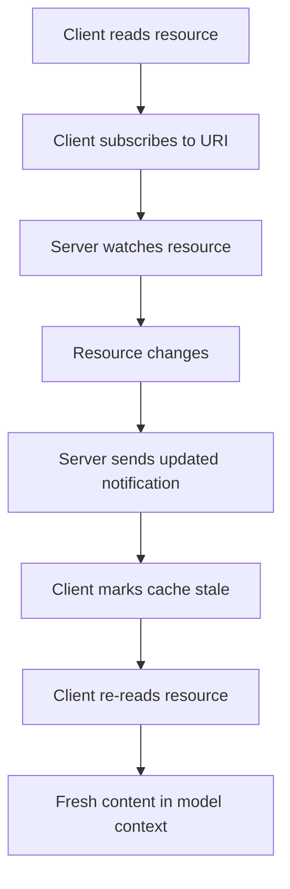

# Resource Subscriptions and Live Data: Keeping the Model's View Fresh

## English

Resources in MCP are read-only data identified by URIs — a file, a database row, a log stream, a rendered page. The naive mental model is 'client reads a resource, gets a snapshot, done.' But real data changes: a config file is edited, a deploy status flips, a ticket is updated. Without a mechanism for freshness, the model is reasoning over stale context and the host has no way to know. MCP addresses this with resource subscriptions: a client can subscribe to a specific resource URI, and the server promises to send a notification when that resource changes. The notification is not the new content — it is a signal that the content is stale and the client should re-read.

The design is deliberately lightweight. The server does not push the full resource body in the notification; it just says 'this URI changed.' The client then issues a fresh `resources/read` to fetch the current state. This keeps notifications small and avoids duplicating the resource content in two places. It also means the client stays in control of when it actually pulls data — useful when the resource is expensive to fetch or when the client wants to batch several changes into one re-read.

A concrete example: a host has subscribed to `file:///project/config.yaml`. The user edits the file in their editor. The MCP server (which is watching the file) sends a `notifications/resources/updated` message naming that URI. The host marks its cached copy as stale, and the next time the model asks about the config, the host re-reads it and passes fresh content into the model's context. The model never sees a stale answer, and the host never wasted bandwidth pushing content the model wasn't going to use.

The pattern generalises beyond files. A server wrapping a CI system can subscribe to `ci://builds/12345` and notify when the build status changes. A server wrapping a ticketing system can notify when a ticket's state changes. The key discipline is that the URI must be stable and the notification must be cheap — otherwise the mechanism becomes a polling system in disguise.

Subscriptions are also a place where capability negotiation matters: a client must declare it supports resource subscriptions during the initialize handshake, and a server must declare it can send them. Neither side assumes the other can. If you are building a server, treat subscriptions as a promise: if you say a resource will notify, you must actually watch it and send the notification reliably, or the model will reason over stale data indefinitely. If you are building a client, treat the notification as a hint, not as truth — always re-read before trusting the content.

## 中文

MCP 入面嘅 resource 係用 URI 識別嘅唯讀資料——一個檔案、一行資料庫記錄、一條 log 流、一個渲染好嘅頁面。天真嘅心智模型係「client 讀一個 resource，攞到快照，搞掂」。但真實資料會變：config 檔被編輯、部署狀態翻轉、ticket 被更新。冇新鮮度機制嘅話，模型就係喺過時上下文上面推理，而 host 完全唔知。MCP 用 resource subscription 處理呢個問題：client 可以訂閱某個特定 resource URI，而 server 承諾喺嗰個 resource 改變時送通知。通知唔係新內容——佢係一個信號，話俾你知內容過時咗，client 應該重新讀。

呢個設計刻意輕量。Server 唔會喺通知入面推送完整 resource 內容；佢只係話「呢個 URI 變咗」。Client 之後發一個新嘅 `resources/read` 去攞最新狀態。咁樣通知就保持細小，亦避免喺兩個地方重複 resource 內容。佢亦意味住 client 保持控制幾時真正拉資料——當 resource 拉取成本高，或者 client 想將幾個改動合併成一次重讀嗰陣，呢點好有用。

一個具體例子：host 訂閱咗 `file:///project/config.yaml`。用戶喺編輯器改咗個檔。MCP server（一直監察住個檔）送出一個 `notifications/resources/updated` 訊息，指名嗰個 URI。Host 將自己嘅快取標記為過時，下次模型問起 config，host 就重讀佢，並將新鮮內容放入模型上下文。模型永遠唔會見到過時答案，而 host 亦永遠唔會浪費頻寬推送模型唔會用嘅內容。

呢個模式可以推廣到檔案以外。一個包裝 CI 系統嘅 server 可以訂閱 `ci://builds/12345`，喺 build 狀態改變時通知。一個包裝 ticketing 系統嘅 server 可以喺 ticket 狀態改變時通知。關鍵紀律係：URI 必須穩定，通知必須便宜——否則呢個機制就會變成偽裝嘅輪詢系統。

Subscription 亦係 capability negotiation 發揮作用嘅地方：client 必須喺 initialize 握手時聲明佢支援 resource subscription，server 必須聲明佢識送。雙方都唔會假設對方識。如果你整緊 server，就將 subscription 當成一個承諾：如果你話某個 resource 會通知，你就必須真正監察佢並可靠咁送通知，否則模型就會無了期咁喺過時資料上面推理。如果你整緊 client，就將通知當成提示而唔係真相——信任內容之前永遠先重讀。

## Key Takeaway

Resource subscriptions are a staleness signal, not a data push — the server says 'this changed,' the client decides when to re-read.

## Related Concepts
- Pagination, Notifications, and Change Tracking in MCP
- MCP Resources and Prompts — The Read and Template Primitives

## Diagram

