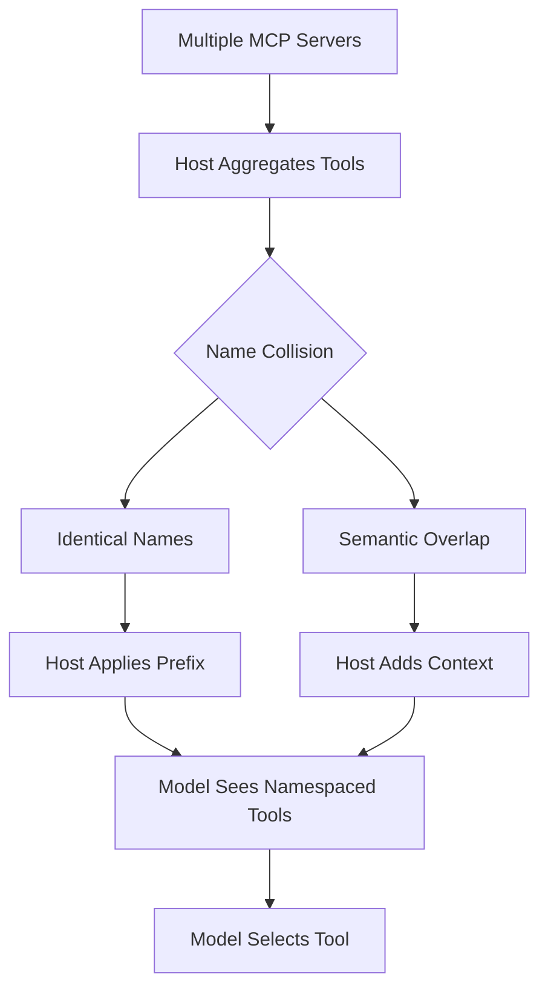

# Namespacing and Collision Resolution in Tool Surfaces

## English

When a host aggregates tools from several MCP servers, the names a model sees are not necessarily the names the servers declared. A file server and a database server may both expose a tool called `query`; if the host passed both through verbatim, the model would face two identical labels and could not reliably pick one. Hosts therefore namespace or prefix tool names — often with the server's identifier or a short alias — so that `files.query` and `db.query` remain distinguishable in the model's tool list. The exact separator and prefixing scheme is a host decision, not something the protocol mandates, which means the same server may appear under different names in different hosts.

This has a subtle consequence: the model's choice is driven by the text it reads, so a poorly chosen prefix can change behaviour. A prefix like `mcp_` tells the model nothing, while `github_` or `billing_` gives it a semantic hint about where the tool lives and what it touches. Good hosts treat the prefix as part of the prompt surface, not as an internal bookkeeping detail. Some hosts also rewrite descriptions to mention the source server, so the model can reason about provenance when two tools overlap in function.

Collisions are not only about identical names. Two tools can be semantically identical under different names — `search_files` on one server and `find_documents` on another — and the model must still choose. Here the host cannot fix the problem by renaming alone; it needs to expose enough context (descriptions, server identity, perhaps a short summary of each server's domain) for the model to distinguish them. When the model cannot tell them apart, it may pick arbitrarily, retry, or hallucinate arguments that fit neither tool.

A practical mitigation is to keep the visible tool surface small and deliberate. If a host knows that two servers cover overlapping domains, it can hide one behind a routing tool or present only the more specific one. Namespacing is therefore not just a labelling convention — it is a curation decision that shapes what the model can plausibly choose. Hosts that expose every tool from every connected server verbatim tend to produce noisier selection behaviour than hosts that invest in naming and pruning.

For server authors, the lesson is to choose distinctive, descriptive tool names that are unlikely to collide and that remain meaningful when prefixed. Avoid generic verbs like `get` or `run`; prefer `fetch_invoice` or `run_migration`. If your server is likely to be aggregated alongside others, assume your names will be prefixed and that your descriptions must survive that prefixing without losing their meaning.

## 中文

當一個 host 匯集多個 MCP server 的工具時，模型見到的名稱未必就是 server 原先宣告的名稱。一個檔案 server 和一個資料庫 server 可能都提供名為 `query` 的工具；若 host 原封不動地轉發，模型就會面對兩個一模一樣的標籤，無法可靠地選擇其中一個。因此 host 通常會為工具名稱加上命名空間或前綴——往往用 server 的識別碼或短別名——令 `files.query` 與 `db.query` 在模型的工具清單中仍然可分辨。具體用哪個分隔符、哪種前綴方案，是 host 的決定，而非協議強制，這意味著同一個 server 在不同 host 中可能以不同名稱出現。

這帶來一個微妙的後果：模型的選擇是由它讀到的文字驅動的，所以一個選得不好的前綴可以改變行為。像 `mcp_` 這樣的前綴對模型毫無資訊，而 `github_` 或 `billing_` 則給它一個語意提示，說明工具身處何方、觸及什麼。好的 host 會把前綴視為 prompt 表面的一部分，而非內部的記帳細節。有些 host 甚至會改寫描述以提及來源 server，令模型在兩個功能重疊的工具之間可以就出處作出推理。

碰撞不只在於名稱完全相同。兩個工具可以在不同名稱下語意相同——一個 server 的 `search_files` 與另一個的 `find_documents`——而模型仍然必須選擇。此時 host 無法單靠改名解決問題；它需要披露足夠的上下文（描述、server 身分，也許還有每個 server 領域的簡短摘要），讓模型能夠區分。當模型無法分辨時，它可能任意挑選、重試，或憑空編造出兩者都不符合的參數。

一個實用的緩解方法是保持可見的工具表面小而審慎。若 host 知道兩個 server 覆蓋重疊的領域，它可以將其中一個藏在路由工具之後，或只呈現較具體的那個。因此命名空間化不只是一種標籤慣例——它是一個策展決定，塑造模型能合理地選擇什麼。把每個已連接 server 的每個工具原樣曝光的 host，往往比投資於命名與修剪的 host 產生更嘈雜的選擇行為。

對 server 作者而言，教訓是選擇獨特、具描述性、不易碰撞、且在加上前綴後仍然有意義的工具名稱。避免像 `get` 或 `run` 這類泛用動詞；偏好 `fetch_invoice` 或 `run_migration`。若你的 server 很可能與其他 server 一起被匯集，就要假設你的名稱會被加上前綴，而你的描述必須在加前綴後仍然不失其義。

## Key Takeaway

Namespacing is a host-level curation decision, so server authors should pick distinctive, descriptive tool names that survive prefixing.

## Related Concepts
- Tool naming conventions
- Multi-server orchestration

## Diagram

