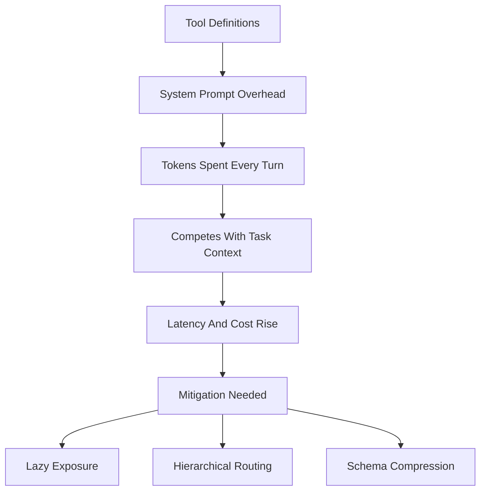

# The Cost of a Schema: Tokens Spent Before Any Tool Runs

## English

Every tool a host exposes to the model consumes context before the model does anything. The tool's name, description, and JSON Schema for its arguments all sit in the system prompt or tool list, and they are paid for on every turn of the conversation. A single tool with a rich schema — nested objects, enums, per-field descriptions — can easily run to several hundred tokens. Multiply that by twenty tools across three servers and the fixed overhead can be thousands of tokens per request, before the user has even asked a question.

This overhead is not free. It competes directly with the conversation history, retrieved documents, and the model's working space for reasoning. On models with modest context windows, a bloated tool surface can crowd out the actual task. Even on large-context models, the cost is real in latency and money: every token in the tool list is processed on every call, and providers bill for input tokens. A host that connects to ten servers with fifty tools each may be spending more on tool definitions than on the user's content.

There are several ways hosts manage this. One is lazy exposure: only surface tools whose descriptions match the current task, using a lightweight retrieval step over tool metadata. Another is hierarchical routing: expose a small number of coarse tools ("search", "execute") that internally dispatch to more specific ones, trading selection precision for a smaller surface. A third is schema compression: shorten descriptions, drop redundant field descriptions, and flatten nested structures where the model does not need the full shape. Each technique trades some capability for context budget.

Server authors contribute to the problem when they over-specify. A schema that enumerates twenty optional parameters, each with a paragraph of description, is rarely necessary. The model needs enough to choose the tool and fill its arguments; it does not need a full API reference. Descriptions should be tight and purposeful, and defaults should be expressed in the schema rather than in prose. Where a parameter is genuinely complex, consider splitting the tool into two simpler ones rather than one tool with a sprawling signature.

A useful mental model is that the tool surface is a budget the host spends on the model's behalf. Every tool added is a small recurring tax on every turn. Hosts and server authors both benefit from treating that tax as a design constraint: expose what the task needs, describe it precisely, and prune what is not pulling its weight. The cheapest tool is the one the model never has to read.

## 中文

host 向模型曝光的每一個工具，都會在模型做任何事之前消耗上下文。工具的名稱、描述，以及其參數的 JSON Schema，全都放在系統提示或工具清單中，並且在對話的每一輪都要付費。一個帶有豐富 schema 的工具——嵌套物件、enum、逐欄位描述——輕易就能達到數百個 token。把它乘以三個 server 共二十個工具，固定開銷在每次請求中就可以是數千個 token，而使用者甚至還未發問。

這份開銷並非免費。它直接與對話歷史、檢索到的文件，以及模型用於推理的工作空間競爭。在上下文窗口不大的模型上，臃腫的工具表面可以把真正的任務擠出去。即使在大型上下文的模型上，代價在延遲與金錢上也是真實的：工具清單中的每個 token 在每次呼叫時都會被處理，而供應商會就輸入 token 收費。一個連接到十個 server、每個五十個工具的 host，花在工具定義上的資源可能比花在使用者內容上的還多。

host 有幾種方法管理此事。一種是延遲曝光：只呈現描述與當前任務相符的工具，使用對工具中介資料的輕量檢索步驟。另一種是階層式路由：只曝光少量粗粒度的工具（「search」、「execute」），在內部再分派到更具體的工具，以選擇精確度換取更小的表面。第三種是 schema 壓縮：縮短描述、刪去多餘的欄位描述，並在模型不需要完整形狀時攤平嵌套結構。每種技術都以部分能力換取上下文預算。

當 server 作者過度指定時，他們也在助長這個問題。一個列舉二十個可選參數、每個都附一段描述的 schema，很少是必要的。模型只需要足夠的資訊去選擇工具並填寫參數；它不需要完整的 API 參考。描述應該緊湊而有目的，預設值應在 schema 中表達而非在文字中。若某個參數確實複雜，考慮把工具拆成兩個較簡單的工具，而不是一個簽名龐雜的工具。

一個有用的心智模型是：工具表面是 host 代模型花費的預算。每加入一個工具，就是對每一輪課一筆小額的經常性稅。host 與 server 作者都受益於把這筆稅視為設計約束：曝光任務所需的、精確地描述它、修剪掉沒有貢獻的部分。最便宜的工具，就是模型永遠不必讀的那個。

## Key Takeaway

Tool schemas are a recurring token tax on every turn, so both hosts and server authors should treat the visible surface as a budget to be spent deliberately.

## Related Concepts
- Context budget
- Tool schema design

## Diagram

