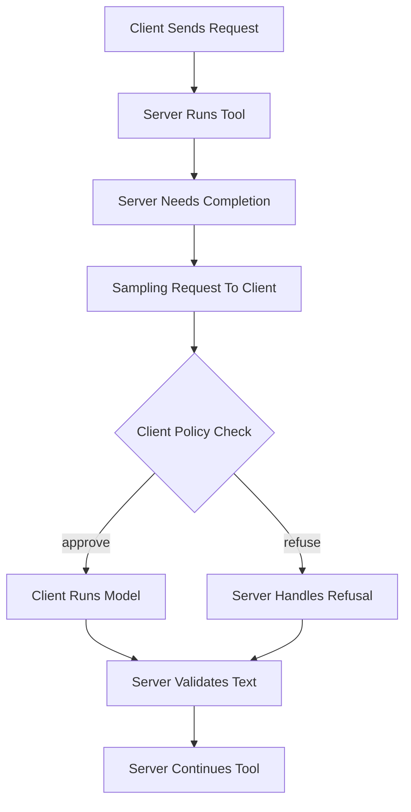

# When the Server Needs the Model: Sampling as a Reverse Dependency

## English

Most MCP conversations flow one way: the client asks, the server answers. Sampling inverts that. A server can, mid-tool-call, ask the client to run a model completion on its behalf — passing a prompt and receiving generated text back. This is useful when a tool's logic needs language understanding it cannot do itself: a summarisation tool that must condense a long document, a classification tool that must label free text, or an agentic tool that must decide which sub-step to take next. Rather than bundling its own model, the server borrows the client's.

The design has clear advantages. The client controls which model is used, so the user's cost, privacy, and capability preferences are respected without the server needing to know anything about them. The server stays simple: it describes what it wants in natural language and receives text. And because the completion passes through the client, the client can apply its own policies — refusing, redacting, or routing to a different model based on the prompt's content.

But sampling introduces a reverse dependency that changes the shape of failure. A tool that expects a completion may block indefinitely if the client declines, or may receive text in an unexpected format and misbehave. The server must treat the completion as an unreliable external call: handle refusals gracefully, validate the returned text before acting on it, and never assume a particular model or output style. This is the same discipline as calling any third-party API, applied to the model itself.

There is also a trust dimension. A server that can trigger model completions can influence what the model sees and does, potentially steering the conversation. Clients therefore typically gate sampling behind user consent or policy, and may restrict which servers are allowed to sample at all. The server's request is a suggestion, not a command; the client decides whether to honour it, and with what model, and at what cost.

For tool designers, sampling is best used sparingly and transparently. A tool that quietly calls the model three times inside one invocation is hard to reason about, hard to cost, and hard to debug. Prefer explicit, bounded uses: one summarisation, one classification, one decision — each with a clear purpose and a fallback path when the client declines. The reverse dependency is powerful precisely because it is rare; overusing it turns a simple tool into an opaque agent.

## 中文

大多數 MCP 對話是單向流動的：client 提問，server 回答。Sampling 把這個方向倒轉。server 可以在工具呼叫中途，要求 client 代它執行一次模型補全——傳入一個 prompt，並接收生成的文字回來。當工具的邏輯需要它自己無法做到的語言理解時，這就很有用：一個必須濃縮長文件的摘要工具、一個必須為自由文字貼標籤的分類工具，或一個必須決定下一個子步驟的代理式工具。server 與其自帶模型，不如借用 client 的。

這個設計有明顯的好處。client 控制使用哪個模型，因此使用者的成本、私隱與能力偏好都得到尊重，而 server 無需知道任何相關資訊。server 保持簡單：它用自然語言描述自己想要什麼，然後收到文字。而且因為補全經過 client，client 可以套用自己的政策——根據 prompt 內容拒絕、遮蔽，或路由到不同的模型。

但 sampling 引入了一種反向依賴，改變了失敗的形態。一個期待補全的工具，若 client 拒絕，可能會無限阻塞；或者收到格式出乎意料的文字而行為失常。server 必須把補全視為一個不可靠的外部呼叫：優雅地處理拒絕、在據此行動前驗證返回的文字，並且永不假設某個特定模型或輸出風格。這與呼叫任何第三方 API 的紀律相同，只是套用在模型本身。

還有一個信任的維度。一個能觸發模型補全的 server，可以影響模型所見與所為，有可能操縱對話。因此 client 通常把 sampling 置於使用者同意或政策之後，並可能限制哪些 server 才被允許 sampling。server 的請求是建議，不是命令；由 client 決定是否予以採納、用哪個模型、以什麼成本。

對工具設計者而言，sampling 最好克制而透明地使用。一個在單次呼叫中悄悄叫用模型三次的工具，難以推理、難以計費、也難以除錯。偏好明確、有界的用法：一次摘要、一次分類、一次決策——每個都有清晰的目的，以及當 client 拒絕時的後備路徑。反向依賴之所以強大，正因為它罕見；過度使用會把一個簡單的工具變成不透明的代理。

## Key Takeaway

Sampling lets a server borrow the client's model, but it inverts the dependency and demands careful handling of refusal, validation, and consent.

## Related Concepts
- Sampling
- Client-server architecture

## Diagram

