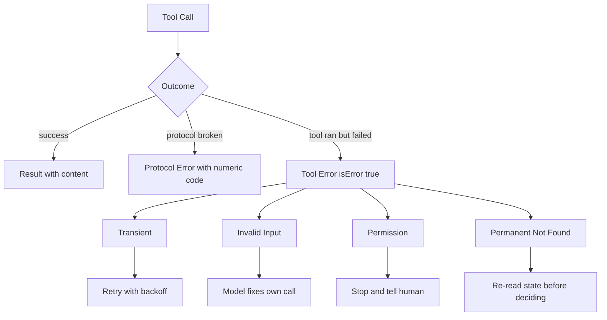

# Error Taxonomies: Classifying What Went Wrong So the Model Can React

## English

A tool that fails with a single opaque 'error' string forces the model to guess. The useful approach is an error taxonomy: a small set of named categories, each implying a different recovery strategy. Roughly, you can split failures into four buckets. Transient failures (timeout, connection reset, HTTP 429 throttling) mean 'try again later, possibly with backoff'. Invalid-input failures (bad argument, missing required field, schema mismatch) mean 'the model should fix its own call'. Permission failures (403, expired credential, scope missing) mean 'stop and tell the human; retrying will not help'. And permanent or not-found failures (404, the record was deleted, the file does not exist) mean 'the world changed; re-read state before deciding'. If you collapse all four into one error type, the model cannot distinguish 'retry' from 'escalate', and it tends to default to one behaviour — usually retrying, which is the worst choice for permission errors.

The mechanism matters: in JSON-RPC 2.0, a tool call that fails at the protocol level (unknown method, malformed JSON) produces a protocol error object with a numeric code. But a tool that runs correctly and reports a business failure should NOT be a protocol error. The convention is to return a normal successful result whose content includes text describing the failure, plus an explicit indicator (a boolean like isError) that flags it as a tool-level failure. This distinction is load-bearing: protocol errors mean the client or server is broken; tool errors mean the tool executed and the outcome was a failure the model should reason about. Mixing them up causes hosts to treat a routine 'record not found' as an infrastructure outage.

A good taxonomy also carries structured detail, not just a label. Instead of a prose sentence, return a small object with fields like category, a machine-readable code, a human-readable message, and a retryable boolean. The message is for the model and the human; the code and boolean are for deterministic logic in the host or in the model's reasoning. For example, {category: 'invalid_input', code: 'MISSING_FIELD', field: 'start_date', retryable: true} tells the model exactly what to change. Compare that with 'Error: could not complete request', which tells it nothing and invites random rephrasing of arguments.

There is a subtle trap: error messages are also prompt text. If your error message says 'please try a different date format', the model will do exactly that, so write messages that steer toward the correct action. Conversely, avoid leaking internal details — stack traces, SQL fragments, internal hostnames — because they burn context tokens, confuse the model, and can expose information to whatever the host logs. A short, actionable message plus a stable code is the sweet spot.

Finally, design for the failure the model cannot fix. Some errors are the human's problem: expired OAuth token, missing account permission, a resource that requires approval. In those cases the correct behaviour is to surface a clear, user-facing explanation and stop, not to loop. Encoding that intent in the taxonomy — a category like needs_human with retryable: false — is what lets a host implement sensible retry budgets and escalation instead of watching the model hammer the same wall five times.

## 中文

一個工具若只用一句含糊的「錯誤」字串來回報失敗，模型就只能靠猜。比較有用的做法是建立錯誤分類法（error taxonomy）：一組數量不多、各有名稱的類別，每個類別都隱含不同的復原策略。大致上可以把失敗分成四類。暫時性失敗（逾時、連線被重設、HTTP 429 限流）意思是「稍後再試，可能需要退避」。輸入無效的失敗（引數錯誤、缺少必填欄位、結構描述不符）意思是「模型應該修正自己的呼叫」。許可權失敗（403、憑證過期、缺少 scope）意思是「停下來告訴人類；再試也沒用」。永久性或找不到的失敗（404、紀錄已被刪除、檔案不存在）意思是「世界變了；先重新讀取狀態再決定」。若把這四類全塞進同一種錯誤型別，模型就無法分辨「重試」與「升級處理」，而它往往會傾向某一種行為——通常是重試，而這對許可權錯誤來說是最糟的選擇。

機制層面很重要：在 JSON-RPC 2.0 裡，工具呼叫若在協定層失敗（未知方法、JSON 格式錯誤），會產生帶數字錯誤碼的協定錯誤物件。但工具若正常執行、只是回報業務上的失敗，就不該當成協定錯誤。慣例是回傳一個正常的成功結果，內容中帶有描述失敗的文字，並加上一個明確的指示（例如名為 isError 的布林值）標記這是工具層級的失敗。這個區分非常關鍵：協定錯誤代表客戶端或伺服器壞了；工具錯誤代表工具跑完了，而結果是模型應該去推理的失敗。兩者混淆，會讓宿主把例行的「找不到紀錄」當成基礎設施故障。

好的分類法還會攜帶結構化細節，而不只是一個標籤。別只回傳一句散文，而是回傳一個小物件，欄位例如 category、機器可讀的 code、給人看的 message，以及 retryable 布林值。message 是給模型和人類看的；code 和布林值則是給宿主或模型推理中的確定性邏輯用的。例如 {category: 'invalid_input', code: 'MISSING_FIELD', field: 'start_date', retryable: true} 就明確告訴模型該改什麼。對照之下，「Error: could not complete request」什麼都沒說，只會誘使模型隨機換個說法再試一次。

有個微妙的陷阱：錯誤訊息本身也是提示文字（prompt text）。若你的錯誤訊息寫「請改用不同的日期格式」，模型就會照做，所以訊息要寫得能引導到正確動作。反過來說，也要避免洩漏內部細節——堆疊追蹤、SQL 片段、內部主機名稱——因為它們會耗掉上下文 token、混淆模型，還可能把資訊暴露給宿主的日誌。簡短、可行動的訊息加上穩定的錯誤碼，才是最佳平衡點。

最後，要為模型修不了的失敗設計。有些錯誤是人類的問題：OAuth token 過期、帳號缺少許可權、資源需要核准。這時正確行為是提出清楚、給使用者看的說明然後停下，而不是迴圈重試。把這個意圖編碼進分類法——例如 needs_human 這個類別配上 retryable: false——正是讓宿主能實作合理的重試預算與升級機制、而不是看著模型對著同一堵牆連撞五次的關鍵。

## Key Takeaway

Classify tool failures into transient, invalid-input, permission, and permanent categories, and return them as structured tool-level results rather than protocol errors, so the model knows whether to retry, fix its arguments, or escalate to the user.

## Related Concepts
- JSON-RPC 2.0 error objects
- Retry budgets and backoff

## Diagram

