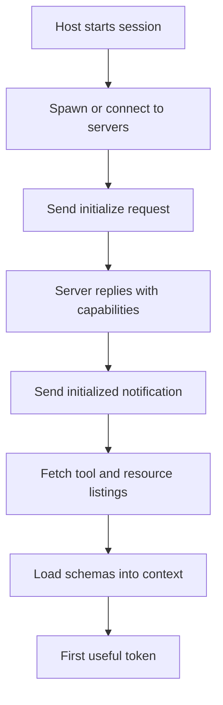

# The Cold-Start Handshake Cost: What Every Session Pays Before the First Useful Token

## English

Every MCP session begins with a fixed overhead that users rarely notice but engineers must budget for. Before a single tool runs, the host must spawn or connect to each server, exchange the initialize request and response, negotiate protocol version and capabilities, then discover the tool and resource listings. For a stdio server, 'spawn' means forking a process — on a cold machine that can mean loading a Python or Node runtime, importing libraries, and opening database connections. A server that takes 1.5 seconds to boot is invisible in a demo and painful in a chat UI where the user is waiting for the first token.

The handshake itself is cheap in bytes but not free in round trips. The client sends initialize with its protocol version, capabilities, and client info; the server replies with its own version, capabilities, and server info; the client sends a notifications/initialized message to confirm. Only then can the client call tools/list or resources/list. Over a remote transport each of these is a network round trip, so on a 200 ms link the handshake alone can cost half a second before any listing request. If the host then lists tools from ten servers sequentially rather than in parallel, the cold start multiplies.

A second hidden cost is schema loading. Tool definitions — names, descriptions, and full JSON Schema for inputs — must be fetched and then, in most hosts, rendered into the model's context. A server exposing forty tools with detailed schemas can easily consume several thousand tokens before the user has typed anything. That is the 'cost of a schema' problem, but the cold-start angle is that this cost is paid up front and repeatedly if sessions are short-lived. A host that reconnects per conversation pays it every time; one that keeps a warm pool pays it once.

Mitigations fall into a few patterns. Lazy connection: connect to a server only when a tool from it is plausibly needed, accepting a latency spike on first use. Warm pools: keep long-lived server processes and reuse sessions across conversations, trading memory for latency. Caching: persist the tools/list result with an ETag or version marker and revalidate cheaply, since tool surfaces change rarely. Parallel discovery: issue all list requests concurrently rather than in sequence. And pre-warming at app launch: start servers in the background while the user is still reading the welcome screen.

There is a design lesson hiding here. Because the handshake is versioned and capability-based, a host cannot assume what a server supports until it has heard back — so it cannot pre-render a tool palette or pre-build a schema cache without connecting first. That makes connection cost a first-class product concern, not an implementation detail. Measure it: time from process spawn to first successful tools/list response is a metric worth putting on a dashboard, because it is the floor under your time-to-first-useful-action.

## 中文

每個 MCP 工作階段在開始時都有一段固定開銷，使用者很少注意到，但工程師必須把它編進預算。在任何工具執行之前，宿主必須啟動或連上每個伺服器、交換 initialize 請求與回應、協商協定版本與能力，然後才探索工具與資源清單。對 stdio 伺服器而言，「啟動」意味著 fork 一個行程——在冷機上，這可能代表載入 Python 或 Node 執行環境、匯入函式庫、開啟資料庫連線。一個開機要 1.5 秒的伺服器，在示範裡看不出來，但在使用者等著第一個 token 出現的聊天介面裡卻很痛。

握手本身位元組數不多，但往返次數不是免費的。客戶端送出 initialize，附上自己的協定版本、能力與客戶端資訊；伺服器回覆自己的版本、能力與伺服器資訊；客戶端再送一個 notifications/initialized 訊息確認。到這裡客戶端才能呼叫 tools/list 或 resources/list。走遠端傳輸時，每一步都是一次網路往返，所以在 200 毫秒的鏈路上，光是握手就可能花掉半秒，還沒開始列清單。若宿主接著是依序而非平行地向十個伺服器列工具，冷啟動成本就會相乘。

第二個隱藏成本是結構描述載入。工具定義——名稱、描述，以及輸入的完整 JSON Schema——必須被抓取，然後在大多數宿主裡被渲染進模型的上下文。一個暴露四十個工具、每個都有詳細結構描述的伺服器，很容易在使用者還沒打字前就吃掉數千個 token。這就是「結構描述的代價」問題，但從冷啟動角度看，重點是這筆成本是預先支付、且在工作階段短命時反覆支付的。每次對話都重連的宿主每次都要付；維持暖池的宿主只付一次。

緩解方式大致有幾種模式。延遲連線：只在某伺服器的工具很可能被用到時才連，接受首次使用時的延遲尖峰。暖池：維持長命的伺服器行程，跨對話重複使用工作階段，用記憶體換延遲。快取：把 tools/list 的結果連同 ETag 或版本標記持久化，之後便宜地重新驗證，因為工具介面很少變動。平行探索：所有清單請求併傳送出，而非依序。以及應用啟動時預熱：在使用者還在讀歡迎畫面時就在背景啟動伺服器。

這裡藏著一個設計教訓。因為握手是有版本、以能力為基礎的，宿主在聽到回覆之前不能假設伺服器支援什麼——所以它無法在連線前就預先渲染工具面板或預建結構描述快取。這讓連線成本成為第一級的產品考量，而非實作細節。去量測它：從行程啟動到第一次成功 tools/list 回應的時間，是值得放上儀錶板的指標，因為它是你「到達第一個有用動作」時間的地板。

## Key Takeaway

Cold-start cost — process spawn, the initialize round trips, and schema loading — is paid before any tool runs, so measure and reduce it with warm pools, caching, and parallel discovery.

## Related Concepts
- Capability negotiation
- Context token budgeting

## Diagram

