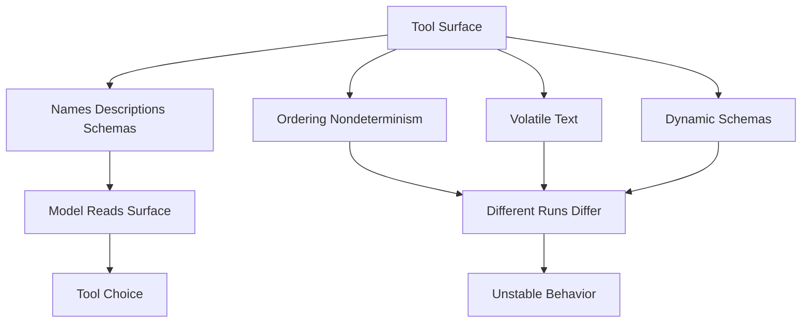

# Deterministic Tool Surfaces: Why the Same Server Should Look Identical Every Time

## English

A model chooses tools by reading their names, descriptions, and schemas. That means the tool surface is an input to a stochastic function, and any nondeterminism in the surface becomes nondeterminism in behaviour. If tools/list returns entries in a different order on each call, or if descriptions embed timestamps, request IDs, or 'current user' names, then two runs of the same prompt can produce different tool choices for reasons that have nothing to do with the task. Determinism in the surface is therefore a correctness property, not a nicety.

The most common offenders are ordering and incidental text. JSON objects are unordered by specification, so a server that builds its tool list from a hash map may emit tools in an arbitrary order that changes between process restarts. Many hosts sort tools before rendering, which papers over the problem — until one host does not, and the model's attention shifts because a different tool appears first. Similarly, a description like 'Search the catalog (last synced 14:32:07)' changes every minute; the model may latch onto the timestamp as a signal. Stable, sorted ordering and descriptions free of volatile data make runs comparable.

A second source is dynamic schemas. Some servers generate their input schema at runtime from a database, a config file, or an environment variable — for example, an enum of allowed regions populated from a live API. That is sometimes necessary, but it means the contract the model sees can differ between sessions without any code change. If a region is added, an enum grows, and the model's behaviour can shift. The fix is not to forbid dynamic schemas but to make changes deliberate and visible: version the surface, log when it changes, and treat a schema change like an API change that deserves a test.

Determinism also matters for testing and regression. Golden-conversation tests — recording a prompt plus the tool calls a model made, then replaying it — only work if the tool surface is identical between record and replay. If the server's tool list drifts, the replay diverges for reasons unrelated to the change under test, and the test becomes noise. Pinning the surface: fixed order, fixed descriptions, fixed schema, fixed protocol version, is what makes such tests meaningful.

Practically, this is a checklist. Sort tools and resources by a stable key before returning them. Keep descriptions free of timestamps, counters, and per-user data; put volatile context in the tool's response, not its definition. Generate schemas from a checked-in source of truth and hash them so you can detect drift. Include the surface hash in logs so you can correlate a strange model decision with the exact tool definitions it saw. And when you must change the surface, change it on purpose, version it, and re-record your fixtures — because from the model's point of view, the tool list is part of the prompt.

## 中文

模型是靠閱讀工具的名稱、描述與結構描述來選擇工具的。這意味著工具介面是一個隨機函式的輸入，而介面中任何不確定性都會變成行為上的不確定性。若 tools/list 每次呼叫都回傳不同順序的專案，或描述中嵌了時間戳、請求 ID、或「目前使用者」的名字，那麼同一個提示的兩次執行，就可能因為與任務無關的原因而做出不同的工具選擇。因此介面的確定性是一項正確性屬性，而不是錦上添花。

最常見的元兇是排序與附帶文字。JSON 物件在規範上是無序的，所以若伺服器從雜湊表建構工具清單，就可能以任意順序輸出工具，且會在行程重啟之間改變。許多宿主在渲染前會排序工具，把問題遮住——直到某個宿主沒這麼做，模型就因為某個不同的工具排在前面而注意力轉移。同樣地，像「搜尋目錄（上次同步 14:32:07）」這種描述每分鐘都在變；模型可能把時間戳當成訊號抓住不放。穩定的排序，以及不含易變資料的描述，才能讓不同次執行可比較。

第二個來源是動態結構描述。有些伺服器在執行時從資料庫、設定檔或環境變數產生輸入結構描述——例如從即時 API 填入允許區域的列舉。這有時確有必要，但這意味著模型看到的契約可能在沒有任何程式碼變更的情況下，於不同工作階段之間不同。若新增一個區域，列舉就變長，模型的行為可能跟著改變。解法不是禁止動態結構描述，而是讓變更刻意且可見：為介面版本化、在變更時記錄，並把結構描述變更當成值得寫測試的 API 變更。

確定性對測試與回歸也很重要。黃金對話測試——錄下一次提示加上模型所做的工具呼叫，然後重播——只有在錄製與重播之間工具介面完全相同時才有意義。若伺服器的工具清單漂移，重播就會因為與受測變更無關的原因而分歧，測試也就變成噪音。把介面釘死：固定順序、固定描述、固定結構描述、固定協定版本，才能讓這類測試有意義。

實務上這是一張檢查清單。回傳前用穩定鍵排序工具與資源。描述中不要有時間戳、計數器、每位使用者的資料；把易變的上下文放在工具的回應裡，而不是它的定義裡。從簽入的單一真實來源產生結構描述並對它做雜湊，以便偵測漂移。在日誌中加入介面雜湊，好讓你能把某個奇怪的模型決策，對應到它當時看到的確切工具定義。而當你必須改變介面時，刻意地改、為它版本化、並重新錄製你的測試樣本——因為從模型的角度看，工具清單就是提示的一部分。

## Key Takeaway

Treat the tool surface as part of the prompt: keep ordering, descriptions, and schemas stable and versioned, or the model's choices will drift for reasons unrelated to the task.

## Related Concepts
- Deterministic fixtures and replay testing
- Schema evolution

## Diagram

