# MCP and the Limits of Model Memory: What Persists Across Sessions

## English

A common misconception is that an MCP server is a place where the model 'remembers' things. It is not. The protocol has no primitive for persistent memory; every conversation begins with a fresh context window, and the server holds no state that the model can read back unless the server explicitly exposes it as a resource or a tool result. This distinction matters because teams often build a 'memory server' expecting it to behave like a database the model can query at will, then discover that the model only knows what fits in the current turn. The server can be a store of facts, but the model must ask for them, and the host must decide whether to include them.

What actually persists is the server's own state — files on disk, rows in a table, an in-memory cache — plus whatever the host chooses to keep outside the model's context. If you want continuity across sessions, you have to design for it explicitly: a tool that writes a note to disk, a resource that lists notes, a prompt template that summarises them. The protocol gives you verbs, not a memory model. Think of MCP as a telephone line to a filing cabinet, not as the cabinet itself.

There is also a subtler trap: the model's apparent memory within a single session is really just the transcript. If the host truncates old tool results to save context (a common and sensible optimisation), the model loses access to facts it 'learned' earlier. A tool that returned a long list of IDs five turns ago may now be invisible, and the model will re-call the tool or hallucinate. Good servers anticipate this by offering compact summaries, stable identifiers, and tools that can re-fetch specific items by key rather than dumping everything again.

Finally, consider what 'memory' means for correctness. If a server caches data and the model relies on a stale copy, the model may confidently act on outdated facts. The fix is not more memory but better freshness signals: timestamps in tool results, resource subscriptions that notify the host of changes, or tools that accept a 'since' parameter. Memory is a design decision distributed across the host, the server, and the model's context budget — not a feature you can switch on.

## 中文

很多人誤以為 MCP 伺服器是模型「記得」事情的地方，其實不然。協議本身沒有任何持久記憶的原語；每次對話都由全新的上下文視窗開始，伺服器不持有任何模型可以讀回的狀態，除非伺服器明確把它當作資源或工具結果暴露出來。這個區別很重要，因為團隊常常建立一個「記憶伺服器」，期望它像資料庫一樣讓模型隨時查詢，結果發現模型只知道當前這一輪塞得進去的東西。伺服器可以是事實的倉庫，但模型必須主動去問，而主機必須決定要不要把它放進上下文。

真正會持久化的是伺服器自己的狀態——磁碟上的檔案、資料表裡的列、記憶體快取——再加上主機選擇保留在模型上下文之外的東西。如果你想要跨工作階段延續，就必須明確設計：一個把筆記寫到磁碟的工具、一個列出筆記的資源、一個把它們摘要出來的提示模板。協議給你的是動詞，不是記憶模型。把 MCP 想成通往檔案櫃的電話線，而不是檔案櫃本身。

還有一個更隱蔽的陷阱：模型在單一工作階段內的「記憶」，其實只是對話紀錄。如果主機為了節省上下文而截斷舊的工具結果（這是常見且合理的優化），模型就失去了它早先「學到」的事實。五輪之前回傳一長串 ID 的工具，現在可能已經不可見，模型會重新呼叫工具或憑空編造。好的伺服器會預先應對：提供精簡摘要、穩定識別碼，以及能依鍵重新取得特定項目的工具，而不是每次都倒出全部。

最後，想想「記憶」對正確性意味著什麼。如果伺服器快取了資料，而模型依賴過時的副本，模型可能會自信地根據舊事實行動。解法不是更多記憶，而是更好的新鮮度訊號：工具結果裡的時間戳、通知主機變更的資源訂閱，或接受「since」參數的工具。記憶是一個分散在主機、伺服器與模型上下文預算之間的設計決策，不是一個可以打開的開關。

## Key Takeaway

MCP servers store data, not model memory; continuity across sessions must be designed explicitly through tools, resources, and host-side context management.

## Related Concepts
- Context window management
- Resource subscriptions

## Diagram

```mermaid
flowchart TD
    A[User Turn Starts] --> B[Host Builds Context]
    B --> C[Model Sees Only Context]
    C --> D[Model Calls MCP Tool]
    D --> E[Server Returns Result]
    E --> F[Result Enters Transcript]
    F --> G[Host May Truncate Old Results]
    G --> H[Model Loses Earlier Facts]
    H --> D
```

