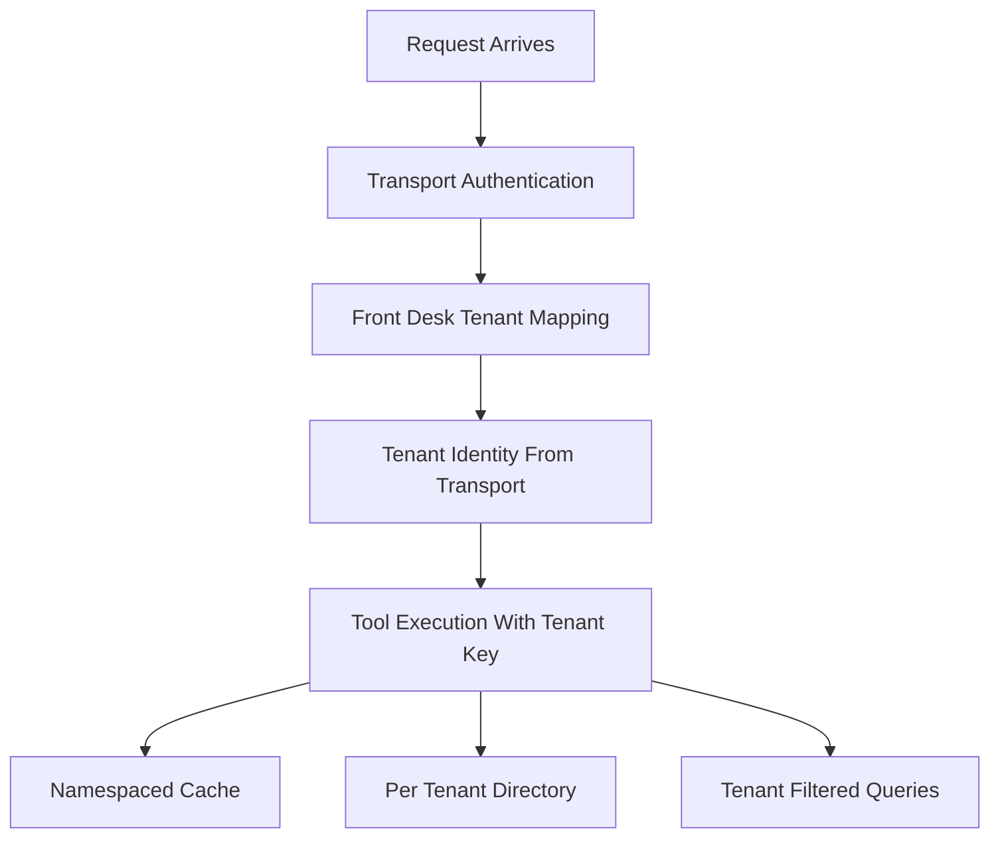

# Multi-Tenancy in MCP Servers: Serving Many Users Without Leaking Between Them

## English

Most tutorials show a single-user MCP server running on a laptop over stdio. Real deployments often look different: one remote server, many users, each with their own credentials and data. Multi-tenancy is the property that a single server instance can safely serve many distinct principals without one seeing another's stuff. MCP does not hand you a tenancy model — it hands you a session and, if you use HTTP transport, a stream of requests that may belong to different users. Deciding what 'user' means is entirely up to you.

A useful mental model is the hotel: the building is shared, but each room has its own key, and the front desk verifies who is allowed into which room. In MCP terms, the building is the server process, the key is the credential presented during transport-level authentication, and the front desk is your authorisation logic that maps a caller to a tenant. If your tools accept a 'user_id' parameter from the model, you have built a hotel where guests write their own room numbers — a security hole disguised as a feature. Tenant identity must come from the transport layer, not from the model's arguments.

The tricky part is state. A tool that writes to a global cache, a shared temp directory, or a module-level variable is a cross-tenant leak waiting to happen. Every piece of mutable state needs a tenant key: cache entries namespaced by caller, file paths rooted in a per-tenant directory, database queries with a mandatory tenant filter. This is the same discipline as row-level security in a database, just applied to the whole server surface. Testing it is straightforward: run two simulated sessions concurrently and assert that neither can see the other's writes.

There is also a cost dimension. A tenant-heavy server may want per-tenant rate limits, per-tenant tool budgets, and per-tenant logging so that one noisy user cannot starve the others. The protocol gives you no built-in quota mechanism, so these live in your server's request handling layer. Treat tenancy as a first-class concern from the first line of code; retrofitting it later usually means rewriting every tool.

## 中文

大多數教學都示範一個單一使用者的 MCP 伺服器，透過 stdio 跑在筆記型電腦上。真實部署往往不同：一個遠端伺服器、許多使用者，各有自己的憑證和資料。多租戶是指單一伺服器實例能安全地服務許多不同的主體，而彼此看不到對方的東西。MCP 不會送你一套租戶模型——它給你一個工作階段，如果你用 HTTP 傳輸，還會給你一串可能屬於不同使用者的請求。所謂「使用者」是什麼意思，完全由你決定。

一個好用的心智模型是旅館：建築是共用的，但每個房間有自己的鑰匙，櫃檯會核對誰可以進哪個房間。用 MCP 的語言來說，建築就是伺服器行程，鑰匙就是傳輸層認證時出示的憑證，櫃檯就是你的授權邏輯，把呼叫者對應到租戶。如果你的工具接受模型傳來的「user_id」參數，你就建了一間讓客人自己填房號的旅館——那是偽裝成功能的資安漏洞。租戶身分必須來自傳輸層，而不是模型的引數。

棘手的地方在狀態。一個寫入全域快取、共用暫存目錄或模組層級變數的工具，就是一個隨時會發生的跨租戶洩漏。每一塊可變狀態都需要租戶鍵：快取項目依呼叫者加上命名空間、檔案路徑根植於每個租戶的目錄、資料庫查詢帶上強制的租戶過濾條件。這和資料庫的列級安全是同一套紀律，只是套用到整個伺服器介面。測試很直接：同時跑兩個模擬工作階段，斷言彼此都看不到對方的寫入。

還有成本面向。租戶眾多的伺服器可能需要依租戶限流、依租戶的工具預算，以及依租戶的日誌，這樣一個吵鬧的使用者才不會餓死其他人。協議沒有內建配額機制，所以這些都活在你伺服器的請求處理層。從第一行程式碼就把多租戶當成核心關注點；事後補救通常意味著重寫每一個工具。

## Key Takeaway

Tenant identity must be derived from the transport layer, never from model-supplied arguments, and every piece of mutable state needs a tenant key.

## Related Concepts
- Authentication and authorization
- Session identity

## Diagram

