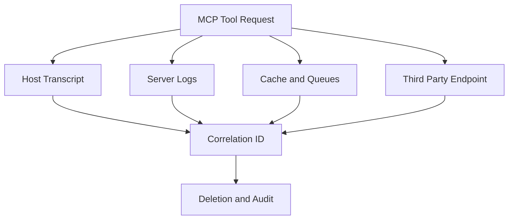

# MCP in a Regulated Environment: Data Residency, Retention, and the Audit Trail

## English

When an MCP server touches health records, financial data, or anything under a compliance regime, the interesting questions are not about JSON-RPC but about where data lives and how long it stays. Two concepts dominate: data residency (which jurisdiction holds the bytes) and retention (how long they are kept and who can delete them). Neither is addressed by the protocol itself; both are properties of your deployment. A tool that forwards a query to a third-party API in another region has just moved data across a border, even if your server runs locally.

Residency is easy to violate accidentally. A 'search the web' tool, a cloud LLM call from inside a sampling request, or a logging pipeline that ships tool results to an external observability service all create outbound flows. The disciplined approach is to map every tool to the external endpoints it talks to, note the region of each, and decide per tool whether that flow is acceptable for the data classes it will see. If a tool can see regulated data, its outbound dependencies are part of your compliance surface, not an implementation detail.

Retention is subtler because MCP conversations leave traces in many places: the host's transcript, the server's logs, any cache, any queue, and the model provider's own records. Each has its own lifetime. A user who asks for deletion needs all of them addressed, which is only possible if you can trace a single request across those systems. Structured logs with a correlation identifier — the same ID threaded through host, server, and downstream calls — make this tractable. Without one, deletion becomes archaeology.

Auditability closes the loop. Regulators typically want to know who did what, when, and with what authority. For MCP that means logging the caller identity (from transport), the tool name and arguments (redacting sensitive fields), the outcome, and the consent decision that authorised the call. Note that the model's own reasoning is not an audit record; it is a stochastic artefact. The audit trail should reflect what the system did, not what the model said it was thinking. Design the log schema before you write the tools, because retrofitting correlation IDs into a running system is painful.

## 中文

當 MCP 伺服器碰到健康紀錄、財務資料，或任何受法規監管的東西，有趣的問題就不在 JSON-RPC，而在資料住在哪裡、留多久。兩個概念主導一切：資料落地（哪個司法管轄區持有這些位元組）與保留期（保留多久、誰能刪除）。協議本身兩者都不處理；兩者都是你部署方式的屬性。一個把查詢轉發到另一個地區第三方 API 的工具，就已經把資料送過國界，即使你的伺服器跑在本機也一樣。

資料落地很容易被意外違反。一個「搜尋網路」工具、在取樣請求中呼叫雲端 LLM、或把工具結果送到外部可觀測性服務的日誌管線，都會產生對外流量。有紀律的做法是把每個工具對應到它會接觸的外部端點，記下各自的地區，並逐一決定該流量對它會看到的資料類別是否可接受。如果一個工具能看到受監管資料，它的對外依賴就是你合規面的一部分，不是實作細節。

保留期更微妙，因為 MCP 對話會在許多地方留下痕跡：主機的對話紀錄、伺服器的日誌、任何快取、任何佇列，以及模型供應商自己的紀錄。每個都有自己的壽命。使用者要求刪除時，全部都要處理到，而這只有在你能跨這些系統追蹤單一請求時才做得到。帶有相互關聯識別碼的結構化日誌——同一個 ID 貫穿主機、伺服器與下游呼叫——讓這件事可行。沒有它，刪除就變成考古。

可稽核性把迴圈閉合。監管者通常想知道誰在何時、憑什麼許可權做了什麼。對 MCP 而言，這意味著記錄呼叫者身分（來自傳輸層）、工具名稱與引數（遮蔽敏感欄位）、結果，以及授權該次呼叫的同意決策。注意，模型自己的推理不是稽核紀錄，它是隨機性的產物。稽核軌跡應該反映系統做了什麼，而不是模型說它在想什麼。在寫工具之前就先設計日誌結構，因為事後把相互關聯 ID 塞進執行中的系統會很痛苦。

## Key Takeaway

Compliance in MCP is a deployment property: map every tool's outbound flows for residency, thread correlation IDs through all logs for retention and deletion, and audit what the system did rather than what the model reasoned.

## Related Concepts
- Logging and audit trails
- Human-in-the-loop consent

## Diagram

