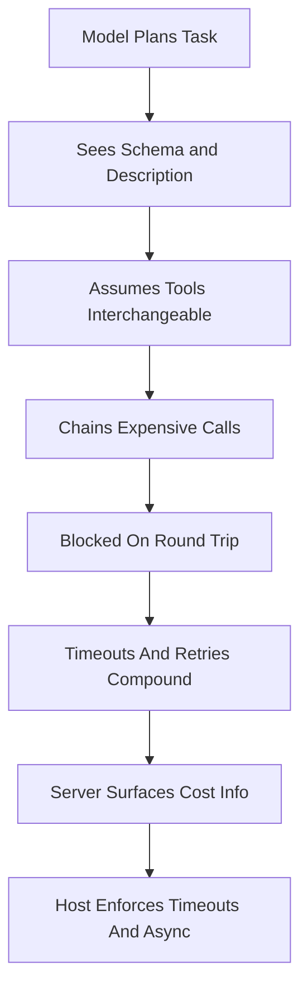

# The Tool That Costs Nothing and the Tool That Costs a Fortune: Latency Budgets Across a Tool Surface

## English

When a model plans a multi-step task, it implicitly assumes its tools are roughly interchangeable in cost. They are not. One MCP tool answers from an in-memory cache in two milliseconds; another runs a SQL query over a billion rows and takes forty seconds; a third calls a third-party API that occasionally rate-limits and retries for two minutes. The model sees a schema, a description, and nothing about the price. It will happily chain five expensive calls in a row if the description sounds right.

Why this matters beyond user patience: every tool call is a round trip that consumes wall-clock time, and in an agent loop the model is blocked waiting for the result before it can decide the next step. A single slow tool can dominate the entire task's latency even if the model's own inference is fast. Worse, timeouts and retries compound: if a call takes thirty seconds and the host's timeout is twenty, the model may retry, doubling the cost and possibly duplicating side effects.

Good server design surfaces cost information. The tool description can state expected latency and whether the call is cheap or expensive, so the model can prefer a cheap lookup before an expensive one. The server can expose a lightweight 'probe' tool that answers 'is this likely to be fast or slow?' before the heavy call. Some servers return partial results quickly and stream the rest, letting the model act on the first page while the rest arrives. None of these are protocol features; they are design patterns layered on top of MCP's basic request-response shape.

The host also has a role. It can enforce per-tool timeouts, cap the number of retries, and decide whether a slow tool should run asynchronously with a progress token rather than blocking the conversation. It can also hide expensive tools behind a confirmation step so the model does not casually trigger them. These are policy decisions the host makes on behalf of the user, and they belong in the host, not in the server, because only the host sees the whole surface and the user's tolerance.

A useful exercise: for every tool in your surface, write down three numbers — typical latency, worst-case latency, and cost per call (money, quota, or side effects). If you cannot fill in the third column, you do not yet understand your own tool surface. The model will discover the answer the hard way, at the user's expense.

## 中文

當模型規劃多步任務時，它隱含地假設手上的工具在成本上大致可以互換。事實並非如此。某個 MCP 工具從記憶體快取兩毫秒就答完；另一個要對十億行資料跑 SQL，花四十秒；第三個呼叫第三方 API，偶爾被限流、重試兩分鐘。模型看到的只有結構定義（schema）、一段描述，對價格一無所知。只要描述聽起來對，它會毫不猶豫地連環呼叫五個昂貴工具。

為甚麼這不只關乎用戶耐性：每次工具呼叫都是一次來回，消耗實際時間；在代理迴路（agent loop）裡，模型要等結果回來才能決定下一步。即使模型自身推理很快，一個慢工具就可以主導整個任務的延遲。更糟的是逾時與重試會疊加：若一次呼叫要三十秒而主機逾時設二十秒，模型可能重試，成本翻倍，甚至可能重複產生副作用。

好的伺服器設計會把成本資訊攤出來。工具描述可以寫明預期延遲、這次呼叫是便宜還是昂貴，讓模型在貴操作之前先試便宜的查詢。伺服器可以暴露一個輕量的「探測」工具，先回答「這次大概快還是慢？」再進行重活。有些伺服器會先快速回傳部分結果、其餘用串流送達，讓模型可以先處理第一頁。這些全都不是協定功能，而是疊在 MCP 基本請求和回應形狀之上的設計模式。

主機也有角色。它可以為每個工具設定逾時、限制重試次數，並決定慢工具應該用進度權杖（progress token）非同步進行，而不是卡住整個對話。它也可以把昂貴工具藏在確認步驟之後，免得模型隨手觸發。這些是主機代使用者作出的政策決定，理應放在主機而非伺服器，因為只有主機看得到整個工具面和使用者的容忍度。

一個有用的練習：為工具面上的每個工具寫下三個數字——典型延遲、最壞延遲、每次呼叫成本（金錢、配額或副作用）。如果你填不出第三欄，你還沒真正了解自己的工具面。模型會用最痛的方式替你找出答案，代價由使用者支付。

## Key Takeaway

The model sees schemas but not prices, so latency and cost must be made explicit in tool descriptions and enforced by host-side timeouts, retries, and confirmation gates.

## Related Concepts
- Latency budgets
- Progress tokens

## Diagram

