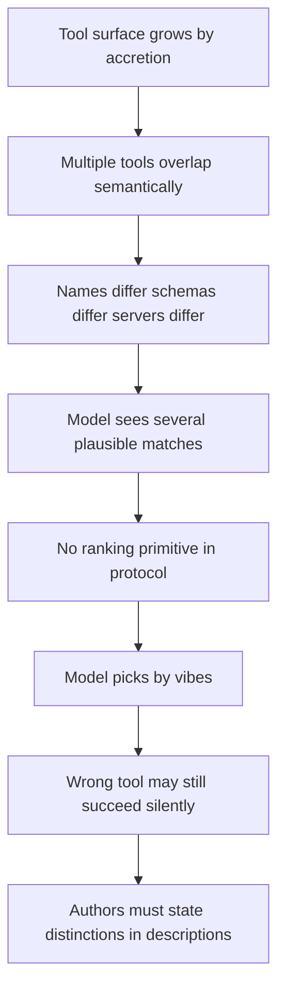

# When Two Tools Describe Themselves the Same Way: Semantic Collisions in a Tool Surface

## English

Namespacing solves the easy collision: two servers both expose a tool called search, and the host prefixes them as github.search and filesystem.search. The hard collision is semantic. Two tools with different names, different schemas, and different servers can mean almost the same thing to the model, and nothing in the protocol tells the model which to prefer. A weather API and a general web-search API both answer 'what's the temperature in Osaka?' One is precise and structured; the other is noisy and may be stale. The model picks by vibes.

This happens more than people expect because tool surfaces grow by accretion. A team adds a 'database query' tool; six months later another team adds a 'data warehouse query' tool; a third adds a 'reporting API' that internally calls the warehouse. Now three tools overlap, each with a plausible description, and the model has to guess which one the user meant. Worse, the wrong choice may succeed — returning a slightly different number from a slightly different source — so the error is silent.

The protocol gives you no ranking primitive. There is no 'prefer this tool over that one' field in the schema. The host can mitigate: it can order tools in the list, hide low-priority ones behind a category, or inject a system-level hint describing which tool to use for which class of question. But those are host-side conventions, not guarantees. The server author's real leverage is in the description text: stating explicitly when the tool should be used, when it should not, and what makes it different from its nearest neighbour.

A practical discipline: whenever you add a tool, ask 'what existing tool is this most similar to, and how would a careful human distinguish them?' Write that distinction into both descriptions. If you cannot articulate it in one sentence, the tools probably should be merged, or one should be deprecated. Semantic collisions are a symptom of surface sprawl, and the fix is curation, not cleverer naming.

Finally, remember that the model's choice is stochastic. Two runs of the same question may pick different tools from a colliding pair. That means your test suite must cover both branches, and your monitoring must record which tool was chosen so you can spot drift. A tool surface is not just an API; it is a menu the model reads, and menus with near-duplicate items produce unpredictable orders.

## 中文

命名空間（namespacing）解決的是容易的碰撞：兩個伺服器都暴露叫 search 的工具，主機把它們加上前綴，變成 github.search 和 filesystem.search。難處理的是語意碰撞。兩個名字不同、結構不同、來自不同伺服器的工具，對模型而言意思幾乎一樣，而協定裡沒有任何東西告訴模型該偏好哪一個。天氣 API 和通用網頁搜尋 API 都能回答「大阪現在幾度？」一個精確而有結構，另一個嘈雜且可能過時。模型憑感覺選。

這種情況比想像中常見，因為工具面是層層疊加長出來的。某團隊加了「資料庫查詢」工具；半年後另一團隊加了「資料倉儲查詢」工具；第三個團隊又加了「報表 API」，內部其實呼叫同一個倉儲。現在三個工具重疊，每個描述都言之成理，模型要猜使用者到底想要哪個。更糟的是，選錯也可能「成功」——從略有不同的來源回傳略有不同的數字——錯誤因此無聲無息。

協定沒有提供排序原語。結構定義裡沒有「優先使用這個工具而非那個」的欄位。主機可以緩解：調整工具列表次序、把低優先的藏在分類之後，或注入系統層提示說明哪類問題該用哪個工具。但這些都是主機端的慣例，不是保證。伺服器作者真正的槓桿在描述文字：明確寫出這工具該在何時用、何時不該用、與最接近的鄰居有甚麼分別。

一個實用紀律：每次新增工具，先問「這與哪個既有工具最相似？一個謹慎的人類會怎樣區分它們？」然後把這個區分寫進兩邊的描述。如果你無法用一句話講清楚，這些工具大概應該合併，或者其中一個應該退役。語意碰撞是工具面膨脹的症狀，解法是策展，不是更聰明的命名。

最後，記住模型的選擇是隨機的。同一個問題跑兩次，可能從碰撞的一對裡選到不同工具。這意味著測試套件要覆蓋兩條分支，監控要記錄實際選了哪個工具，才能發現漂移。工具面不只是 API，它是模型閱讀的餐牌；餐牌上若有近乎重複的菜式，點單就會難以預測。

## Key Takeaway

Namespacing fixes name collisions but not semantic ones, so every new tool must state in its description how it differs from its nearest neighbour, and the host must monitor which tool the model actually chooses.

## Related Concepts
- Tool surface curation
- Tool selection failure modes

## Diagram

