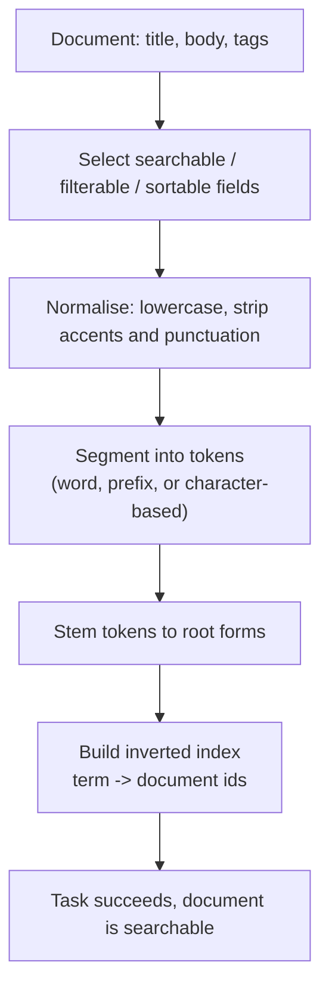

# How Meilisearch Turns Documents into Searchable Terms

### English

Meilisearch is a search engine you can drop into an application in one command. What makes it interesting is what happens to your data before anyone can search it. Raw documents — say a blog post with a title, a body, and a list of tags — are not searchable as they are. A search engine must first break them into terms and build an index, and this process is called tokenisation.

The tokenisation pipeline has a few stages. First, the document's fields are processed according to the index settings: each field can be marked as searchable, filterable, sortable, or faceted, which determines what role it plays in queries. Then each field's text is split into tokens (words) by a normaliser that lowercases, removes accents, and (optionally) strips punctuation, so that "Café" and "cafe" match the same way. Next, Meilisearch applies its tokenisation strategies: for Latin scripts the default is a word-based strategy that splits on spaces, but you can switch to a prefix strategy so that typing "wom" finds "woman". For Chinese and Japanese, Meilisearch uses character-based segmentation instead, since those languages do not put spaces between words.

Finally, a stemming step reduces words to their root form, so "running", "runs", and "run" become one term. From all these tokens, Meilisearch builds an inverted index: instead of storing "this document contains the word 'search'", it stores "the word 'search' appears in documents 3, 17, and 42". That inversion is what makes a query fast — to answer a query, the engine intersects the document lists of every term in the query, rather than scanning every document.

The index is updated asynchronously: you add a document, get a task (a `uid`) back immediately, and the document becomes searchable once that task succeeds. This task-based design lets you batch many writes and poll for completion, and it makes errors visible instead of silent.

### 中文

Meilisearch 係一個可以用一句指令就接入應用程式嘅搜尋引擎。有趣之處在於資料被搜尋之前會經歷咩處理。原始文件（例如一篇文章，有標題、內容同標籤清單）本身係搜尋唔到嘅，搜尋引擎必須先將佢哋拆成詞語（terms）並建立索引，呢個過程叫 tokenisation（分詞）。

分詞流程有幾個階段。首先按索引設定處理每個欄位：每個欄位可以標記為 searchable（可搜尋）、filterable（可篩選）、sortable（可排序）或 faceted（可分面），決定佢喺查詢中扮演咩角色。然後每個欄位嘅文字會由 normaliser 拆分同規範化：轉小寫、去除重音符號、（可選）移除標點，令 "Café" 同 "cafe" 可以互相配對。之後 Meilisearch 套用分詞策略：拉丁字母預設用基於詞語嘅策略，按空格切分，但可以改用 prefix 策略，咁輸入 "wom" 就搵到 "woman"。至於中文同日文，由於唔靠空格分詞，Meilisearch 改用基於字元嘅切分。

最後係詞幹還原（stemming）步驟，令 "running"、"runs"、"run" 變成同一個詞。由呢啲 token 建立嘅叫反向索引（inverted index）：唔係存「呢份文件包含『搜尋』呢個詞」，而係存「『搜尋』呢個詞出現喺文件 3、17、42」。正因為咁反向儲存，查詢先會快——引擎將查詢中每個詞嘅文件清單取交集，而唔係逐份文件掃描。

索引係非同步更新：加入一份文件之後會即時返回一個 task（`uid`），等呢個 task 成功，文件就會可以被搜尋。呢種以 task 為本嘅設計令你可以批次寫入並輪詢完成狀態，亦令錯誤變成可見而唔係靜靜哋發生。

## Key Takeaway
Meilisearch tokenises each field (normalisation, segmentation strategy, stemming) and stores the result in an inverted index of term-to-document lists, which is what makes queries fast.

## Related Concepts
- Inverted index
- Tokenisation strategies: word, prefix, character-based
- Stemming and normalisation
- Asynchronous task queue and `uid` polling

## Diagram

