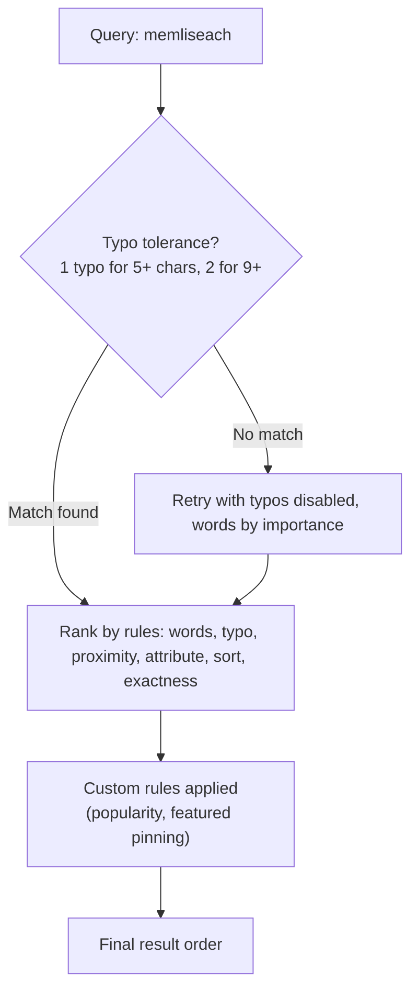

# Typo Tolerance, Ranking Rules, and Relevance Tuning

### English

Search engines are judged by results a human considers correct. Two mechanisms in Meilisearch shape that: typo tolerance and ranking rules.

Typo tolerance means a search for "memliseach" still finds Meilisearch. Meilisearch allows one typo for queries of five characters or more, and two typos for queries of nine characters or more (by default). A typo is not just a wrong character — it can be an omitted character, an extra character, or two adjacent characters swapped. The engine only tolerates a single typo per word, and if the search returns no results it automatically retries with typo tolerance disabled and the words sorted by importance, which rescues cases where the user typed something that looks like a typo but is not.

The second mechanism is ranking rules. These are ordered instructions that decide the final position of each matching document, and they are applied in order. The default order is roughly: words, typo, proximity, attribute, sort, exactness. Proximity rewards documents where the search words appear close together; attribute rewards matches in high-priority fields (a title match beats a body match); sort prefers the most recently updated documents; exactness rewards documents that contain the exact query string. You can reorder or remove rules in the index settings, and you can add custom rules — for example, boosting documents where a `popularity` field is high, or pinning a specific document to the top. Rules can be global for the index, or applied per query, so a "recommended" endpoint might boost a `featured` flag while a plain search does not.

Relevance is therefore not a single magic score but a stack of rules you control. The practical workflow is: make sure the fields you want ranked highly are actually searchable, then reorder the default rules to match your use case, then add a custom sort rule for business signals like popularity. Test with realistic queries and check that top results make sense before shipping.

### 中文

搜尋引擎嘅好壞，標準係人覺得啱唔啱。Meilisearch 入面有兩個機制決定呢啲結果：typo tolerance（容錯）同 ranking rules（排序規則）。

Typo tolerance 意思係搜 "memliseach" 一樣搵到 Meilisearch。預設情況下，查詢字串達 5 個字元容許 1 個錯字，達 9 個字元容許 2 個錯字。錯字唔只係打錯一個字，亦可以係漏咗一個字、多打一個字，或者將兩個相鄰字元互換。引擎每個詞只會容忍一個錯字；而如果第一次搜尋冇結果，佢會自動喺關閉容錯並按重要程度重新排序詞語之後再試一次，救返一啲「睇落似錯字但其實唔係」嘅情況。

第二個機制係 ranking rules。呢啲係有次序嘅指令，逐條決定每份匹配文件嘅最終位置，並按次序執行。預設次序大概係：words（詞語匹配）、typo（錯字）、proximity（接近度）、attribute（欄位）、sort（排序）、exactness（完全匹配）。Proximity 會獎勵搜尋詞靠得近嘅文件；attribute 會優先高權重欄位（標題命中比正文命中更值錢）；sort 偏好最近更新嘅文件；exactness 獎勵包含完整查詢字串嘅文件。你可以在索引設定入面重新排列或者移除規則，亦可以加入自訂規則，例如提升 `popularity` 欄位高嘅文件，或者將某份指定文件釘喺最前。規則可以全索引生效，亦可以逐個查詢套用，例如「推薦」介面可以加強 `featured` 標記，而普通搜尋就唔加。

所以相關性唔係一個神秘分數，而係一疊你可以控制嘅規則。實際工作流程係：先確保你想優先嘅欄位真係設定咗 searchable，再按用途調整預設規則次序，然後為咗商業訊號（例如人氣）加入自訂排序規則。上線前用真實查詢測試，確認頭幾名結果合理。

## Key Takeaway
Typo tolerance makes search forgiving, and ranking rules — ordered, editable, and overridable per query — are what actually determine whether the top result is the right one.

## Related Concepts
- Typo tolerance thresholds and typo types
- Proximity and attribute ranking
- Custom sort and placeholder ranking rules
- Placeholder search for partial queries

## Diagram

