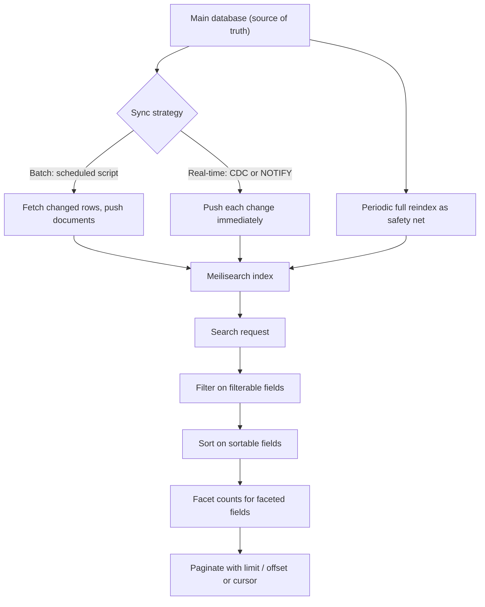

# Filtering, Faceting, Pagination, and Keeping the Index in Sync

### English

Once a search returns candidates, users need to narrow them down, and Meilisearch provides several ways to do that. Filtering applies a condition to the query: `filter` accepts expressions such as `genre = horror AND rating > 4`, or `user_id = 42`. For the filter to work, the field must be declared `filterable` in the index settings — this is deliberate, because indexing every field as filterable wastes memory and can slow the engine down. Sorting is similar: a field becomes sortable when declared as such, and you then pass `sort: ["rating:desc"]`. Filtering and sorting can be combined in one request.

Faceting is a related but distinct feature. A facet distribution tells you how many results exist per value of an attribute — for example, 120 horror films, 85 comedies — and it is normally shown next to the search box as a list of counts that the user can click to filter. The field must be declared `faceted`. Because Meilisearch computes facet distributions at query time, faceting works best on attributes with a moderate number of distinct values, not on free-text fields.

Pagination is handled with two parameters: `limit` sets how many hits to return (default 20) and `offset` skips the first N hits. Meilisearch also exposes a total hit count, so a UI can render "showing 1–20 of 1,304". For very large result sets, `offset` gets slow because the engine still has to walk past the skipped hits; the solution is to page with `cursor`, which uses a search-after style token instead of a number.

The operational question that follows is: how does the data get into the index? Meilisearch stores its own copy of the documents, so the source of truth is usually your main database. Two approaches exist. Batch synchronisation runs a script on a schedule that re-reads changed rows and sends them as documents — simple, and fine for a daily or hourly job. Real-time synchronisation listens to changes in the source database (for example a Postgres `NOTIFY` trigger or a change-data-capture stream) and pushes each change to Meilisearch as it happens, which gives near-instant search results. Either way, a periodic full reindex acts as a safety net, and you should design document IDs to match the source IDs so updates are idempotent and deletes are easy to apply.

### 中文

搜尋器一旦交出候選結果，用戶通常需要再收窄範圍，Meilisearch 提供幾種方式。Filtering 係俾查詢加條件：`filter` 接受類似 `genre = horror AND rating > 4` 或者 `user_id = 42` 嘅表達式。前提係嗰個欄位喺索引設定入面宣告咗 `filterable`，呢個係刻意設計嘅——將每個欄位都當可篩選會浪費記憶體，亦拖慢引擎。Sorting 類似，欄位宣告為 `sortable` 就可以傳 `sort: ["rating:desc"]`。篩選同排序可以喺同一個請求一齊用。

Faceting（分面）係相關但唔同嘅功能。Facet distribution 會話你每個屬性值有幾多結果，例如 120 部恐怖片、85 部喜劇，通常顯示喺搜尋框旁邊做可點擊嘅計數清單。欄位需要宣告為 `faceted`。因為分面統計係查詢時即時計算，佢適合用喺相對有限數目嘅不重複值嘅屬性，而唔係自由文字欄位。

分頁用兩個參數：`limit` 設定返回幾多筆（預設 20），`offset` 跳過頭 N 筆。Meilisearch 亦會提供總命中數，介面可以顯示「顯示第 1–20 筆，共 1,304 筆」。結果集極大時 `offset` 會變慢，因為引擎仍然要行過被跳過嘅結果；解決方法係用 `cursor` 分頁，佢用 search-after 風格嘅 token 而唔係數字。

跟住就係運維問題：資料點樣入到索引？Meilisearch 會存自己一份文件副本，所以真相來源通常係你嘅主資料庫。有兩種做法。批次同步係寫個定時執行的腳本，讀出有變動嘅行再送去做文件——簡單，適合每日或每小時嘅工作。實時同步就係監聽來源資料庫嘅變更（例如 Postgres 的 `NOTIFY` trigger 或者 change-data-capture stream），一有變動即時推送，令搜尋結果近乎即時。兩種做法都需要定期做一次完整 reindex 作為安全網，而且應該令文件 ID 同來源 ID 對應，令更新冪等（重複執行結果一樣），刪除亦容易執行。

## Key Takeaway
Filterable, sortable, and faceted attributes enable narrowing and counting, and the index stays trustworthy only if a deliberate sync strategy — batch or real-time plus periodic full reindex — keeps it aligned with the source database.

## Related Concepts
- `filterable` / `sortable` / `faceted` settings
- Facet distribution and counts in the UI
- `offset` versus `cursor` pagination
- Database-to-index synchronisation and idempotent document IDs

## Diagram

