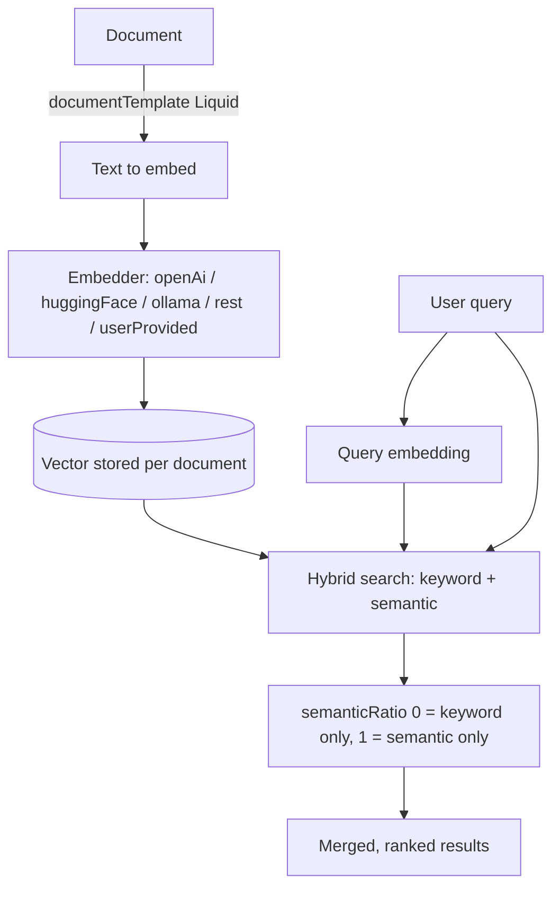

# Semantic and Hybrid Search with Embedders in Meilisearch

### English

Classic full-text search matches **strings**. A user searching for "cheap laptop for students" will get documents containing the literal words `cheap`, `laptop`, `students` — but a document titled "Affordable Notebooks for University" contains none of them, so it never appears. This is the **vocabulary mismatch** problem, and it is the fundamental limitation of keyword search: it matches how the *document* was written, not how the *user* thought.

**Semantic search** attacks this by converting text into an **embedding** — a fixed-length list of floats (say 1536 numbers) that captures meaning rather than spelling. Text with similar meaning ends up close together in this vector space, so "cheap laptop for students" and "affordable notebook for university" land near each other even without shared words. To find matches, you compute the embedding of the query and look for the nearest vectors, usually with an approximate nearest-neighbour index such as HNSW (Hierarchical Navigable Small World), which finds good-enough neighbours without comparing against every document.

Meilisearch implements this through **embedders**. An embedder is a configured provider that turns documents and queries into vectors. You declare one under the `embedders` index setting:

```json
PATCH /indexes/movies/settings
{
  "embedders": {
    "my-hf": {
      "source": "huggingFace",
      "model": "BAAI/bge-base-en-v1.5",
      "documentTemplate": "A movie named '{{doc.title}}' described as '{{doc.description}}'"
    }
  }
}
```

The available `source` values are `openAi`, `huggingFace`, `ollama`, `rest` and `userProvided`. `huggingFace` runs the model locally on your machine (no API key, no network latency per query, but it downloads the model on first use and eats CPU); `openAi` and `rest` call a remote API; `userProvided` means you compute the vectors yourself and store them in the document's reserved `_vectors` field. The `documentTemplate` is a Liquid template that decides *which* text of a document gets embedded — this matters enormously, because embedding a whole page of metadata and boilerplate dilutes the meaning of the sentence you actually care about.

You then run a **hybrid** search, which blends keyword results with semantic results:

```json
POST /indexes/movies/search
{
  "q": "something to stir soup with",
  "hybrid": { "embedder": "my-hf", "semanticRatio": 0.5 }
}
```

`semanticRatio` is the dial. At `0.0` you get pure keyword search (fastest, most predictable, best for exact product names, SKUs and error codes). At `1.0` you get pure semantic search (best for natural-language descriptions and vocabulary mismatch). In between is hybrid, which runs both and merges the results. Hybrid is usually the best default for general-purpose search — ecommerce catalogues, documentation, knowledge bases — because it catches both exact matches and conceptually relevant ones. The cost is latency: hybrid is the slowest mode, since generating the query embedding adds a network round trip to a cloud provider, and both result sets must be merged.

There is a subtle point about *why* you need a ratio at all. Keyword scores and vector similarity scores live on completely different scales, so merging them naively produces nonsense. Meilisearch normalises the two sides before blending, which is what makes the ratio meaningful rather than arbitrary.

Changing `source` or `model` in an embedder configuration always regenerates embeddings for every document — this is an expensive operation on a large index, so it is worth picking the model deliberately. Changing the `apiKey` never does. Also note that Meilisearch v1.16 added **multimodal embeddings** (behind the `multimodal` experimental feature), which lets you embed images alongside text and search with an image query — the same idea applied to posters and product photos.

The practical decision tree is simple: if users search with precise identifiers, use keyword search; if users describe what they want in words, use semantic or hybrid; if your corpus contains images as well as text, consider multimodal embeddings.

### 中文

傳統全文檢索比對嘅係**字串**。使用者搜「cheap laptop for students」，系統會拎到包含 `cheap`、`laptop`、`students` 呢啲字面詞嘅文件；但一篇標題係「Affordable Notebooks for University」嘅文件一個字都冇中過，就永遠唔會出現。呢個就係**詞彙不匹配（vocabulary mismatch）**問題，亦係關鍵字檢索最根本嘅限制：佢比對嘅係「文件點樣寫」，而唔係「使用者點樣諗」。

**語義檢索（semantic search）** 就係針對呢一點：將文字轉成 **embedding（嵌入向量）** —— 一串固定長度嘅浮點數（例如 1536 個數），承載嘅係意思而唔係拼寫。意思相近嘅文字喺呢個向量空間裡面會靠得好近，所以「cheap laptop for students」同「affordable notebook for university」即使冇共同字詞都會互相靠近。要搵出匹配，就係將查詢轉成向量，再搵最近嘅向量，通常用近似最近鄰索引（例如 HNSW，Hierarchical Navigable Small World），佢可以喺唔逐一比較全部文件嘅情況下搵到「夠好」嘅鄰居。

Meilisearch 透過 **embedder** 實現呢件事。Embedder 就係一個已配置嘅供應商，負責將文件同查詢轉成向量。你喺 `embedders` index setting 下面宣告：

```json
PATCH /indexes/movies/settings
{
  "embedders": {
    "my-hf": {
      "source": "huggingFace",
      "model": "BAAI/bge-base-en-v1.5",
      "documentTemplate": "A movie named '{{doc.title}}' described as '{{doc.description}}'"
    }
  }
}
```

可用嘅 `source` 有 `openAi`、`huggingFace`、`ollama`、`rest` 同 `userProvided`。`huggingFace` 喺你部機本地行模型（唔使 API key，查詢亦冇網絡延遲，但首次使用要下載模型，而且食 CPU）；`openAi` 同 `rest` 會呼叫遠端 API；`userProvided` 就係你自己計向量，存入文件保留嘅 `_vectors` 欄位。`documentTemplate` 係一個 Liquid 模板，決定文件嘅**邊一部分**文字會被嵌入 —— 呢點極其重要，因為將成頁 metadata 同樣板文字一齊嵌入，會稀釋真正有意義嗰句嘅語意。

然後你可以行 **hybrid（混合）** 檢索，將關鍵字結果同語義結果融合：

```json
POST /indexes/movies/search
{
  "q": "something to stir soup with",
  "hybrid": { "embedder": "my-hf", "semanticRatio": 0.5 }
}
```

`semanticRatio` 就係個調節掣。`0.0` 係純關鍵字檢索（最快、最可預測，最適合精確嘅商品名、SKU、錯誤代碼）；`1.0` 係純語義檢索（最適合自然語言描述同詞彙不匹配嘅情況）；喺中間就係 hybrid，兩邊都行然後合併結果。一般用途（電商目錄、文件、知識庫）hybrid 通常係最好嘅預設，因為佢同時捉到精確匹配同概念相關嘅結果。代價就係延遲：hybrid 係最慢嘅模式，因為產生查詢向量要加一轉網絡來回，而且兩份結果都要合併。

有一個細節值得留意：點解需要 ratio 咁樣一個掣。關鍵字分數同向量相似度分數根本唔同量級，直接混合只會出亂子。Meilisearch 會先將兩邊正規化（normalise）再融合，正因為咁，呢個 ratio 先係有意義而唔係隨意嘅數字。

改動 embedder 設定入面嘅 `source` 或 `model`，一定會令全部文件重新產生 embedding —— 喺大索引上係好貴嘅操作，所以值得認真揀模型。改 `apiKey` 就唔會。另外 Meilisearch v1.16 加入咗 **multimodal embeddings**（要開 `multimodal` experimental feature），可以將圖片同文字一齊嵌入，並且用圖片做查詢 —— 同一個概念套落海報同產品相片上面。

實務上嘅決策樹好簡單：如果使用者係用精確識別符搜，就用關鍵字檢索；如果使用者用自然語言描述想要咩，就用語義或者 hybrid；如果你嘅語料除咗文字仲有圖片，就考慮 multimodal embeddings。

## Key Takeaway
Embedders let Meilisearch compare meaning rather than spelling, and `semanticRatio` decides how much keyword versus semantic signal drives the final ranking.

## Related Concepts
- Text Embeddings and Vector Space
- Approximate Nearest Neighbour Search
- Keyword vs Semantic vs Hybrid Search
- Liquid Document Templates

## Diagram

