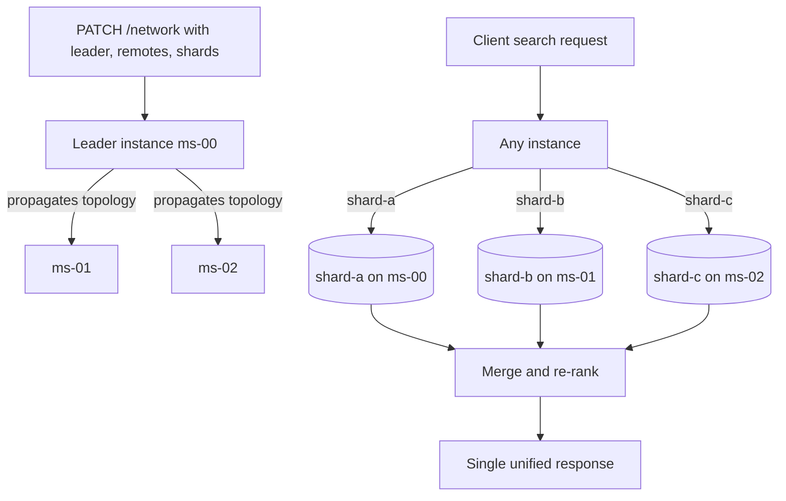

# Sharding a Meilisearch Cluster with the Network Feature

### English

A single Meilisearch instance stores everything in one **LMDB** database file on one disk. That is fast and simple, but it has a hard ceiling: your documents must fit on one machine's disk, and the search throughput is whatever one process can deliver. When a dataset outgrows that, you need to split it across several instances — **sharding** — and search across all of them at once.

Meilisearch's approach to sharding is unusual and quite elegant, because it does **not** require a separate orchestrating cluster manager. Instead, the instances themselves form a **network**: you tell each instance its own name, the names and URLs of its peers, and how the shards are distributed. One instance is designated the **leader**; you send the network configuration to the leader once, and the leader propagates it to every remote.

The `network` object looks like this:

```json
{
  "leader": "ms-00",
  "self": "ms-00",
  "remotes": {
    "ms-00": { "url": "http://ms-00.example.com:7700", "searchApiKey": "...", "writeApiKey": "..." },
    "ms-01": { "url": "http://ms-01.example.com:7701", "searchApiKey": "...", "writeApiKey": "..." },
    "ms-02": { "url": "http://ms-02.example.com:7702", "searchApiKey": "...", "writeApiKey": "..." }
  },
  "shards": {
    "shard-a": { "remotes": ["ms-00"] },
    "shard-b": { "remotes": ["ms-01"] },
    "shard-c": { "remotes": ["ms-02"] }
  }
}
```

Each **shard** is a named slice of the index, and each shard lists the remotes that own it. In the configuration above each shard lives on exactly one remote, so documents are distributed across the three instances and each instance serves searches for its own shards. There is **no replication** in this setup: if a remote goes down, its shards simply vanish from the search results, because Meilisearch does not automatically fall back to another instance. Replicated sharding, where a shard can be owned by several remotes, is available in the Enterprise Edition.

Searching is where the magic happens. You send an ordinary search request to *any* instance in the network — not just the leader — and Meilisearch fans the query out to every shard, collects the results, and returns one merged, ranked response. Recent versions make `useNetwork` default to `true` when a leader is configured, so you may not need to set it explicitly at all. The mechanism is shard-aware: Meilisearch picks the local instance whenever it owns the shard in question, avoiding unnecessary network traffic, and each shard is queried exactly once so no document is duplicated or dropped in the merged output. You can also filter on shard assignment directly with a `_shard` filter, for example `_shard = "shard-a"` or `_shard IN ["shard-a", "shard-b"]`, which is useful for manual federated queries against specific slices. Document retrieval routes also fan out by default in a network configuration, and `useNetwork: false` limits them to the local instance.

Because the feature is **experimental**, you must turn it on explicitly:

```bash
curl -X PATCH 'MEILISEARCH_URL/experimental-features' \
  -H 'Content-Type: application/json' \
  -H 'Authorization: Bearer MEILISEARCH_KEY' \
  --data-binary '{ "network": true }'
```

You also need to allow private-network communication between instances using the `--experimental-allowed-ip-networks` flag (for example `10.0.0.0/8,192.168.0.0/16`) if the instances talk over an internal network.

There is one security warning worth repeating. The documentation notes that if an attribute is **not** on the `displayedAttributes` list but **is** on `sortableAttributes`, its value can become publicly accessible through the `/network` endpoint. If you rely on a hidden attribute staying hidden at all times, do not enable the network feature. This is the sort of leak that only shows up in production.

The honest assessment: Meilisearch's sharding is young, gated behind an experimental flag, and the basic topology has no replication or automatic failover. It is a genuine answer to "my data does not fit on one box" and it demonstrates that a distributed search engine can be operated without a separate coordinator, but for production use today you should read the current documentation carefully and test failure modes yourself.

### 中文

單一 Meilisearch 實例會將所有資料存喺一個磁碟上面嘅一個 **LMDB** 資料庫檔案。呢個又快又簡單，但有一個硬上限：你嘅文件一定要塞得晒喺一部機；搜尋吞吐量就係單一進程嘅極限。當資料量超過呢個臨界點，就要把佢拆到幾個實例上面 —— 呢個就係 **sharding（分片）** —— 並且要可以一次過搜尋所有實例。

Meilisearch 嘅分片做法幾特別，而且幾優雅，因為**唔需要**額外嘅協調器（orchestrator）程式。反而係實例之間自己組成一個 **network**：你話俾每個實例知自己嘅名、_peer 嘅名同 URL，以及分片點樣分配。其中一個實例會被指定做 **leader**；你只需要將網絡設定送一次畀 leader，leader 就會負責傳播畀所有 remote。

`network` 物件長咁樣：

```json
{
  "leader": "ms-00",
  "self": "ms-00",
  "remotes": {
    "ms-00": { "url": "http://ms-00.example.com:7700", "searchApiKey": "...", "writeApiKey": "..." },
    "ms-01": { "url": "http://ms-01.example.com:7701", "searchApiKey": "...", "writeApiKey": "..." },
    "ms-02": { "url": "http://ms-02.example.com:7702", "searchApiKey": "...", "writeApiKey": "..." }
  },
  "shards": {
    "shard-a": { "remotes": ["ms-00"] },
    "shard-b": { "remotes": ["ms-01"] },
    "shard-c": { "remotes": ["ms-02"] }
  }
}
```

每個 **shard** 係索引嘅一個命名切片，每個 shard 都列出擁有佢嘅 remote。上面呢個設定入面，每個 shard 只存在於一個 remote，所以文件會分佈到三個實例，而每個實例處理自己嗰啲 shard 嘅搜尋。呢種設定**冇複製（replication）**：如果某個 remote 掛咗，佢嗰啲 shard 會直接從搜尋結果入面消失，因為 Meilisearch 唔會自動改用另一個實例。同一個 shard 可以由多個 remote 擁有嘅「複製式分片」，屬於 Enterprise Edition 功能。

搜尋嗰part 就係最神奇嘅地方。你可以將普通嘅搜尋請求送去 network 入面**任何一個**實例（唔止 leader），Meilisearch 會將查詢扇出到每個 shard，收齊結果，再返回一份合併、重新排序過嘅回應。較新版本喺設定咗 leader 之後，會令 `useNetwork` 預設為 `true`，所以你甚至唔需要明確設定。機制上係 shard-aware：只要本地實例擁有嗰個 shard，Meilisearch 就會揀本地，避免不必要嘅網絡流量；而且每個 shard 只會被查詢一次，所以合併出嚟嘅結果唔會有重複或者遺漏。你亦可以直接用 `_shard` filter 過濾分片賦屬，例如 `_shard = "shard-a"` 或者 `_shard IN ["shard-a", "shard-b"]`，方便針對特定切片做手動 federated 查詢。喺 network 設定下，文件讀取路由亦預設會扇出，`useNetwork: false` 就可以限制為只查本地。

因為呢個功能屬於 **experimental**，你必須手動開啟：

```bash
curl -X PATCH 'MEILISEARCH_URL/experimental-features' \
  -H 'Content-Type: application/json' \
  -H 'Authorization: Bearer MEILISEARCH_KEY' \
  --data-binary '{ "network": true }'
```

如果實例之間行內網絡溝通，仲要用 `--experimental-allowed-ip-networks` 旗標（例如 `10.0.0.0/8,192.168.0.0/16`）允許私網連線。

有一個安全警告值得重複講一次。官方文件指出，如果某個屬性**唔喺** `displayedAttributes` 清單入面，但**卻喺** `sortableAttributes` 入面，佢嘅值有機會經由 `/network` endpoint 公開可見。如果你依賴某個隱藏屬性一直保持隱藏，就唔好開啟 network 功能。呢類洩漏通常只會喺生產環境爆發。

誠實咁講：Meilisearch 嘅分仲仲好年輕，要開 experimental 旗標，而且基本拓撲冇複製亦冇自動故障轉移。佢係真正回應咗「我嘅資料裝唔落一部機」呢個問題，亦證明咗分散式檢索引擎係可以喺冇獨立協調器嘅情況下運作，但係今日喺生產環境使用，你應該仔細閱讀最新文件，並且自己實測各種故障情境。

## Key Takeaway
Meilisearch shards by letting instances form a self-describing network, where a leader propagates the topology and any instance can fan a query out to every shard and merge the results.

## Related Concepts
- Sharding and Partitioning
- Federated Search
- Experimental Features
- Distributed Topology and Leader Election

## Diagram

