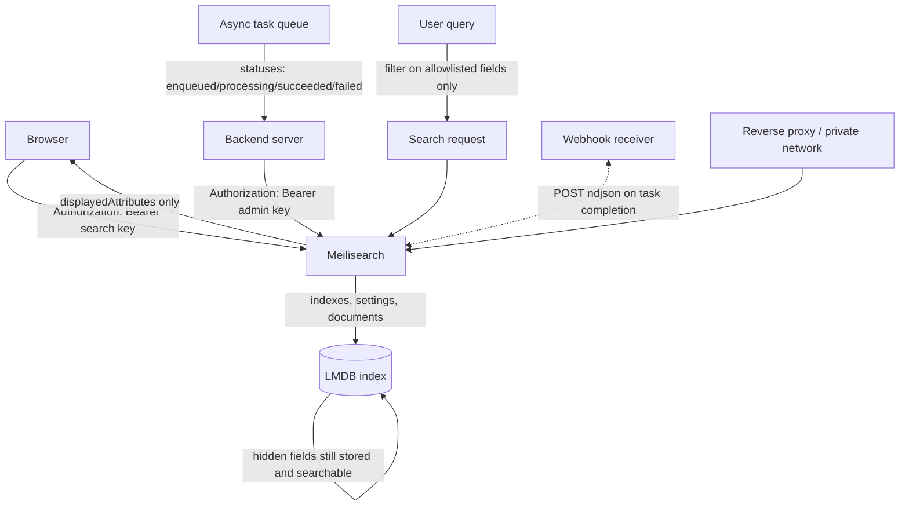

# Securing a Meilisearch Instance: API Keys, Permissions and Attribute Allowlists

### English

Meilisearch is designed to be dropped into an application with almost no ceremony — which means it is also designed to be dropped into production by someone who forgets to think about who should be allowed to do what. The security model has three parts: **master key**, **API keys with scoped actions**, and **network-level protection**.

The **master key** is the root credential. If you set one at boot (`--master-key` or `MEILI_MASTER_KEY`), it grants full administrative access: creating indexes, changing settings, reading documents, and creating other keys. Without a master key, the instance runs in a development mode where it accepts everything from anyone — fine on a laptop, dangerous on a shared network. The master key is never stored in dumps, because the `key` field in a dump depends on the master key and is not propagated; that means a leaked dump does not hand over your admin access.

Beyond the master key, Meilisearch issues **API keys** that carry a specific list of **actions**. This is the mechanism you use to give a browser only search access while your backend keeps write access:

- `search` — run searches. The **Default Search API Key** is generated automatically alongside the admin key and is meant to live in front-end code.
- `documents.add`, `documents.get`, `documents.delete` — document operations.
- `indexes.create`, `indexes.get`, `indexes.update`, `indexes.delete`, `indexes.swap` — index lifecycle.
- `settings.get`, `settings.update` — index settings.
- `tasks.get`, `tasks.cancel`, `tasks.delete` — the task queue.
- `dumps.create`, `snapshots.create` — backups.
- `stats.get`, `version`, `keys.get`, `keys.create`, `keys.update`, `keys.delete` — introspection.
- `*` — everything, which is what the **Default Admin API Key** has.

Keys can also be restricted to a specific set of **indexes**, so a partner integration can search `products` but not `customers`. And they can carry an **expiry** date, which makes short-lived keys a practical option for CI jobs or one-off migrations.

The key is sent in the `Authorization: Bearer <key>` header. The older `X-MEILI-API-KEY` header is the deprecated form. A common mistake is shipping the admin key to the browser "just to make it work"; that gives every visitor the ability to delete your index. The rule is simple: the browser gets the search key, the server gets the admin key.

The second layer is **network-level protection**. Meilisearch listens on port 7700 and, by default, is reachable from anywhere it can bind to. In production you should place it behind a reverse proxy or a private network so the raw port is never exposed, and terminate TLS there. Meilisearch's built-in protections matter mostly for its webhook and network features: by default it refuses to make outbound requests to private IP ranges, which is what stops a webhook URL pointing at `169.254.169.254` (the cloud metadata endpoint) from being used to steal instance credentials. You relax this deliberately with `--experimental-allowed-ip-networks`, and you should think twice before you do.

The third layer is **searching safely**. Two settings do most of the work here. `displayedAttributes` controls which document fields come back in results; fields not listed are still stored and still searchable, they just do not appear in the response. That is the clean way to hide internal notes, cost prices or admin-only identifiers without removing them from the index. `filterableAttributes` restricts which fields may be used in a `filter` expression, and `sortableAttributes` restricts which fields may be used in `sort` — an allowlist, so a user cannot sort by a field you never meant to expose. Note the interaction: a field that is sortable but not displayed can leak its value through the network endpoint in sharded setups, as the sharding documentation explicitly warns.

Finally, remember that Meilisearch operations are **asynchronous**. Adding documents returns a task, not a result; you poll `/tasks` (filterable by `statuses` — `enqueued`, `processing`, `succeeded`, `failed`, `canceled`) to know when indexing finished. That matters for security because a task can *fail* after you thought it succeeded, and the `error` object explains why. A robust pipeline checks task status and treats a failed task as a failed operation rather than assuming success.

The overall mental model: Meilisearch tries to be secure by default for developers but hands you a lot of sharp tools. Master key for the server, scoped search key for the browser, reverse proxy for the network, allowlisted settings for the queries, and task status checks for the pipeline.

### 中文

Meilisearch 設計成係「隨手掉入應用入面、幾乎唔使儀式」—— 同樣地,佢亦設計成可以由一個唔記得諗過「邊個應該可以做咩」嘅人直接擺上生產。佢嘅安全模型有三層：**master key**、**帶權限範圍嘅 API key**，同埋**網絡層保護**。

**Master key** 係根憑證。如果喺啟動時設定咗（`--master-key` 或者 `MEILI_MASTER_KEY`），佢就賦予完整管理權限：建立索引、改設定、讀文件、埋其他 key。如果唔設 master key，實例會以開發模式運行，即係接受任何人嘅任何請求 —— 喺自己部 laptop 冇問題，喺共享網絡就非常危險。Master key 永遠唔會存落 dump 入面，因為 dump 入面嘅 `key` 欄位係依賴 master key 產生而唔會被傳播；換言之，dump 洩漏唔會連帶交出你嘅管理權限。

喺 master key 之上，Meilisearch 會簽發帶住特定 **actions（權限動作）清單**嘅 **API key**。呢個就係你用嚟畀瀏覽器淨係搜尋權限、而後端保留寫入權限嘅機制：

- `search` —— 執行搜尋。**Default Search API Key** 會同 admin key 一齊自動生成，設計上就係俾前端代碼用。
- `documents.add`、`documents.get`、`documents.delete` —— 文件操作。
- `indexes.create`、`indexes.get`、`indexes.update`、`indexes.delete`、`indexes.swap` —— 索引生命週期。
- `settings.get`、`settings.update` —— 索引設定。
- `tasks.get`、`tasks.cancel`、`tasks.delete` —— 任務隊列。
- `dumps.create`、`snapshots.create` —— 備份。
- `stats.get`、`version`、`keys.get`、`keys.create`、`keys.update`、`keys.delete` —— 自我檢視。
- `*` —— 全部權限，**Default Admin API Key** 就係咁。

Key 仲可以限制喺指定嘅一組 **indexes** 入面，令合作方整合方案可以搜 `products` 但搜唔到 `customers`。Key 亦可以帶 **expiry（到期時間）**，所以短期 key 係 CI job 或者一次性遷移嘅實用選項。

Key 係用 `Authorization: Bearer <key>` 標頭送出。舊式嘅 `X-MEILI-API-KEY` 標頭已經係棄用形式。常見錯誤係「為咗快啲搞掂」而將 admin key 送到瀏覽器端，咁每個訪客都獲得刪除你索引嘅能力。規律好簡單：瀏覽器攞 search key，伺服器攞 admin key。

第二層係**網絡層保護**。Meilisearch 監聽 7700 埠，預設情況下任何綁得到嘅地方都可以連入。生產環境應該放喺反向代理或者私網後面，令原始埠從來唔對外暴露，並且喺嗰度做 TLS 終止。Meilisearch 內建嘅保護主要係為咗佢嘅 webhook 同 network 功能：預設拒絕對私網 IP 範圍發出對外請求，正正係防止有人將 webhook URL 指去 `169.254.169.254`（雲端 metadata endpoint）去偷 instance 憑證。你可以刻意用 `--experimental-allowed-ip-networks` 放寬，但放寬之前諗清楚。

第三層係**安全咁搜尋**。有兩個設定做緊大部分功夫。`displayedAttributes` 控制邊啲文件欄位會喺結果入面返回；唔喺清單入面嘅欄位依然會被儲存、依然可以被搜尋，只係唔會出現喺回應中。呢個就係隱藏內部備註、成本價或者管理員專用識別碼嘅乾淨做法，唔使將佢哋由索引移除。`filterableAttributes` 限制邊啲欄位可以用喺 `filter` 表达式，`sortableAttributes` 限制邊啲欄位可以用喺 `sort` —— 兩者都係 allowlist（允許名單），所以使用者唔會排序到一個你根本冇打算公開嘅欄位。注意當中嘅交互：一個 sortable 但唔 displayed 嘅欄位，喺分片環境下可以經由 network endpoint 洩漏值，官方分片文件有明確警告。

最後，唔好唔記得 Meilisearch 嘅操作係**非同步**嘅。加文件回傳嘅係一個 task 而唔係結果；你要輪詢 `/tasks`（可以用 `statuses` 過濾 —— `enqueued`、`processing`、`succeeded`、`failed`、`canceled`）去知道索引完成咗未。呢點喺安全上好重要，因為一個 task 可能喺你以為佢成功咗之後先失敗，而 `error` 物件會話你知點解。一條穩健嘅管線必須檢查 task 狀態，將失敗 task 當成失敗操作處理，而唔係當作成功。

整體心智模型係：Meilisearch 對開發者係預設安全嘅，但同時遞咗好多利器畀你。伺服器用 master key，瀏覽器用權限收窄嘅 search key，網絡層用反向代理，查詢層用 allowlist 設定，管線層檢查 task 狀態。

## Key Takeaway
Meilisearch's security model is a scope ladder — master key for servers, scoped search keys for browsers, allowlisted attributes for queries, and task status checks for pipelines — layered on top of network isolation.

## Related Concepts
- Master Key vs API Keys
- Bearer Token Authentication
- Allowlisting Attributes
- Asynchronous Task Queue

## Diagram

