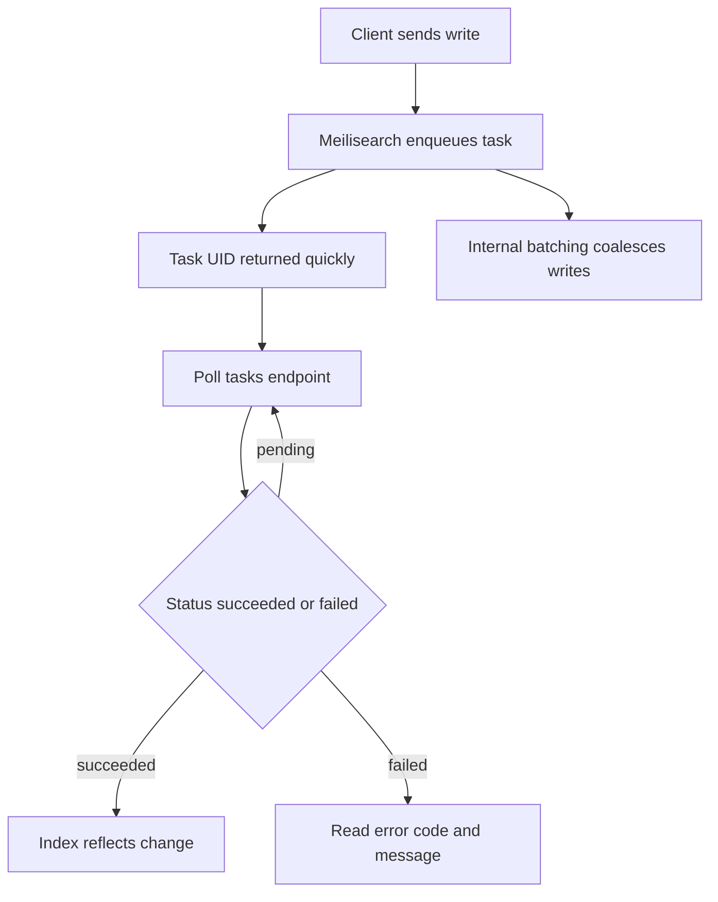

# Keeping the Index in Sync: Tasks, Batching, and Asynchronous Writes

## English

Unlike a database where a write is visible the instant the transaction commits, Meilisearch treats every mutation — adding documents, updating settings, deleting records — as an asynchronous task. When you POST documents to an index, you get back a task object with a unique UID and a status such as enqueued, processing, succeeded, or failed. The HTTP call returns quickly, but the index may not yet reflect your change. This is a deliberate design: it lets the engine batch many small writes together, rebuild internal data structures in bulk, and keep search latency low while ingestion happens in the background. If you assume the write is instantly visible, you will see flaky tests and confusing 'my document is missing' bugs.

The practical pattern is to capture the task UID from the response and poll the tasks endpoint until the status is succeeded or failed. In client SDKs this is usually exposed as a wait-for-task helper that blocks until completion. For bulk imports, you can enqueue many tasks and then wait on the last one, because tasks within a single index are processed in order. This ordering guarantee is what makes it safe to, say, update settings and then add documents without racing.

Batching matters for performance. Each task carries overhead — parsing, reindexing affected structures, writing to disk. If you send one document per request in a tight loop, you pay that overhead thousands of times. Sending documents in reasonably sized batches (hundreds to a few thousand per request, depending on document size) amortizes the cost. Meilisearch also performs its own internal batching of queued tasks, so a burst of small writes may be coalesced automatically.

When a task fails, the task object includes an error code and message explaining why — for example, a document with a mismatched primary key type, or a filterable attribute referenced in settings that does not exist. Always inspect failed tasks rather than assuming success. In production, monitoring the task queue depth and failure rate is as important as monitoring search latency.

Finally, think about the sync strategy between your source of truth (your database) and the search index. Common approaches are: write-through (application writes to both database and Meilisearch), change-data-capture (a stream of database changes feeds the indexer), or periodic full reindex. Each has trade-offs in consistency, complexity, and cost. The task system is the foundation that makes all three workable, because it gives you a durable, inspectable record of every index mutation.

## 中文

同一般資料庫唔同——資料庫交易一 commit 就即刻睇到改動——Meilisearch 會將每一次變更（新增文件、更新設定、刪除記錄）都當成一個非同步任務（asynchronous task）。當你將文件 POST 去某個索引，你會收到一個任務物件，入面有唯一嘅 UID 同狀態，例如 enqueued（已排隊）、processing（處理中）、succeeded（成功）或者 failed（失敗）。個 HTTP 呼叫好快就返嚟，但索引可能未反映你嘅改動。呢個係刻意嘅設計：佢讓引擎可以將好多細細嘅寫入合併埋一齊（batching）、批量重建內部資料結構，並且喺背景匯入資料嘅同時保持搜尋延遲夠低。如果你以為寫入係即刻可見，你就會見到時好時壞嘅測試，同埋令人一頭霧水嘅「我份文件唔見咗」bug。

實務上嘅做法係：由回應度攞個任務 UID，然後不斷 poll（輪詢）tasks 端點，直到狀態變成 succeeded 或 failed。喺客戶端 SDK 入面，通常會有一個 wait-for-task 嘅輔助函式，會阻塞直到完成為止。做批量匯入嘅時候，你可以一次過排隊好多個任務，然後淨係等最後嗰個，因為同一個索引入面嘅任務係按次序處理嘅。呢個次序保證就係令你可以安全地「先更新設定、再新增文件」而唔會出現競爭條件（race condition）嘅原因。

批量處理（batching）對效能好關鍵。每個任務都有開銷——解析、重建受影響嘅結構、寫入磁碟。如果你喺一個緊密嘅迴圈入面每次請求只送一份文件，你就會重複支付呢啲開銷幾千次。用合理大小嘅批次去送文件（每次請求幾百到幾千份，視乎文件大細），就可以攤薄成本。Meilisearch 自己亦會對排隊中嘅任務做內部合併，所以一連串細細嘅寫入可能會被自動整合埋一齊。

當任務失敗，個任務物件會包含錯誤代碼同訊息，解釋失敗原因——例如某份文件嘅主鍵（primary key）類型唔脗合，又或者設定入面引用咗一個唔存在嘅可過濾屬性（filterable attribute）。一定要檢查失敗咗嘅任務，唔好假設一定成功。喺生產環境，監控任務佇列嘅深度同失敗率，同監控搜尋延遲一樣咁重要。

最後，要諗清楚你嘅真實資料來源（source of truth，即係你嘅資料庫）同搜尋索引之間嘅同步策略。常見做法有三種：write-through（應用程式同時寫入資料庫同 Meilisearch）、change-data-capture（用一串資料庫變更事件餵畀索引器）、或者定期做完整重建索引（full reindex）。每種喺一致性、複雜度同成本上都有取捨。任務系統就係令呢三種做法都行得通嘅基礎，因為佢為每一次索引變更提供咗一份持久、可檢查嘅記錄。

## Key Takeaway

Meilisearch writes are asynchronous tasks that must be awaited and inspected, and batching them well is the key to fast, reliable index synchronization.

## Related Concepts
- Asynchronous task queue
- Change data capture

## Diagram

