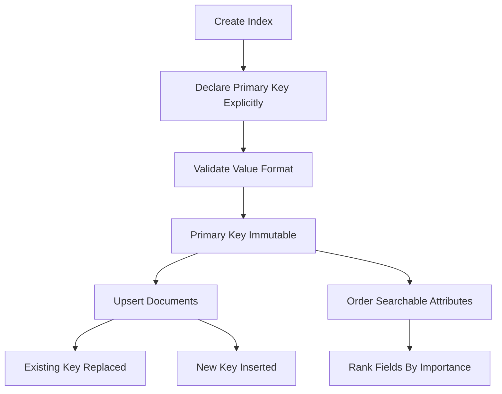

# Choosing a Primary Key and Shaping Documents for Good Relevance

## English

Every Meilisearch index needs a primary key: a field whose value uniquely identifies each document. Meilisearch can infer it — it looks for an attribute whose name ends in `id` (for example `id`, `movieId`, or `product_id`) — but relying on inference is risky because it can pick the wrong field or fail when there are several candidates. Best practice is to declare the primary key explicitly when you create the index or when you add the first batch of documents. The value must be either an integer or a string containing only alphanumeric characters, hyphens, and underscores. Once set, the primary key is immutable for that index; changing it means creating a new index and re-importing.

Why does the primary key matter so much? Because it defines identity for upserts. When you add a document whose primary key already exists, Meilisearch replaces the existing document rather than creating a duplicate. This is how you keep the index in sync with your database without tracking which documents changed: just re-send the current version and the engine overwrites. If your primary key is unstable (for example, a slug that can change when a title is edited), you will end up with orphaned duplicates.

Document shape also affects relevance. Meilisearch searches across all fields by default, but you can control which fields are searchable via the searchableAttributes setting. More importantly, the order of fields in searchableAttributes matters: fields listed earlier are considered more important when ranking. A common pattern is to put the title first, then short summary fields, then long body text, then tags. This mirrors how a human would judge relevance — a match in the title is usually more meaningful than a match buried in a description.

You can also use field-level ranking hints. If a field is not worth searching (for example, a raw HTML blob or an internal status code), remove it from searchableAttributes entirely. This both improves relevance and reduces index size, since Meilisearch does not need to tokenize and store positional information for it. Similarly, fields you never filter or sort on do not need to be marked filterable or sortable, and doing so unnecessarily increases memory usage.

Finally, think about denormalization. A search index is not a relational database; joins are not available at query time. If users should be able to search by an author's name, the author's name must be copied into the document. This is normal for search engines and is the reason indexing pipelines often flatten nested data into a single document. The trade-off is that when the source data changes, you must reindex the affected documents — which is exactly what the asynchronous task system is designed to handle efficiently.

## 中文

每個 Meilisearch 索引都需要一個主鍵（primary key）：一個欄位，佢嘅值可以唯一識別每份檔案。Meilisearch 可以自己推斷——佢會搵一個名稱以 `id` 結尾嘅屬性（例如 `id`、`movieId` 或 `product_id`）——但依賴推斷有風險，因為佢可能揀錯欄位，或者喺有多個候選欄位嘅時候失敗。最佳做法係喺建立索引嗰陣、或者喺加入第一批檔案嗰陣，明確宣告主鍵。個值一定要係整數，或者係一個只包含英文字母數字、連字號同底線嘅字串。主鍵一經設定，對嗰個索引嚟講就係不可變（immutable）嘅；要改就等於要建立一個新索引再重新匯入。

點解主鍵咁重要？因為佢定義咗 upsert（有就更新、冇就新增）嘅身份。當你加入一份主鍵已經存在嘅檔案，Meilisearch 會取代現有嗰份檔案，而唔係建立重複項。呢個就係你點樣令索引同資料庫保持同步、又唔使追蹤邊啲檔案改咗嘅方法：直接重新送最新版本，引擎就會覆寫。如果你嘅主鍵唔穩定（例如一個會喺標題被編輯時改變嘅 slug），你就會得到一堆孤立嘅重複檔案。

檔案嘅形狀都會影響相關性（relevance）。Meilisearch 預設會搜尋所有欄位，但你可以透過 searchableAttributes 設定去控制邊啲欄位可以被搜尋。更重要嘅係，searchableAttributes 入面欄位嘅次序都有影響：排得越前嘅欄位，喺排名嗰陣會被視為越重要。一個常見嘅模式係：標題排第一，然後係簡短摘要欄位，再之後係長篇正文，最後係標籤。呢個正正反映人類點樣判斷相關性——喺標題度命中，通常比喺描述深處命中更有意義。

你亦可以用欄位層級嘅排名提示。如果某個欄位唔值得搜尋（例如一大嚿原始 HTML、或者一個內部狀態碼），就索性將佢由 searchableAttributes 度移除。咁做既可以改善相關性，又可以縮細索引體積，因為 Meilisearch 唔需要為佢做分詞（tokenize）同儲存位置資訊。同樣道理，你永遠唔會用嚟過濾或者排序嘅欄位，就唔需要標記為 filterable 或 sortable；無必要咁做只會增加記憶體用量。

最後，要諗嚇反正規化（denormalization）。搜尋索引唔係關聯式資料庫；查詢嗰陣冇 join 可以用。如果使用者應該可以按作者名搜尋，作者名就一定要複製入檔案度。呢個對搜尋引擎嚟講好正常，亦係點解索引管線（indexing pipeline）經常會將巢狀資料攤平（flatten）成單一份檔案。取捨就係：當來源資料改變，你必須重新索引受影響嘅檔案——而呢個正正就係非同步任務系統設計嚟高效處理嘅嘢。

## Key Takeaway

Declare a stable primary key explicitly and order your searchableAttributes deliberately, because both identity and field order directly shape relevance and index size.

## Related Concepts
- Primary key design
- Denormalization for search

## Diagram

