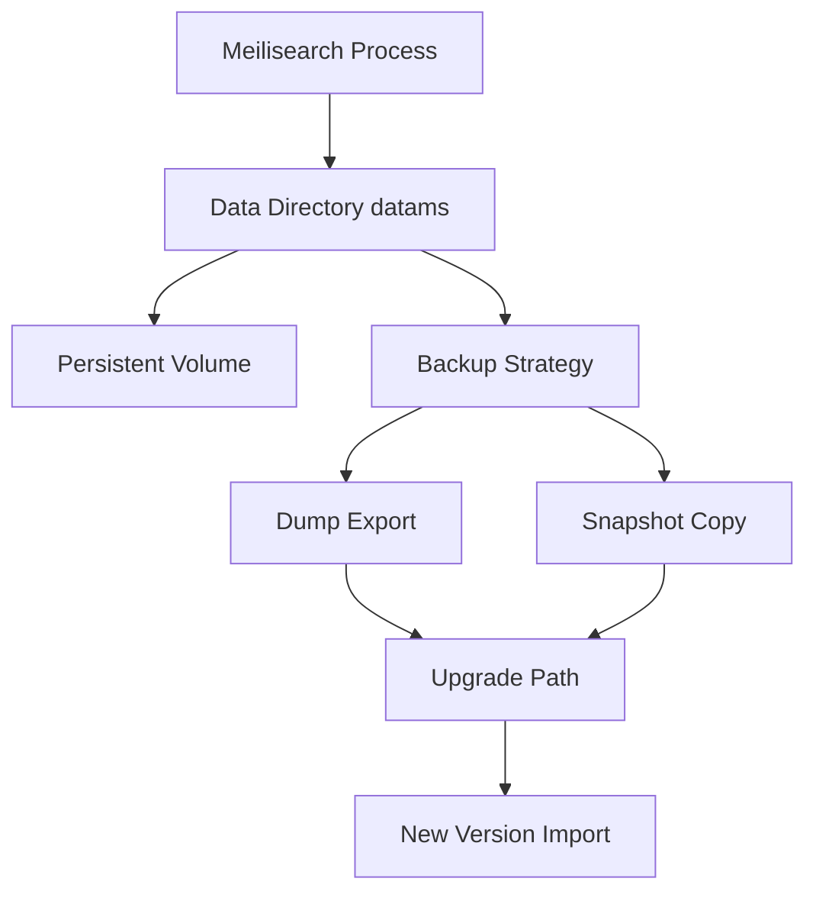

# Running Meilisearch in Production: Persistence, Snapshots, and Upgrades

## English

Meilisearch stores its data in a local directory, by default a folder named data.ms relative to where the process runs. This is an embedded storage engine — there is no external database to manage — which makes deployment simple but also means you must think carefully about disk, backups, and process lifecycle. If you run Meilisearch in a container without a persistent volume mounted at the data directory, a container restart will silently wipe your entire index. The first production lesson is therefore: always mount a durable volume and point the process at it explicitly.

For backups, Meilisearch offers two related mechanisms. A dump is a portable export of all indexes, settings, and documents in a format that can be re-imported into another Meilisearch instance, even a different version. A snapshot is a point-in-time copy of the internal database files, useful for fast recovery on the same version. Dumps are the safer choice for long-term backups and migrations because they are version-tolerant and human-inspectable; snapshots are faster to restore but tied to the storage format. Both can be triggered through the API or scheduled with command-line flags, and both are asynchronous tasks you can monitor.

Upgrading Meilisearch deserves care. Because the storage format can change between major versions, the recommended path is usually to export a dump from the old version, start the new version with an empty data directory, and import the dump. This avoids in-place migration surprises. Always read the release notes for the specific version you are moving to; some releases require intermediate steps. Test the upgrade on a copy of production data before doing it for real.

Resource planning matters too. Meilisearch keeps a significant portion of its index in memory for speed, so RAM is usually the binding constraint rather than CPU. Memory usage scales with the number of documents, the number of searchable fields, and whether you enable features like faceting and sorting on many attributes. Monitoring memory and disk together will tell you when to scale up or when to trim unnecessary settings. Running it on a machine with fast local SSD storage also makes a noticeable difference, because index writes and snapshot creation are disk-heavy.

Finally, treat the process as a service: run it under a supervisor or orchestration system that restarts it on failure, expose only the HTTP port you need, and put it behind a reverse proxy that terminates TLS. Combined with the API key and permission model, this gives you a deployment that is both simple to operate and reasonably safe by default.

## 中文

Meilisearch 會將資料儲存喺一個本機目錄，預設係相對於程序執行位置嘅一個叫 data.ms 嘅資料夾。呢個係一個嵌入式儲存引擎（embedded storage engine）——冇外部資料庫要管理——所以部署好簡單，但亦意味住你一定要認真諗清楚磁碟、備份同程序生命週期。如果你喺容器度跑 Meilisearch，但冇喺資料目錄掛載持久化磁碟區（persistent volume），容器一重啟就會靜靜雞清空你成個索引。所以生產環境嘅第一課係：永遠掛載一個持久化磁碟區，並明確將程序指向佢。

講到備份，Meilisearch 提供兩個相關機制。dump 係一個可攜式匯出，包含所有索引、設定同文件，格式可以重新匯入去另一個 Meilisearch 實例，甚至係唔同版本。snapshot 就係內部資料庫檔案嘅某個時間點副本，適合喺同一版本上快速復原。dump 係長期備份同遷移嘅較安全選擇，因為佢對版本有容忍度、又可以人手檢查；snapshot 復原得快，但綁死喺嗰個儲存格式。兩者都可以透過 API 觸發，或者用命令列旗標（command-line flags）排程，而且兩者都係你可以監控嘅非同步任務。

升級 Meilisearch 要格外小心。因為儲存格式可能會喺大版本之間改變，建議嘅路徑通常係：由舊版本匯出一個 dump、用空嘅資料目錄啟動新版本、再匯入個 dump。咁樣可以避免就地遷移（in-place migration）嘅意外。一定要睇清楚你要升級去嗰個版本嘅發布說明（release notes）；有啲版本需要中間步驟。喺真正做之前，先用生產資料嘅副本測試一次升級。

資源規劃都好重要。Meilisearch 會將相當大部份嘅索引放喺記憶體度以換取速度，所以通常係 RAM 而唔係 CPU 成為瓶頸。記憶體用量會隨文件數量、可搜尋欄位數量、以及你有冇喺好多屬性上面啟用分面（faceting）同排序而增加。同時監控記憶體同磁碟，就會話畀你知幾時要擴容、或者幾時要精簡唔必要嘅設定。喺有快速本機 SSD 儲存嘅機器上面跑亦會有明顯分別，因為索引寫入同建立 snapshot 都係好食磁碟嘅操作。

最後，要將個程序當成一個服務咁看待：喺一個 supervisor 或者編排系統（orchestration system）下面跑，等佢失敗時會自動重啟；只對外開放你需要嘅 HTTP 埠；並且放喺一個負責 TLS 終結嘅反向代理（reverse proxy）後面。配合 API 金鑰同權限模型，你就可以得到一個既容易營運、預設又算安全嘅部署。

## Key Takeaway

In production, mount a durable data volume, prefer dumps for backups and cross-version upgrades, and watch RAM and disk together because they constrain Meilisearch long before CPU does.

## Related Concepts
- Embedded storage engines
- Backup and restore strategies

## Diagram

