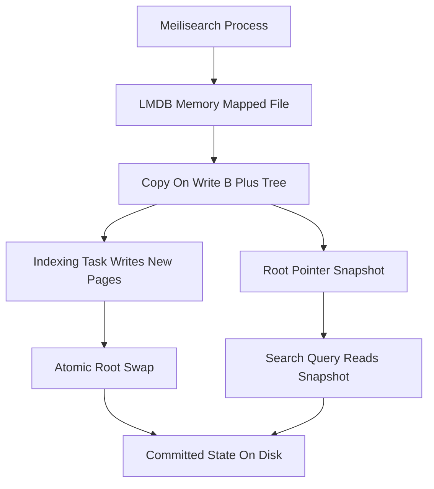

# How Meilisearch Stores Data on Disk: LMDB, Memory Mapping, and Persistence

## English

Meilisearch does not keep its index in a custom file format or a relational database. It leans on LMDB (Lightning Memory-Mapped Database), an embedded key-value store originally built for OpenLDAP. LMDB organises data as a copy-on-write B+ tree inside a single memory-mapped file. When Meilisearch reads a document or a posting list, the operating system pages the relevant bytes from disk into RAM on demand; you are not loading the whole index into a heap. This is why a Meilisearch instance can start almost instantly and serve queries against an index far larger than the RAM you allocated: the OS page cache becomes the hot tier, and cold pages stay on disk until touched.

The copy-on-write design has a pleasant side effect: readers never block writers and writers never block readers. A search query takes a consistent snapshot of the tree at the moment it starts, while an indexing task writes new pages elsewhere in the file and then atomically swaps a root pointer. LMDB guarantees ACID transactions within a single process, so a crash mid-write leaves the previous committed state intact. This is also why Meilisearch is fundamentally single-node: LMDB assumes one process owns the file, so you scale by sharding across machines rather than by pointing several processes at the same data directory.

Because the file is memory-mapped, the 'database size' setting you configure is really a preallocation hint. LMDB reserves virtual address space up front and grows the file in chunks; on 64-bit systems the virtual reservation is cheap, but the file itself still consumes real disk. If you set the size too small, writes fail with a 'map full' style error rather than silently truncating, which is a deliberate safety choice. Monitoring free disk space matters more than monitoring free RAM, because the OS will happily evict clean pages and re-read them later.

Persistence knobs follow from this model. A snapshot is a compacted copy of the database taken at a point in time, useful for backups and for migrating between machines or major versions. The task queue and the index share the same storage engine, so an unprocessed task survives a restart and resumes. Dumps, by contrast, are human-readable JSON-lines exports of documents and settings that can be re-imported into a fresh instance, which is the safer route across incompatible storage-format changes.

A practical consequence: performance tuning is mostly about giving the OS enough page cache. On a machine with 8 GB of RAM and a 4 GB index, the working set fits and queries are served from memory with no special configuration. On a 64 GB index with 8 GB of RAM, you will see disk I/O on cold queries, and the fix is more RAM or sharding, not a Meilisearch flag. Understanding LMDB turns 'why is my search slow' into a page-cache question rather than a mystery.

## 中文

Meilisearch 並不是用自訂檔案格式或關聯式資料庫來保存索引，而是倚賴 LMDB（Lightning Memory-Mapped Database）——一個最初為 OpenLDAP 而寫的嵌入式鍵值儲存引擎。LMDB 以寫時複製（copy-on-write）的 B+ 樹組織資料，全部放在單一記憶體映射檔案之內。當 Meilisearch 讀取一份文件或一組倒排列表時，作業系統會按需要將相關位元組由磁碟分頁載入 RAM，而不是把整個索引塞進堆積記憶體。這正是為何 Meilisearch 幾乎可以瞬間啟動，亦能對遠大於你所分配 RAM 的索引提供查詢服務：作業系統的頁面快取就是熱資料層，冷頁面留在磁碟上，直到被存取為止。

寫時複製的設計帶來一個好處：讀者永遠不會阻塞寫入者，寫入者亦永遠不會阻塞讀者。一個搜尋查詢在開始的那一刻取得樹的一致快照，而索引任務則在檔案的其他位置寫入新頁面，最後原子性地替換根指標。LMDB 在單一程序內保證 ACID 交易，所以寫入途中當機也只會保留先前已提交的狀態。這亦是 Meilisearch 本質上屬於單節點的原因：LMDB 假設只有一個程序擁有該檔案，所以要擴展就得跨機器分片，而不是讓多個程序指向同一個資料目錄。

由於檔案是記憶體映射的，你所設定的「資料庫大小」其實只是預先分配的提示。LMDB 會預先保留虛擬位址空間，並以區塊方式擴充檔案；在 64 位元系統上保留虛擬位址成本很低，但檔案本身仍然佔用真實磁碟空間。若你設定得太小，寫入會以「map full」之類的錯誤失敗，而不是悄悄截斷資料，這是刻意的安全選擇。因此監察剩餘磁碟空間比監察剩餘 RAM 更重要，因為作業系統會樂意驅逐乾淨頁面，之後再重新讀取。

持久化的相關設定都由此模型推導而來。快照（snapshot）是資料庫在某個時間點的壓縮副本，適合備份，亦適合在機器之間或跨主要版本遷移。任務佇列與索引共用同一個儲存引擎，所以未處理的任務在重啟後仍然存在並會繼續執行。相對地，傾印（dump）是可讀的 JSON-lines 匯出，包含文件與設定，可以重新匯入全新實例，這是在儲存格式不相容時較安全的途徑。

實際後果是：效能調校主要就是給作業系統足夠的頁面快取。在一部有 8 GB RAM、索引 4 GB 的機器上，工作集完全放得下，查詢直接由記憶體提供，毋須任何特別設定。在 64 GB 索引但只有 8 GB RAM 的情況下，冷查詢會出現磁碟 I/O，解法是加 RAM 或分片，而不是找某個 Meilisearch 旗標。理解 LMDB 之後，「為何我的搜尋很慢」就會變成頁面快取的問題，而不再是謎團。

## Key Takeaway

Meilisearch's speed and durability both come from LMDB's memory-mapped, copy-on-write B+ tree, so tuning is mostly about page cache and disk headroom rather than engine flags.

## Related Concepts
- LMDB
- Operating system page cache

## Diagram

